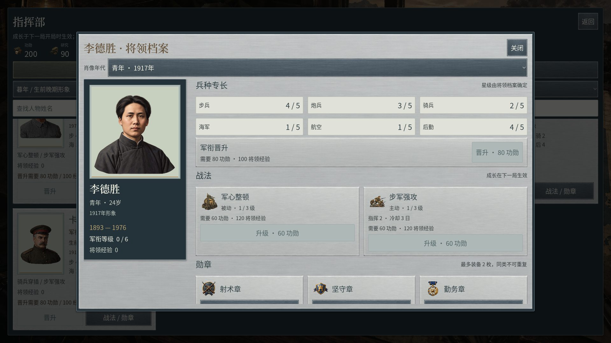
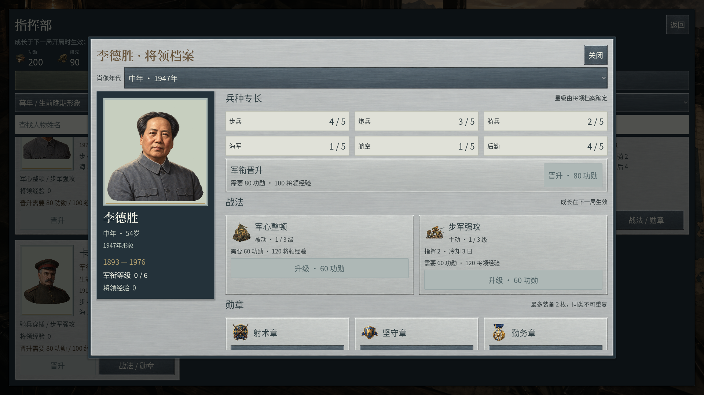
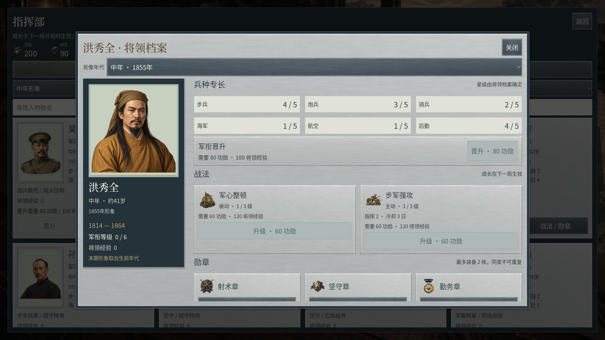
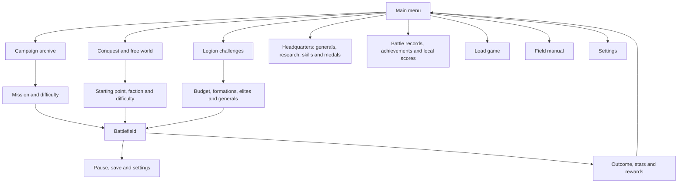
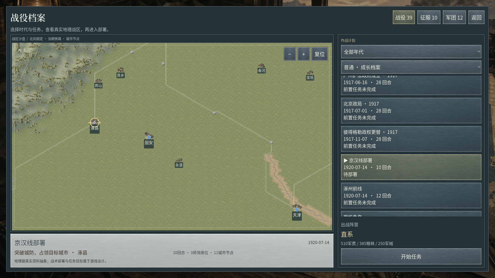
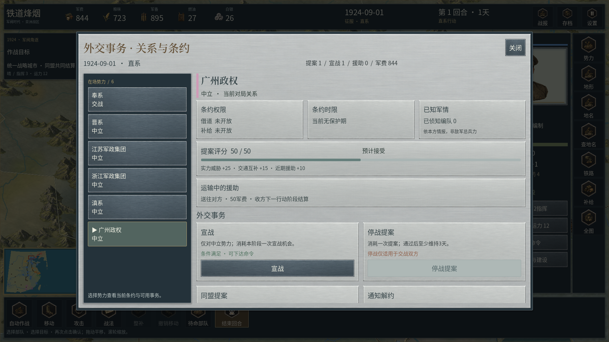
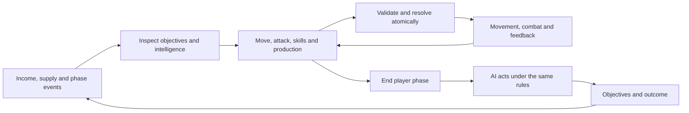
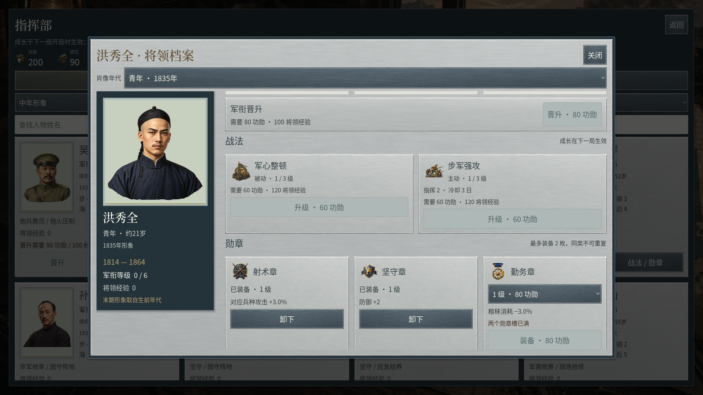

<!-- repository-readme: maintained in Chinese and English -->
# Railway Warlords

**铁道烽烟：军阀时代 · A hex-based, turn-based strategy game set in modern Chinese and Asian theaters**

[中文](README.md) · [English](README.en.md) · [All scenarios](docs/SCENARIO_INDEX.md) · [Documentation](docs/00_程序文档索引.md) · [Completion assessment](docs/23_当前完成度评估.md)

Move armies by rail. Sustain them through cities. Use artillery to breach defenses, infantry and cavalry to take objectives, and engineers to reopen supply routes. Food, ammunition, morale and diplomacy determine whether an offensive can continue.

The game centers on China's warlord period and extends to **Asian starting points from 1840 to 1940**. Built with **Godot 4.7.2 / GDScript**, it targets **Windows x86_64 and Android ARM64 / ARMv7**. The current version is **0.2.26, a playable test build**. It is an offline, single-player game. **The game UI currently uses Simplified Chinese**; these READMEs are bilingual, but English game localization is not implemented yet.

European War 6 is the main reference for visual presentation and interaction. Campaign, conquest and legion structures also draw on the World Conqueror series. The project uses its own code, generated artwork and attributed geography. Its current production quality has not reached the reference games' commercial standard.


*A complete native viewport capture. PNG screenshots below have no montage, repainting or promotional overlays.*

Version 0.2.22 uses one calendar day per complete round and provides four living age-stage originals for each of 33 people, 135 portraits in total: 29 military generals and four political-only figures. Match dates select the appearance automatically. Li Desheng uses a youthful 1917 appearance and a middle-aged 1947 appearance; post-1940 art does not add a new 1947 scenario. See [daily calendar and age-stage implementation](docs/40_每日历法与四阶段人物肖像.md).





The headquarters now includes a political archive with all 17 registered political figures, stage previews and selection by the current match date. Short-lived people retain four actual living periods: Xianfeng's illustrations represent approximately 18, 22, 26 and 29 years of age, with the third stage labelled as the middle of his reign. The archive does not add military appointments for political-only figures.

Version 0.2.23 refines the military UI direction with gunmetal framing, cool silver cards, large whole portraits, independent scrolling and roster search. Promotion, skills and medals expose actual costs, experience and slot restrictions. Five independent Sub2 UI originals are new; maps and all 135 portrait originals are retained. See [military UI and dossier refinement](docs/41_军事界面与将领档案精修.md).



Version 0.2.24 connects selection maps to the shipping ground, elevation, river and whole-scenery renderer, with zoom, pan, pinch and fit. Settlements and sourced places follow registered dates. The diplomacy office separates its faction roster from selected-counterparty details, showing actual treaty dates, visible formations, offer reasons and pending aid. Three legacy seven-day conquest registrations are synchronized to daily rounds. No new raster originals are added. See [selection atlas and diplomacy office](docs/42_战区沙盘与外交事务精修.md).

Version 0.2.25 adds 20 direct Sub2 ground originals with calmer material shapes, world-anchored translated sampling and softly blended mountain feet. Forty earlier grounds remain intact; 121 existing rule, scenario and geographical JSON files retain the delivered 0.2.24 bytes. The shipping material passes 48 native checks. See [quiet ground and mountain feet](docs/43_安静地表与山脚融合.md).

Version 0.2.26 refines sourced marine geometry in four maps, uses offline land triangulation and a narrow fading shoreline batch, and clips ground, administrative display lines and city influence zones to the same land boundary. Of 123 existing JSON files, 111 retain their bytes and 12 have documented drawing-data changes. Rule grids and historical nodes remain intact. No PNG originals are added or processed. See [coast geometry and coastal layers](docs/44_细海岸与沿岸图层统一.md).

<a id="contents"></a>
## Contents

- [Version and content](#status)
- [Gameplay screenshots and GIFs](#screenshots)
- [Menus and battlefield UI](#menus)
- [Getting started and controls](#play)
- [Turns, combat and victory](#combat)
- [Units, generals and progression](#army)
- [Cities, economy, logistics and diplomacy](#economy)
- [Geography, terrain and historical scope](#geography)
- [Scenarios and timelines](#content)
- [Saves and settings](#saves)
- [Running and exporting the source](#development)
- [Architecture, validation and performance](#engineering)
- [Artwork, media and licensing](#assets)
- [Known limitations and next steps](#limits)
- [Documentation guide](#docs)

<a id="status"></a>
## Version and content

Counts come from current runtime data, excluding unimplemented plans and duplicate historical inventories. Runtime compatibility is **schema 2 / ruleset 10**.

| Content | Implemented scope |
| --- | --- |
| Campaigns | **39**: 18 warlord missions across 1920 / 1922 / 1924, plus 21 Asian timeline missions |
| Conquest / free world | **10 starting scenarios**: 3 warlord conquests and 7 Asian starting points |
| Legion challenges | **12** budget-based tactical exercises with standardized progression |
| Total scenarios | **61**; names, dates, maps and round limits are in the [scenario index](docs/SCENARIO_INDEX.md) |
| Maps | **6**: Beijing–Tianjin, Beijing–Fengtian, eastern China, Hankou, Nanjing–Pukou and strategic Asia |
| Units | **13 base definitions and 3 elite variants**, restricted by era and scenario |
| Factions and generals | **47 faction definitions and 29 general definitions**; availability is scenario-specific |
| Progression | **28 technologies, 9 passive skills, 9 active skills and 24 achievements** |
| Facilities | **12 types** covering recruitment, transport, supply, medicine, defense, communications and trade |
| Raster art | **1,324 PNGs**; **1,010 stored map assets, 970 currently active**; 64 cardinal-direction unit views and 16 ordinary-infantry action images |
| Regional terrain | **20 types × (1 new continuous ground + 4 detail originals) = 100 active originals**; 40 superseded macrogrounds retained, interactive atlas |
| Audio and fonts | 14 procedural effects, 3 local YuE2 scores (180 seconds each), 3 retained fallback loops and 2 Chinese fonts with OFL notices |
| Current regression snapshot | **29 groups / 5,787 checks**, plus 1,725 portrait UI, 157 dossier transaction, 216 terrain, 373 UI, 84 coastal, 220 map-symbol and 18 music checks; older numerical fixtures retain their version identity |
| Character portraits | **33 people × 4 stages + 3 extra dates = 135 independent originals**; automatic dated selection, general roster and political archive previews |
| Calendar | **One day per complete round**; all factions finish their phases before the Gregorian date advances |
| Platforms | Windows run natively; APK checked for signatures, architectures, permissions and resources; physical X30 acceptance pending |

Runtime data lives in `content/`. Original designs and older versions retain their own status. Content counts do not establish complete art, historical, balance or device acceptance. See the [completion assessment](docs/23_当前完成度评估.md).

<a id="screenshots"></a>
## Gameplay screenshots and GIFs

### Battlefield layout


*The resource/date bar sits above the map, objectives occupy the upper left, the inspector is on the right, and command previews and confirmations sit below.*

### Twenty distinct ground materials

Version 0.2.21 clips ground to source land beneath cities, roads and shore edges. Leaf/needle floors require forest evidence; all twenty families remain in the atlas, while nineteen are deployed in the tested Asia 1927 map. Three local YuE2 scores, each 180 seconds, share a theme across menus, planning and combat with 2.4-second crossfades. See [source-clipped ground](docs/38_源陆地补纹与林底选材约束.md) and [music, downloads and verification scope](docs/39_本地YuE2纯器乐配乐与场景衔接.md).

| Listen | Context | Arrangement |
| --- | --- | --- |
| [Embers over the Land · 3 minutes](docs/audio/01_menu_embers.mp3) | Main menu and mode selection | 72 BPM, plucked strings and chamber strings introduce the theme |
| [Rivers and Post Roads · 3 minutes](docs/audio/02_strategy_rivers.mp3) | Map, diplomacy and supply planning | 80 BPM, bamboo flute, sparse plucked strings and soft strings |
| [Clash along the Railway · 3 minutes](docs/audio/03_battle_railfront.mp3) | Damage, defeated formations and captured cities | 96 BPM, low strings, restrained drums and brass |

All three use instrumental scores with no authored or added dialogue, lyrics or narration. The game uses 48 kHz stereo compressed OGG; the source includes 24-bit WAV, 320 kbps MP3, original FLAC and production/mastering records. Eighteen exported-program playback checks pass. Subjective listening and phone-speaker acceptance are recorded separately.

Version 0.2.20 generates and activates **twenty independent macroground originals**. Grass blades, straw fibers, fallen broad leaves, needles, sand ripples, angular gravel, salt crust, moss and rock plates replace the previous similar mottled textures. All twenty complete originals were individually inspected and use the required Sub2 route. The previous twenty macrogrounds retain their source bytes, prompts and provenance. Existing ecoregion, elevation and river assignments remain; the rules still define twelve terrain categories. See [twenty ground-material identities](docs/37_二十类地表材质形态重制.md).

### Continuous hillshade and small rivers

Version 0.2.19 continuously samples existing source-cell lighting to reduce triangular shade patches. Small rivers gain a muted waterbed and translucent banks. All 20 terrain types retain one continuous ground and four detail originals, selected by sourced geography. See [continuous relief and layered headwaters](docs/36_连续高程光影与细河岸带.md) for implementation, native comparisons and precision limits.

### Regional view and selected formations

City and individual formation symbols continue to change with zoom. Regional counters leave more ground and river detail visible; close views restore the full buildings, unit sources and status. Selected or animated battle formations receive detailed models first. Every counter still represents its original formation, with unchanged deployment, count and geographic position.


Compact formations receive precise selection before the wider city snap radius. The old repeated terrain marks are omitted when the complete painted scenery bank is available. See [map zoom and precise selection](docs/35_地图缩放层次与精确点选.md) for behavior and verification scope.

### Native movement and combat

The following GIFs and full MP4 retain their original **0.2.12** recording identity. They demonstrate real movement and combat commands. Current terrain and UI are shown in the current native screenshots.


*Movement excerpt: 0.5–7.5 seconds, 12 FPS, full frame resized to 960×540, normal speed, looping.*


*Combat excerpt: 15–23 seconds. Dice, attacks and hits follow real committed commands. GIFs have no audio.*

[Full 26.2-second native MP4 with audio](reports/atlas_v2_native_final.mp4) · [Sources, SHA-256 and conversion parameters](docs/media/manifest.json)

Godot MovieWriter produced the recording. A controlled native demonstration submits legal commands, including AI turns, on an unchanged published campaign deployment. Replay was checked against the same final state and random stream. This is a functional gameplay demonstration rather than a claimed manual playthrough.

### Terrain detail


*Hills, mountains, villages and ground around Yanshan. Translucent faction control preserves the underlying terrain.*


*Tributaries use scale-dependent display. Fine visual waterways remain distinct from rule-level rivers and crossings.*

<details>
<summary>More full native screenshots: coast, sand, gravel, wet soil, Yangtze, deployment and mobile layout</summary>


*Version 0.2.15 revises water presentation only. Original endpoints remain intact; the 31 replacement main reaches at Hankou and Nanjing use the existing 60-metre bounded fillet. Same-order reaches share a join frame only when their endpoints coincide and archived upstream/downstream IDs connect them. Widths are cartographic symbols, not measured banks.*

Version 0.2.16 clips city influences and coastal control hexes to source land. The minimap shares those meshes, and Caspian water preserves source islands. See [source coastlines and control clipping](docs/33_真实海岸与控制区裁切.md).

**Version 0.2.17** blends regional grounds over a nonoverlapping mesh, reducing seams inside each material. Map overviews retain cached geographic grounds, and the Asian main map uses one control wash instead of stacking city influences over the field. All 20 types and 100 dedicated originals remain; no new PNG originals are counted. Another 44 native material checks compare actual pixels. See [continuous ground and control coverage](docs/34_连续地表混合与控制色去重.md).


The final image is a **Windows desktop test of the 2400×1080 mobile UI**. It is not a physical Motorola X30 capture and does not establish phone frame rate, touch behavior or thermals.

</details>

<a id="menus"></a>
## Menus and battlefield UI

This diagram shows implemented navigation. Screenshots show the actual visual design.



| Area | Function |
| --- | --- |
| Top bar | Cash, food, arms, fuel, silver, date, round and acting faction |
| Objective card | Current goals, progress, round conditions and briefing |
| Central map | Select hexes, formations, cities and places; inspect movement and targets |
| Right inspector | Strength, AP, range, ammunition, morale, suppression, experience, supply and orders |
| Layer tools | Control, terrain, names, place inspection, railways, supply and overview |
| Lower-left minimap | Position and click-to-center navigation |
| Bottom command bar | Preview, confirm, cancel, auto-play, end phase and skip presentation |
| Battle window | Combatants, dice, attacks, hits and counters; optional and skippable |

Campaign, conquest and legion browsers use real map previews with era, difficulty and faction selection, unlock conditions, stars and objectives. The main-menu campaign count now matches the actual **39 missions**. Recruitment, buildings, general assignment, diplomacy and headquarters use cards with real command costs and visible validation reasons; the technology page exposes all seven branches.


Use plus/minus, the wheel or pinch to zoom, drag to pan, and Fit to restore theater framing. Zoom reaches ten times the initial framing; the operational hexes and scenario bounds stay tied to their actual map. Objective labels take priority, while railways and local places follow registered activation dates.



<details>
<summary>Recruitment, city facilities, diplomacy and research</summary>




Select a counterparty in the left roster to inspect treaties, proposal scores and reasons. Known formations follow the player's visibility. Successful aid deducts 50 actual funds and settles at the recipient's next action phase; withdrawal refunds half of undelivered aid under the existing rules. Disabled actions and cooldowns reflect the live match.


</details>

<a id="play"></a>
## Getting started and controls

| Platform | Method | Scope |
| --- | --- | --- |
| Windows | Run exported `build/windows/RailwayWarlords.exe` | Native x86_64, embedded resources; players need neither Godot nor Python |
| Android | Install your exported `build/android/RailwayWarlords.apk` | Landscape, ARM64 / ARMv7, Android 7.0 / API 24 minimum; validated package targets SDK 36 |
| Godot editor | Import root `project.godot`, wait for import, press **F5** | Godot 4.7.2, Compatibility renderer |

Git includes complete source and runtime assets. Binaries, caches and private signing material are excluded. Original PNGs occupy about 2.13 GiB; allow time for clone/import and several GB of free disk space. Local delivery packages remain separate.

### First battle

1. Open Campaign, choose an unlocked opening mission and read victory/failure conditions.
2. Select artillery and an enemy target, inspect damage/counterattack previews, then confirm.
3. Break defenses and remove the garrison. Move an occupation-capable formation into the city; artillery cannot capture.
4. Watch food, ammunition, supply and morale. Use production, rail transport and engineers to sustain the front.
5. End your phase and observe AI actions under the same rules. Outcomes award stars and progression.
6. Configure generals, technology and skills in Headquarters for the next match; ongoing matches retain their starting snapshots.

### Controls

| Action | Windows | Android |
| --- | --- | --- |
| Select unit / city / hex | Click | Tap |
| Pan | Drag | One-finger drag |
| Zoom | Mouse wheel | Pinch |
| Commit order | Select target, then confirm; repeat selection is supported | Confirm / repeat selection |
| Next ready formation | `Tab` | UI button |
| End phase | `Space` while idle, then confirm | End-phase button |
| Skip presentation | `Space` during playback | Skip button |
| Cancel / pause | `Esc` | Cancel / pause UI |
| Rail destinations | `R` with a unit selected | Unit orders |
| General assignment | `G` with a unit selected | General UI |
| Supply overlay | `F` | Supply button |
| Strategic overview | `M` | Overview button |

<a id="combat"></a>
## Turns, combat and victory

One complete round advances exactly one Gregorian day. A single faction phase does not add another day. Month lengths, leap years and year boundaries follow the calendar. Old ruleset 9 matches require a new game under ruleset 10.



- **Movement:** weighted hex paths consider terrain, zones of control, visibility, bridges, crossings and transport. Movement can be split; hidden contacts use encounter rules.
- **Attacks:** one main attack per formation per phase, spending ammunition and remaining AP. Range, counters, terrain, strength, morale, suppression, generals and research influence results.
- **Counterattacks:** use post-hit strength and suppression. Ordinary units have a per-round allowance; machine guns gain additional capability. Range and defense restrictions apply.
- **Cities:** walls and garrisons have separate health. Breaching does not transfer ownership; eligible formations must occupy.
- **Dice:** previews are read-only and do not advance randomness. Combat records attack/defense dice, modifiers, damage and counters. The random stream is saved and replayable.
- **Visibility:** terrain sight, exploration, reconnaissance, last-known contacts and allied sharing govern intelligence. AI uses visible information and the same command interface.
- **Presentation:** movement, persistent heading, projectiles, muzzle effects, hits, floating values, defeats, occupation, air support and dice follow actual state events.

Objectives include capture, continuous defense, elimination of a target formation, commander capture/defeat, escort, survival and repairs. Protected-unit losses and general injuries can take failure priority. Scenario thresholds and losses determine stars.

Conquest/free world evaluate strategic nodes, faction survival and alliances, with scenario scoring at the round limit. Warlord conquests generally use 80 rounds; Asian free worlds use 180. Those are now 80 and 180 days. Weather and operational values remain gameplay abstractions rather than daily historical measurements.

Difficulty includes ordinary progression, hard and standardized challenge. The current hard setting advertises +10% enemy attack. Legion uses normalized progression; deployment budgets and in-match city funds are separate.

<a id="army"></a>
## Units, generals and progression

| Base unit | Role and restrictions |
| --- | --- |
| Local garrison | Low-cost defense, line coverage and occupation |
| Rifle regiment | Main infantry for capture, defense and combined attacks |
| Assault battalion | Breakthrough and close assault, era-restricted |
| Machine-gun battalion | Suppression, defensive positions and counterattacks |
| Cavalry regiment | Mobility, flanking, pursuit and occupation |
| Engineer battalion | Rail repairs, engineering and occupation |
| Field artillery | Ranged suppression and breaching; cannot capture |
| Heavy artillery | Heavy ranged fire requiring production and supply |
| Armored cars | Mobility and occupation, constrained by era, terrain and supply |
| Armored train | Rail-based firepower on usable track |
| River gunboat | Inland support and escort |
| Transport ship | Port loading and disembarkation; needs land troops for occupation |
| Coastal gunship | Coastal support and shore bombardment |

Health, attack, defense, AP, range, costs and earliest eras are in the [unit reference](docs/UNIT_REFERENCE.md). [units.json](content/definitions/units.json) is authoritative. A `stack` is a game formation layer, not an archival battalion, regiment or brigade. Scenario whitelists also restrict recruitment.

The 29 general definitions include Wu Peifu, Zhang Zuolin, Feng Yuxiang, Yan Xishan, Lin Zexu, Hong Xiuquan, Zeng Guofan, Sun Yat-sen, Chiang Kai-shek and Li Zongren. Presence, affiliation and deployability are scenario-specific. Ratings are gameplay values; portraits and historical affiliations require separate review.

Headquarters manages generals, ranks, active/passive skills, medals, research and elites. Units gain in-match experience. Long-term progression is frozen into a starting snapshot; later profile upgrades do not change an ongoing match. A reward ledger prevents duplicate grants.

Type a name in the military or political roster to filter it; clear the field to restore all entries. A general's skills/medals button opens the dossier. The age selector stays at the top, the whole portrait and lifespan stay on the left, and abilities and progression scroll independently on the right. Buttons show registered prices and disable unavailable purchases with their requirements. Medals have three ranks and two slots, disallow duplicate types, and retain the existing no-refund unequip rule. Successful changes preserve the selected age stage. These are abstract progression emblems, not claims of historical awards.



Three elites cover assault infantry, cavalry and artillery, with chapter and research gates. Eighteen skills cover bombardment, assault, cavalry maneuvers, emergency rations, rail priority, reconnaissance, entrenchment, field repair and coordinated fire.

<a id="economy"></a>
## Cities, economy, logistics and diplomacy

| Resource / indicator | Gameplay role |
| --- | --- |
| Cash | Recruitment, wages, buildings, repairs and some diplomacy |
| Food | Sustaining formations and operations |
| Arms | Recruitment, reinforcement, ammunition and repairs |
| Fuel | Transport/mobility pressure; early-era quantities are abstractions |
| Silver | Trade, diplomacy and reserves |
| Recruits | City recruitment and reinforcement capacity |
| Morale / suppression | Supply condition, incoming fire and fighting capability |
| War exhaustion / legitimacy | Income and long-term war pressure |
| Colonial influence | Abstract port, trade and diplomatic influence |

**Cities** track level, walls, recruits, garrisons and queues. Twelve facilities cover barracks, machine-gun workshops, arsenals, stations, ports, airfields, depots, hospitals, fortifications, telegraphs, markets and granaries. Ordinary facilities use four slots; fortifications are separate. Demolition frees capacity. Completed production waits if deployment is blocked.

**Railways** check both faction capacity and every route segment. Enemy control, damage and passage rights affect transport. Engineers repair over phases; leaving pauses work. Track supports movement and supply, and armored trains need usable lines.

**Supply** follows city, road, rail and river/sea networks. Disruption and permissions affect supply state, then movement, firepower, ammunition and morale. Sustained starvation can cause losses. Loading/unloading obeys port, action and destination restrictions.

**Air support** uses permitted airfields and validates sorties, range, resources, ammunition and weather for reconnaissance and bombing.

**Diplomacy** supports war, truces, alliances, passage, supply rights, aid and trade. Alliances do not automatically transfer cities; shared victory follows relationships. Players can change events after a geographically grounded starting point.

These systems form an economy–production–transport–combat loop. Resources and political/fiscal indicators are balance abstractions, not historical statistics. The game does not claim Europa Universalis-level state-management depth. See [economy and army systems](docs/21_经济物资士气与多元军队.md).

<a id="geography"></a>
## Geography, terrain and historical scope

| Map | Total cells | City nodes | Purpose |
| --- | ---: | ---: | --- |
| Beijing–Tianjin `jingjin` | 26,195 | 11 | Beijing, Tianjin and northern local theaters |
| Beijing–Fengtian `jingfeng` | 65,726 | 15 | Railway, Shanhaiguan and Bohai |
| Eastern China `conquest_china` | 74,762 | 55 | Warlord conquest |
| Hankou `hankou` | 400 | 3 | River defense and escort training |
| Nanjing–Pukou `ningpu` | 440 | 2 | Transport, loading and landing exercises |
| Asia `asia_strategic` | 7,668 | 81 | Continental strategy and related missions |

Totals include water and restricted cells, not only deployable land. Beijing–Tianjin, Beijing–Fengtian and eastern China were expanded fivefold along each dimension while retaining the **48-pixel operational hex radius**. Asia spans **20°E–180°E, 10°S–80°N** at continental scale. It is not village-level coverage of the continent, and detail density varies.

- **Coasts/major rivers:** Natural Earth geometry, real city coordinates and dated railway references.
- **Fine waterways:** 24,268 fine reaches plus 31 replacement display reaches, totaling 24,299 tactical records. Asia separately retains 694 sourced detail reaches. Scale-dependent display does not claim every creek.
- **Relief:** attributed Tilezen/SRTM and other elevation. Asia uses 54 raw GeoTIFFs and 33,696 registered samples; nominal hex radius is 150 km with 100 km sampling support.
- **Ground:** meadow, dry grass, rocky soil, woodland floor, wet soil, water, sand, gravel and alluvium selected through source regions, relief and geography.
- **Scenery:** tree canopies, hills, ridges, peaks, banks, outcrops, reeds and regional buildings with anchors, slope direction and spatial repetition constraints.
- **Settlements:** capitals, provincial/county seats, towns and villages; 67 additional source-linked markers, zoom-dependent visibility and administrative notes.
- **Control:** the translucent control field uses approximately 0.20–0.23 opacity; local city influence fills use 0.26. It follows in-game node ownership, not surveyed historical military boundaries.

The map library grew from 74 to **970 assets, about 13.11×**. The 796 originals added in 0.2.12 include **176 ground materials, 480 scenery assets and 140 buildings**; 0.2.13 adds **80 regional ground textures**, and 0.2.14 adds **20 continuous painted grounds**. Version 0.2.15 reuses existing immutable water art for continuous river surfaces and adds no PNG originals. Display scaling, mirroring and tint variants are not counted as independent originals.

The 20 types cover temperate meadow, dry steppe, desert steppe, aeolian sand, Gobi gravel, saline meadow, alpine meadow, alpine steppe, tundra, boreal litter, temperate leaf litter, conifer needles, subtropical humus, tropical moist humus, dry woodland litter, savanna ground, flood meadow, valley alluvium, weathered rock and alpine scree. Each has one continuous ground and four independently generated detail originals. Ecoregions, relief and existing rivers guide selection; neighboring cells of the same type use different fine sources. Political control remains a separate translucent overlay.

Continuous grounds share world-space UVs across hexes. The existing four fine originals remain as 0.22 tactical / 0.14 strategic detail, reducing gritty contrast and per-cell patching. Main rivers and tributaries share stream-order widths, bank shadow and shallow-water highlights; these are symbolic strokes, not surveyed banks or depth.


Open the terrain atlas from the manual or cell inspector to browse three pages and one continuous ground and four detail originals per type. Regional appearance is separate from the cell's authoritative movement, cover and water rules. See [20 terrain types and source gates](docs/30_二十类地域地表与纹理整改.md), [continuous grounds](docs/31_连续地表与水系层次.md) and [source-linked water surfaces](docs/32_真实河段连续水面.md).

Physical geography, dated administrative sources, people and OOB are tracked separately. Modern potential ecoregions guide representative materials, not annual historical forest/wetland/land-use maps. Modern waterways do not automatically establish historic channels. Generated buildings are regional symbols, not reconstructions of named streets.

Asian local missions currently use coarse strategic nodes, with some places mapped to nearby nodes. Strength, stacks, income, weather, deployments and objectives are authored game data. Dates, people, equipment, OOB and initial control remain subject to item-level review. See [historical data](docs/19_亚洲全境时间线与史实数据.md), [geographic rationale](docs/07_历史地理与地图美术.md) and [surfaces/waterways](docs/29_地表材质与细水系.md).

<a id="content"></a>
## Scenarios and timelines

**Warlord theaters:** 18 original missions form 1920, 1922 and 1924 groups with corresponding eastern-China conquests. Cities, railways, supply and military groups are central. The 1924 conquest has a date-triggered Beijing coup and Guominjun state changes; subsequent outcomes follow gameplay.

| Asian start | Current themes | Interpretation |
| --- | --- | --- |
| 1840 | Qing, British and other Asian powers; Opium War group | Missions extend into 1841/1842; the group label is not each mission's date |
| 1860 | Anglo-French war, northern routes and Taiping themes | Conflicts, regions and relationships are recorded separately |
| 1890 | Pre-Sino-Japanese War setting and 1894/1895 missions | Not the Boxer movement date; no complete separate Russo-Japanese War group yet |
| 1900 | Dagu, Tianjin, Beijing and Eight-Nation Alliance themes | Historical force phases are not interchangeable with game formations |
| 1917 | Constitutional Protection, Beijing politics and Russian power changes | Some labels and registered dates still need review |
| 1927 | Northern Expedition, Wuhan, Shanghai and Jiangxi themes | Event subjects, operation dates and objectives are reviewed separately |
| 1940 | Chinese transport fronts, Hubei and Indochina | Equipment, people and deployments retain separate approval status |

Each Asian start has one free world and three missions: **7 starts and 21 missions**. A mission's `province_scope` has at most three provincial/regional entries; this is authoring scope, not a claim that all historical Asian provincial borders have been drawn. Thirty OOB entries retain strength ranges and source status; unverified squads and officers are not invented.

Twelve legion exercises teach combined attacks, suppression, engineering, supply, rail, reconnaissance, river defense and cross-river transport. They are explicitly exercises. The [61-scenario index](docs/SCENARIO_INDEX.md) lists every current name, date, map and limit.

<a id="saves"></a>
## Saves and settings

- **Saving:** five manual slots, three rotating autosaves and Android background saving. Backup recovery handles corruption; incompatible content/rule fingerprints are rejected explicitly.
- **Versions:** relief corrections changed this version's content fingerprint. Continue older in-progress matches with their corresponding build. Profiles are separate; universal cross-version compatibility is not promised.
- **Pause:** dialogs stop AI submission. Background results are validated against match identity/version to prevent stale commits.
- **Settings:** music, effects, volume, grid, playback speed, battle window, reduced shake and 100% / 120% / 150% text.
- **Mobile:** landscape, larger controls, safe areas, dragging and pinch. Motorola X30 is the target phone, with physical acceptance pending.
- **Storage:** Windows Godot `user://`, usually `%APPDATA%/Godot/app_userdata/铁道烽烟：军阀时代/`; Android private app storage. Achievements and rankings are local.
- **Networking:** no multiplayer or online rankings. APK requests no network, camera, microphone or external-storage permissions.

<a id="development"></a>
## Running and exporting the source

### Clone and run

Use native Windows tools. Local Docker, WSL, VMs and Android emulators are prohibited by project rules.

```powershell
git clone git@github.com:wikigsroom/railway-warlords.git
Set-Location railway-warlords

# Put native Godot 4.7.2 console on PATH as godot, or use its full path.
godot --headless --path . --editor --import --quit
godot --path . --editor
# Run directly:
godot --path .
```

Git LFS is unnecessary. Original PNG bytes and `*.import` settings are tracked; `.godot/` is regenerated. Running the core game requires neither Python nor the generation gateway/private workstation configuration.

### Windows

Install the **official export templates matching Godot 4.7.2 exactly**. The `Windows` preset uses x86_64, Compatibility rendering and embedded PCK.

```powershell
New-Item -ItemType Directory -Force build/windows | Out-Null
godot --headless --path . --export-release "Windows" "build/windows/RailwayWarlords.exe"
```

Commercial code signing is not configured; use your own signing process for production.

### Android

Configure native **JDK 21, Android SDK** and matching templates in Godot editor settings. The validated APK is **minSDK 24 / targetSDK 36**, with ARM64/ARMv7 enabled and x86 emulator targets disabled.

```powershell
New-Item -ItemType Directory -Force build/android | Out-Null
godot --headless --path . --export-debug "Android" "build/android/RailwayWarlords-debug.apk"
adb install -r build/android/RailwayWarlords-debug.apk
adb shell monkey -p org.railwaywarlords.game -c android.intent.category.LAUNCHER 1
```

Configure your own release keystore, alias and password through Godot private credentials or environment variables, outside tracked files, then export:

```powershell
godot --headless --path . --export-release "Android" "build/android/RailwayWarlords.apk"
```

App ID is `org.railwaywarlords.game`, current versionCode 31. Updating an installed app requires the same signature; a differently signed build cannot replace the original. Tracked release-credential fields are empty.

### Automation scope

`tools/` includes build, regression, geography, asset, recording and delivery-review helpers. Some retain the original layout:

```text
workspace/
├── .toolchain/              # Native engine and private signing setup
├── design/铁道烽烟/          # Original design and registries
├── output/                  # Originals, raw geographic archives and older deliveries
└── game/railway_warlords/    # Original location of this repository
```

External archives are not part of a standalone clone. Helpers such as `build_release.py` contain machine paths and require configuration; raw geographic reconstruction needs the original datasets. The Godot commands above run/export a standalone clone using included compiled geography and full runtime art. See [development notes](docs/DEVELOPMENT.md).

<a id="engineering"></a>
## Architecture, validation and performance

```text
.
├── project.godot / export_presets.cfg
├── app/              # Menus, HUD, match controller and native QA
├── domain/           # Commands, combat, movement, economy, logistics and outcomes
├── ai/               # Planning through the shared command interface
├── content/          # Definitions, maps, scenarios and fingerprints
├── presentation/     # Hex map, surfaces, hydrography, sprites, animation and camera
├── persistence/      # Match/profile storage, backups and atomic saves
├── audio/            # Audio events and procedural audio
├── assets/           # Original images, audio, fonts, imports and provenance
├── schemas/          # Data contracts
├── tests/            # Rules, transactions, geography, input and presentation
├── tools/            # Native compilation, validation and media preparation
├── reports/          # Selected validation snapshots and native recording
└── docs/             # Documentation, media, provenance and prompts
```

UI and AI submit commands; previews are read-only. `CommandKernel` validates version, actor, target, costs and legality, resolves atomically, and returns state/events. Rules, AI and save I/O use a serial native worker queue. The main thread validates match identity/version before applying results while map navigation remains independent. See [modules](docs/02_架构与模块.md).

### Validation

```powershell
godot --headless --path . --script tests/run_tests.gd
godot --headless --path . --script tests/acceptance_test.gd
godot --headless --path . --script tests/transaction_test.gd
godot --headless --path . --script tests/asia_content_test.gd
godot --headless --path . --script tests/map_bank_test.gd
godot --headless --path . --script tests/surface_geography_test.gd
godot --headless --path . --script tests/terrain_surfaces_test.gd
```

Version 0.2.26 passes 29 groups / 5,787 checks, including 611 portrait and 88 daily-calendar checks. The shipping EXE passes 1,725 portrait UI checks / 174 captures, 157 dossier checks / 24 captures, 216 terrain and 373 UI checks / 99 captures, 84 coastal checks / 20 captures, 220 symbol checks / 32 captures, plus four changed-map coast views: 353 current scoped native frames. Music playback passes 18 checks. Separate checks cover 61 native coast geometry cases, 152 independent raw-GIS assertions and 48 native material cases. See the [regression seal](reports/regression_dependency_evidence.json), [portrait evidence](reports/general_portrait_native_evidence.json) and [terrain/UI proof](reports/terrain_surface_native_evidence.json). 23 specialist frames and three additional export-check frames were individually viewed (26 complete frames in total); the [current visual record](reports/coast_detail_native_review.json) states remaining issues without claiming manual approval of all 353 frames. Older performance, numerical fixtures, GIFs and recordings retain their original version identities.

[Test scope](docs/05_测试与验收.md) · [Dependency/report binding](reports/regression_dependency_evidence.json) · [Current native evidence](reports/terrain_surface_native_evidence.json) · [Current dossier transaction evidence](reports/ui_refinement_native_evidence.json)

Reports record tests run in the original workspace and do not replace manual gameplay, art, music listening, historical or device acceptance. Full AI endurance was not rerun for this patch. Schema 2 / ruleset 10 remain; drawing data changes the content hash. Continue existing 0.2.25 matches with the retained 0.2.25 build and start a fresh match in this version. Career profiles retain their existing format.

The repository's `.gitattributes` preserves original bytes so automatic newline conversion cannot change hashed prompts, native metadata or evidence. The [Git byte check](reports/git_byte_preservation.json) compares staged objects with working files separately from gameplay checks.

### Historical version 0.2.21 full-load measurements

Final 0.2.21 EXE, desktop RTX 3060, 240 formations and 74,762 cells. Sustained pan/zoom ran for 60 seconds per viewport; other stages use fixed-frame samples or actual combat presentation. Both columns use the desktop GPU.

| Phase | 1920×1080 average FPS / P95 ms | 2400×1080 desktop mobile layout average FPS / P95 ms |
| --- | ---: | ---: |
| Static atlas | 347.1 / 4.32 | 291.5 / 4.33 |
| Atlas pan | 138.9 / 9.48 | 138.7 / 10.35 |
| Tactical selection | 76.4 / 41.68 | 73.3 / 41.33 |
| Sustained pan/zoom | 147.2 / 8.66 | 142.5 / 9.11 |
| Active combat | 108.0 / 9.01 | 112.3 / 8.97 |

Every stage in both layouts passes the existing 60 average FPS gate. Tactical selection reaches 41.68 / 41.33 ms at P95; averages do not establish stable individual frames. The 2400×1080 desktop layout does not replace physical Motorola X30 acceptance. [Current Windows result](reports/capacity_windows_v0221.json) · [Current desktop Android-layout result](reports/capacity_x30_v0221.json). [Version 0.2.20 Windows](reports/capacity_windows_v0220.json), [version 0.2.20 desktop mobile layout](reports/capacity_x30_v0220.json) and the failed 0.2.19 intermediate result below retain their original identities.

### Historical intermediate version 0.2.19 desktop performance

RTX 3060, version 0.2.19 EXE, 240 formations and 74,762 cells. Sustained pan/zoom ran 60 seconds per viewport; other stages use fixed-frame samples or the resolved battle animation. Both profiles use a desktop GPU.

| Phase | 1920×1080 average FPS / P95 ms | 2400×1080 desktop mobile layout average FPS / P95 ms |
| --- | ---: | ---: |
| Static atlas | 289.9 / 5.83 | 303.7 / 4.58 |
| Atlas pan | 132.7 / 10.29 | 140.2 / 9.56 |
| Tactical selection | 76.5 / 41.34 | 62.1 / 47.41 |
| Sustained pan/zoom | 129.8 / 10.43 | 85.6 / 16.00 |
| Active combat | 86.5 / 12.62 | 53.8 / 18.38 |

The Windows profile passes. The desktop mobile-layout battle averages 53.8 FPS and fails the existing 60 average FPS gate; this intermediate version is not packaged as an accepted release. [Windows result](reports/capacity_windows_v0219.json), [failed desktop mobile-layout result](reports/capacity_x30_v0219.json). These are not physical Motorola X30 results.

### Historical version 0.2.15 desktop measurements

RTX 3060, VSync disabled, maximum load including 240 formations. Sustained pan/zoom ran 60 seconds per profile; other phases use fixed-frame samples. Both columns come from the native Windows executable.

| Phase | 1920×1080 average FPS / P95 ms | 2400×1080 desktop mobile layout average FPS / P95 ms |
| --- | ---: | ---: |
| Static atlas | 403.0 / 3.56 | 380.7 / 3.71 |
| Atlas pan | 157.3 / 8.90 | 160.1 / 8.52 |
| Tactical selection | 75.2 / 39.32 | 70.6 / 39.65 |
| Sustained pan/zoom | 189.9 / 7.11 | 164.0 / 8.96 |
| Active combat | 142.0 / 7.58 | 131.3 / 8.24 |

Tactical selection still has frame-time spikes; averages do not establish stable individual frames. These are not physical X30 results. See [capacity and rendering equivalence](docs/12_容量性能与渲染等价.md).

<a id="assets"></a>
## Artwork, media and licensing

All 1,324 registered PNGs came through the designated **sub2-image-gen / gpt-image-2.5** route, including forty retained superseded macrogrounds. Engine copies retain generated bytes; Godot handles compression, mipmaps and display size. Cropping, repainting, composites, manual resizing or mirrored variants were not used to inflate independent source counts.

- [Runtime manifest](assets/manifest.json): original workspace sources, models, dimensions and hashes.
- [Portable provenance](docs/asset-provenance/index.json): repository-relative images/prompts and SHA-256.
- [Prompt directory](docs/asset-prompts/): 1,324 prompts; gateway configuration and credentials are excluded.

Two legacy portrait prompts have readable alias transcriptions using Li Desheng. Their exact original UTF-8 bytes are preserved reversibly with the original SHA256; source images and workspace production originals remain immutable.
- [Media guide](docs/MEDIA.md): native screenshots, recording, GIF conversion and evidence scope.
- [Map expansion](docs/28_地图素材扩充与去重.md), [ground and rivers](docs/29_地表材质与细水系.md): selection and source precision.

Engine, fonts and geographic data retain individual terms. Natural Earth, HydroRIVERS/HydroSHEDS, ecoregion, elevation and other notices live in [assets/legal](assets/legal/); font terms are `assets/font/OFL*.txt`. HydroSHEDS is not public domain merely because the source is published.

**No blanket open-source license has yet been selected for all original code/art.** Publishing source does not automatically grant MIT/Apache-style rights. See [license status](LICENSE-NOTICE.md). Reference-game names describe comparisons and imply no affiliation or authorization.

<a id="limits"></a>
## Known limitations and next steps

| Current boundary | Follow-up |
| --- | --- |
| Expanded map library without full commercial art sign-off | Edge kits, seasons, unique relief, streets, bridges and ports |
| Cardinal unit views; fuller actions mainly for ordinary infantry | Other unit cycles, reloads, deaths and more headings |
| Continental Asia now clips control to source land; some local missions still use coarse nodes | Refine theaters, dated administration and deployment; reduce unit/city crowding and refine mountain-foot transitions and location-specific landforms |
| Historical evidence separated from gameplay data | Item-level dates, labels, people, equipment, OOB and control review |
| Playable loop without all-mission manual balancing | Victory paths, weaker factions, economy pacing and difficulty |
| Desktop X30-size layout checks | Physical X30 install, touch, GPU, thermals, battery and endurance |
| Tactical selection frame-time spikes | Reduce selection, preview and submission peaks |
| Chinese UI and some older labels | Copy cleanup, English localization and onboarding |
| External archives/machine paths in helpers | Parameterized toolchain and data reconstruction |

Pending work is not counted as completed. Full-release gates, scoped test deliveries and older-version status remain separate.

<a id="docs"></a>
## Documentation guide

Detailed implementation chapters currently use Chinese; this English README covers the same current features and delivery scope.

| Topic | Documents |
| --- | --- |
| Getting started | [Index](docs/00_程序文档索引.md), [controls](docs/01_运行与操作.md) |
| Content and values | [Scenarios](docs/SCENARIO_INDEX.md), [units](docs/UNIT_REFERENCE.md) |
| Development | [Standalone setup](docs/DEVELOPMENT.md), [platform exports](docs/06_双端构建与发布.md) |
| Implementation | [Architecture](docs/02_架构与模块.md), [background rules](docs/13_后台规则与响应性.md) |
| Maps | [Geography](docs/07_历史地理与地图美术.md), [fivefold scale](docs/14_地图比例与五倍格网.md), [places](docs/15_历史聚落与势力地图.md) |
| Asia | [Historical sources](docs/19_亚洲全境时间线与史实数据.md), [campaign/free world](docs/20_亚洲战役系统与自由世界.md) |
| Economy/progression | [Resources and morale](docs/21_经济物资士气与多元军队.md), [profile transactions](docs/08_养成与事务回归.md) |
| Visual references | [EW6 direction](docs/16_欧陆战争6对标与美术改版.md), [map gaps](docs/25_欧陆战争6地图资源差距评估.md), [UI structure](docs/26_欧陆战争6_UI结构与视觉对标.md) |
| Current art | [Twenty ground-material identities](docs/37_二十类地表材质形态重制.md), [Continuous ground and control coverage](docs/34_连续地表混合与控制色去重.md), [Source-clipped coastal control](docs/33_真实海岸与控制区裁切.md), [Source-linked water surfaces](docs/32_真实河段连续水面.md), [20 regional ground types](docs/30_二十类地域地表与纹理整改.md), [actions](docs/27_动作关键帧与地格详情.md), [asset bank](docs/28_地图素材扩充与去重.md), [surfaces/rivers](docs/29_地表材质与细水系.md) |
| Verified scope | [Completion](docs/23_当前完成度评估.md), [validation](docs/05_测试与验收.md) |
| Media and sources | [Screenshots/GIFs](docs/MEDIA.md), [provenance](docs/asset-provenance/index.json), [licensing](LICENSE-NOTICE.md) |

The [0.2.23 military UI and dossier chapter](docs/41_军事界面与将领档案精修.md) covers material specifications, complete character pages, desktop phone proportions, large text, actual progression requirements and acceptance boundaries.

The [0.2.24 atlas and diplomacy chapter](docs/42_战区沙盘与外交事务精修.md) covers shipping terrain previews, zoom and pan, date gates, counterparty selection, actual aid transactions and current delivery limits.

Older chapters preserve their version context. Use these READMEs, the 0.2.26 assessment and corresponding reports for current status.
