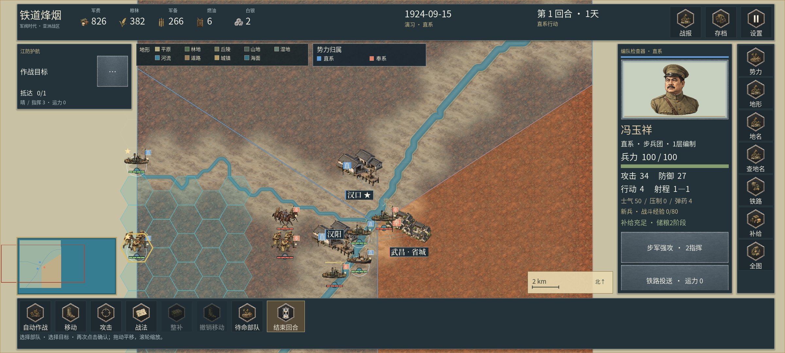

# 真实河段与连续水面 · 0.2.15

本章保留0.2.15水系实施语境，共享媒体/报告随当前版本更新。0.2.16海岸与湖中岛屿修订以[33](33_真实海岸与控制区裁切.md)为准；旧二进制证据保留在对应版本交付。

本次继续处理实机地图与《欧陆战争6》公开画面的差距，重点是主河呈现、河段接缝和细溪可读性。20 类地域地表、80 张细节原图和 20 张连续底材沿用现有登记；总计 1,156 张 PNG、970 张地图资源，本版新增栅格原图为 **0**。源图片没有改绘、裁切或拼接。

## 实际问题与修改

| 实机问题 | 本版实现 | 保留的范围限制 |
| --- | --- | --- |
| 替代主河仍直接描画源栅格折线，转角显得生硬 | 汉口、南京—浦口的全部 31 条替代主河使用已有的有界显示圆角；原始数组保留 | 显示中心线相对来源最大偏移 60 米，不能凭美观添加曲流、支流或沙洲 |
| 主河像多道等距轮廓线，缺少连续水面 | 缓存渐变河带网格，分为外侧柔边、明暗河岸、浅色水面与低强度水纹 | 河宽和明暗均为制图表现，不声称实测岸线、水深或流速 |
| 相邻源河段独立计算端部方向，出现切口 | 仅对源 ID / NEXT_DOWN 有关系、河级相同且端点坐标完全相同的河段共享接头方向 | 不吸附接近端点；没有来源拓扑的重合端点也不建立连接 |
| 汇流处后绘河岸盖住先绘水面 | 可见主河统一按河岸、水体、水纹三个批次绘制 | 不修改源中心线、规则渡点或军事水陆格 |
| 同一条河因源点数量不同而粗细变化 | 宽度统一由河级决定，未知河级的主河使用固定符号宽度 | 河级缺失时保留缺失，不推测河名或河流等级 |
| 小溪三角网格缩小时出现碎点 | 符号宽度小于 3.6 世界单位时使用 Godot 原生抗锯齿线，保留连续细线与轻岸影 | 细溪不会被扩成宽河，也不会自动成为规则障碍 |
| 独立水段的贴图相位不同 | 河面、海面和已有水域孔洞共用 256 世界单位的 UV 周期和世界原点 | 复用既有不可变 Sub2 水纹 `tile_bank_sea_water_001`，没有新造底图 |

明确上游关系的 28 处同河级接头，在汉口与南京源数据中分别形成 26 / 30 个端部方向记录。它们是对同一真实源节点两侧绘制方向的约束，不是增加 28 条河流。

## 地理与历史约束

水系继续来自工作区已归档的 Natural Earth 与 HydroRIVERS 数据。细河源归档 SHA-256 为 `827e03a8e419b9578d5f246bcce1c93de1a0bd561a9f572fe84606c5d36d31fa`；编译结果、原始中心线和上下游 ID 可从 `presentation/data/hydrography_fine.json` 及其来源记录追溯。显示圆角沿用原有 60 米上限，首尾点不变。低地模型支流的排除条件继续生效，没有为增加画面密度重新加入未确认分支。

[HydroSHEDS 官方说明](https://www.hydrosheds.org/products/hydrorivers)记载 HydroRIVERS 的来源支持尺度；这类现代水系数据不等同于 1840—1940 年逐年河道调查。现有约 500 米来源支持尺度会限制放大后的河形。本版既没有提高 GIS 原始精度，也没有完成历史岸线或人工渠复原。河道显示层与通行、渡河、海军位置和补给规则分别管理。

未知河级主河宽度为 6.8 世界单位；已知河级 1—10 的符号宽度为 1.45 / 1.85 / 2.4 / 3.1 / 4.15 / 6.8 / 9.6 / 13.6 / 19.2 / 27.2，战略显示乘 0.82。基础蜂窝半径仍为 48 像素。任何宽度都不是地理测量值。

## 实现与缓存

`MapHydrography` 保管来源点列、有界显示点列与端点连接；`MapRiverSurface` 构建独立河岸和水体索引网格；`MapView` 负责可见性、绘制批次及纹理持有。固定光照按世界方向计算，反向存储同一源点列不会翻转河岸受光。

几何按可见河段按需建立，选择部队时复用实际 ArrayMesh 资源；宽度改变才重建该段显示网格。水纹资源由绘图对象明确持有，避免纹理 LRU 淘汰后失效。使用 [Godot CanvasItem 的原生绘制接口](https://docs.godotengine.org/en/stable/classes/class_canvasitem.html#class-canvasitem-method-draw-mesh)；没有生成拼接 PNG，也没有依赖本地虚拟化环境。

## 实际画面

图片是完整的 Godot 视口原字节，没有外部裁切、拼接、叠字或补绘。最后一张来自 Windows 的移动比例布局，不能当作 Motorola X30 手机截图。

## 验证与交付范围

- [水系专项](../reports/river_surface_tests.json)：46 项，包括六张地图的原始数组与端点、有界圆角、全部 31 条替代主河、真实接头网格截面、无来源连接的拒绝、负坐标纹理相位、锐角边界、反向光照、缓存复用及规则地图隔离。
- [完整回归依赖封存](../reports/regression_dependency_evidence.json)：0.2.15时为25组、4,968项，当前报告另含后续海岸专项；报告字节与当前运行源码绑定。
- [原生画面证据](../reports/terrain_surface_native_evidence.json)：46 张地表/图鉴、39 张菜单与管理页面、7 张局部地图，共 92 张；汉口、南京及移动比例汉口同时验证实际渐变河带、水纹和源连接端部。
- [原生画面检查记录](../reports/river_surface_native_review.json)：记录实际完整视口的查看范围、图像哈希和剩余问题；不等于正式商业美术批准。
- [双端与本版摘要](../reports/terrain_update_verification_summary.json)：当前 Windows EXE、Android APK、资源载荷、来源与容量身份。
- [性能与未闭环项](05_测试与验收.md)：桌面最大负载与两视口性能单列；全 AI 长局、全量人工史实与美术批准、X30 真机安装/触控/GPU/温度/续航仍未在本次完成。

本版改善连续水面与细溪表现，不能据此判定《欧陆战争6》商业品质已经达到。地点专属河口、桥港、历史森林、全兵种动作和完整区域过渡仍见[当前完成度](23_当前完成度评估.md)。此前地表生产与性能失败记录保留各自版本身份，见 [0.2.14 连续地表](31_连续地表与水系层次.md)。

0.2.15曾确认控制色跨岸覆盖海面，当版未修复。0.2.16已依据原陆地几何裁切控制层，保留原海岸与规则格；当前像素对照、精度限制和剩余问题见[33](33_真实海岸与控制区裁切.md)。
