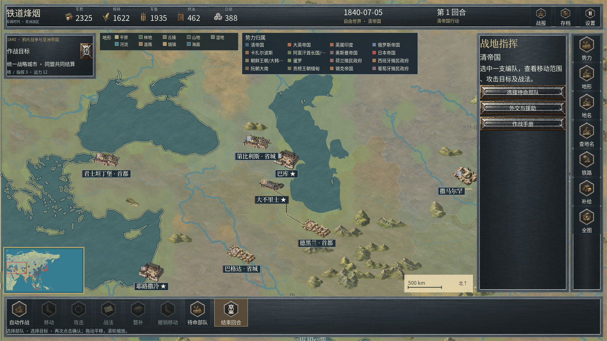
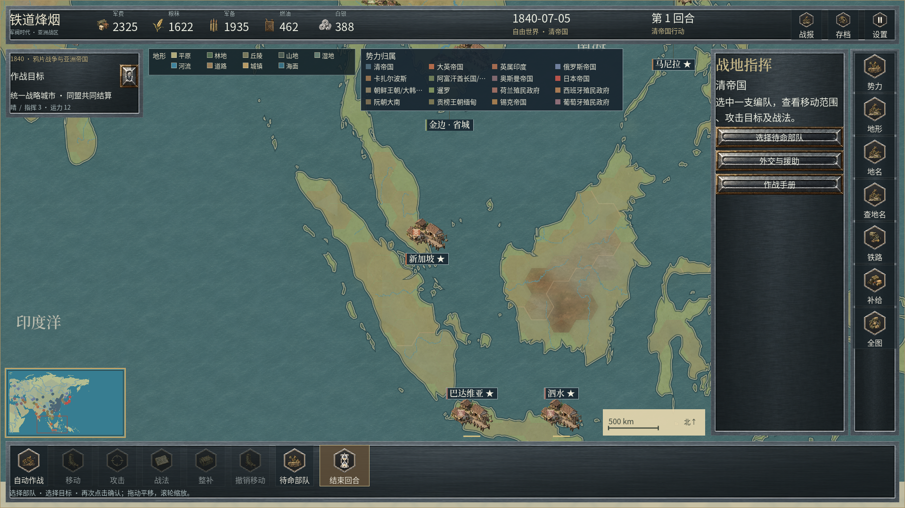
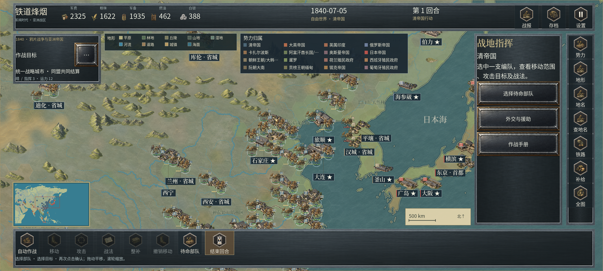

# 真实海岸与控制区裁切 · 0.2.16

0.2.17 的连续地表网格、全亚洲底材与单层控制色修订见 [34 连续地表混合与控制色去重](34_连续地表混合与控制色去重.md)；本章的原始实施版本与历史测量保持其语境。
本轮修复亚洲战略层势力色块跨越海岸的问题，并让主地图和缩略图使用同一套陆地裁切网格。保留20类地域地表与100张专用地表原图，运行PNG仍为1,156张、地图素材970张；本版没有新增或改绘栅格原图。

## 具体问题与结果

此前大陆层城市影响区直接绘成完整六边形，战略控制格也仅检查格心是否属于陆地，缩略图又逐格重画完整六边形。降低透明度不能消除这些越界。

按当前归档地理矢量核对，81个城市影响区中61个包含海面部分。3,744个符合原规则条件的控制格中，3,113个完整位于陆地，617个需要局部裁切，14个候选格完全离岸、因此省略其显示网格。上述数量描述显示几何，不增减军事格、城池或可通行区域。

| 显示层 | 本轮处理 | 保留的事实边界 |
| --- | --- | --- |
| 城市影响色 | 原有影响六边形与实际陆地求交，保留岛屿及水域孔洞 | 仍是城池影响范围，不宣称复原历史县界、军界或完整国境 |
| 战略控制色 | 沿海格使用局部裁切三角网格，内陆格继续复用完整六边形 | 当前所有者和最近城池选择规则保持原有行为 |
| 阵营分界线 | 与实际陆地求交后只画有效线段 | 不跨海湾、湖泊补接一条虚构陆界 |
| 缩略图 | 直接引用主图各阵营的实际裁切网格 | 不再另画整格；两处的地理范围一致 |
| 内陆水域 | 孔洞水面减去来源中独立登记的陆地岛屿 | 湖中真实岛屿继续显示为陆地，不把整个孔洞都当成无岛水面 |

覆盖透明度仍为城市影响层0.26、一般战略场0.21；主图战略场按原缩放档位采用0.23或0.20。基础蜂窝半径仍为48。半透明覆盖继续保留地表、河流和地形的可读性。

## 来源、精度与可复现性

唯一陆地输入是当前 `content/maps/asia_strategic.json` 的 `render_land`：556个外轮廓及现有1个水域孔洞。源文件SHA-256为 `268ab58f6d5bd40c8e88d151449bab27170ac5b5c61ceaa310d84b26334de0ae`。不修改原始陆地、海岸、城市坐标、行政关系、格子、铁路和水系。

编译器 `tools/compile_control_land_clip.py` 使用本机Shapely/GEOS，对原有影响区及控制格执行矢量求交和约束三角化。当前可复现环境为Shapely 2.2.0 / GEOS 3.14.1；独立克隆可先用 `python -m pip install shapely==2.2.0` 安装对应原生Python包，再执行 `python tools/compile_control_land_clip.py --check`。游戏直接读取已提交的编译结果，不需要这些Python包。逐区域检查三角形没有离开求交结果，并核对重建面积误差不超过1e-6平方世界单位。该误差是计算核验容差，不是地理来源的测量精度。

断开的岛屿、凹岸、湖泊孔洞及湖中岛屿均有独立用例。源码还核验原始地图字节保持不变。输出为 `presentation/data/control_land_clip.json`；运行时检查原地图SHA，缺少或过期时省略不可信的控制覆盖，不退回跨岸完整色块。固定LF换行使编译矢量具有可复现的字节身份。

本次没有提高底层GIS的调查精度，也不声称这套归档自然地理资料等同于1840—1940年逐年岸线调查。大陆地图的游戏势力场仍与当时实际行政边界、外交主张分别记录；不能从当前城池所有者推定整个洲的精确历史国境。

## 运行时实现

`MapControlLandClip` 持有来源绑定数据、城市网格、沿海格顶点与内陆水面网格缓存。`HistoricalPlaces` 为大陆层引用这些城市影响网格；原有局部战区的、已经按时期省域与陆地裁切的区划继续使用原登记。

`MapView` 继续依据当前城池所有者生成阵营场，沿海格直接追加预编译三角形；所有者改变时重组颜色批次，复用固定来源几何。缩略图直接绘制这些阵营ArrayMesh，避免每帧重复提交数千个六边形。水域孔洞与海面、河面继续共享256世界单位水纹周期。

控制图开关、相机缩放和图鉴浏览不改变经济、兵力、补给、随机流或历史部署。军事格仍由现有规则地图判定。

## 原生画面

以下为同一本版EXE的完整原生视口，直接保留PNG原字节。








最后一张来自Windows的移动比例布局，不是Motorola X30手机截图。图片没有外部拼接、叠字、裁取或补绘；原有战斗GIF继续保留0.2.12身份。

## 验收证据

- [原始矢量与约束三角化审计](../reports/control_land_clip_audit.json)：编译器从当前源文件重新计算并核对输出；包括陆地、孔洞、断岛及湖中岛屿覆盖。
- [引擎专项回归](../reports/control_land_clip_tests.json)：七个时代的实际归属、实际城市/阵营ArrayMesh、水面见证点、湖中岛屿、水纹相位、所有者变更与规则状态隔离。
- [正式EXE的原生像素对照](../reports/control_land_native_evidence.json)：两个桌面视口，分别检查渤海、日本、里海、新加坡及亚洲总览；各保存控制层开关前后完整画面，共20张。原始来源水面见证点独立于显示网格，检查主图和缩略图水面保持原色，同时确认陆地的归属色仍可见。
- [完整画面目视检查](../reports/control_land_native_review.json)：按实际查看的视口、文件哈希及剩余问题记录，不能替代正式商业美术批准。
- [本版完整回归依赖封存](../reports/regression_dependency_evidence.json)、[双端载荷核验](../reports/apk_content_validation.json)与[本版摘要](../reports/terrain_update_verification_summary.json)：分别约束源码、报告、原生EXE及APK。

```powershell
python tools/compile_control_land_clip.py --check
godot --headless --path . --script tests/control_land_clip_test.gd
python tools/build_release.py
python tools/capture_control_land.py
```

地图编译使用工作区本机Python依赖；运行游戏不需要Python。旧版本交付及其失效画面保持原字节，不重标为本版结果。

像素对照避开实际HUD、标签矩形和标签引线的绘制范围，水面最大通道差阈值保持2/255。早期移动布局总览出现过32/255差值；已按实际引线坐标确认异常像素距标注引线约0.90像素，并非控制网格。修正取样遮挡后继续检查剩余水面，没有调高通过门槛。完整地图的回归、导出、画面捕获与容量测试分别串行执行；并行验证期间曾发生的原生内存分配失败日志保留在工作区研究记录中。

最终EXE的两视口各通过37项检查，共74项。下表为实际无标注遮挡的主图水面采样数；十组的主图和缩略图最大通道差均为0。每组另有24个陆地采样确认控制色仍然改变画面，避免把隐藏整层误当成修复。

| 区域 | 1920×1080 主图水面像素 | 2400×1080 桌面移动布局主图水面像素 |
| --- | ---: | ---: |
| 渤海沿岸 | 354 | 405 |
| 日本沿岸 | 516 | 474 |
| 里海沿岸 | 144 | 135 |
| 新加坡及邻近岛屿 | 66 | 57 |
| 亚洲总览 | 503 | 515 |

缩略图每组分别检查25 / 36个来源水面像素。此结果证明受检源水面未被控制色改写，不代表全部历史边界或整幅地图的商业美术已经验收。

## 仍需继续处理

大陆层仍存在单位与城市聚集、部分地表明暗呈三角拼块、地点专属桥港不足及地域过渡不完整等视觉差距。局部战区的行政/控制描线与物理岸线仍有视觉不一致，本版没有改写全部局部边界层。全兵种动作、季节内容、全量历史与平衡审核和Motorola X30实际安装、触控、GPU、温度、续航尚未闭环。

本轮修复海岸与控制区范围的一致性；《欧陆战争6》整体商业品质仍未达到。上一轮水系实施记录见[32](32_真实河段连续水面.md)，当前范围见[完成度评估](23_当前完成度评估.md)。
