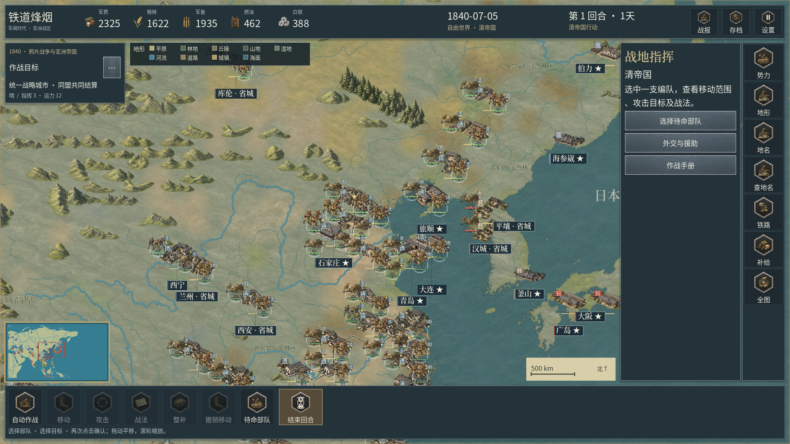
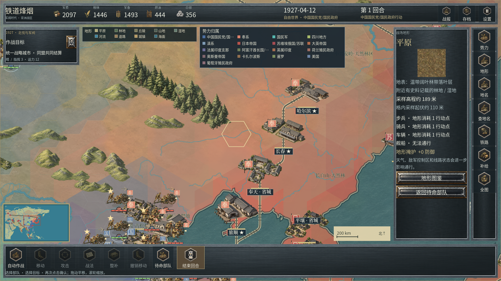

# 连续地表混合与控制色去重 · 0.2.17

本章保留0.2.17的实现语境；链接的共享原生报告和精选截图随当前0.2.18重新验证，实际版本以各自JSON为准。0.2.18增加的图符层次、邻城点选和重复地形线符处理见[35](35_地图缩放层次与精确点选.md)。

本版处理两类会让地图显得粗糙、底纹趋同的问题：亚洲控制色的重复叠加，以及同类地表逐格羽化产生的深浅接缝。沿用已交付的 **20 类地域地表、80 张细节原图和 20 张连续底材**；本轮新增栅格原图为 0。100 张专用地表原图、全部 1,156 张 PNG 均保持原字节。

[中文 README](../README.md) · [English README](../README.en.md) · [20 类名称与地域依据](30_二十类地域地表与纹理整改.md) · [真实海岸裁切](33_真实海岸与控制区裁切.md)

对照了既有设计稿与[《欧陆战争6》官方手册的战场画面](https://ew6w.ieasytech.com/assets/image/manual/en/18.jpg)，本轮将地表连续性、区域色的透底程度和缩放层次作为检查重点；参考图片只用于研究，没有作为本游戏素材。

## 画面变化

| 问题 | 本版处理 | 对玩家的作用 |
| --- | --- | --- |
| 亚洲整片势力底色又叠加城市影响色 | 亚洲只绘制源陆地裁切后的整片控制场，局部战区继续使用其行政来源内的城市影响区 | 同一片控制区的底色更均匀，地表不会在城市附近反复压暗 |
| 每格材质软边相互覆盖，同类区域也显出拼块 | 连续底材改用不重叠的地格分区；相邻来源按共同权重混合 | 草原、沙地、岩坡等内部更连续，类型交界过渡更平缓 |
| 大地图缩放时地域底材直接消失 | 各地图总览保留连续底材，较近视角再增加细节原图 | 沙漠、草原和林带地表在缩小时仍有区别 |
| 纹理变化可能随镜头或势力改变 | 纹理相位固定在世界坐标，类型取自现有地理登记 | 平移、缩放和占领不会让同一地点突然换土质 |

下面是当前导出程序的完整视口，使用正式地图与普通游戏渲染；未拼接、裁切、补绘或叠加宣传文字。

## 为什么此前的透明覆盖仍会变深

0.2.16 的亚洲主地图同时绘制约 20%—23% 的区域控制色和 26% 的城市影响色。同一点两次覆盖时，总影响约为 40.8%—43.0%；城市影响区彼此交叠时还会增加。单独设置每层透明，并不能保证最后画面只有一层透明覆盖。

0.2.17 保留既有颜色和单层透明度，移除亚洲主图重复的城市影响填充。主图与缩略图仍复用真实陆地裁切网格，来源中的海湾、湖泊和岛屿继续保留。城市影响几何仍可用于来源审计，未改写城市归属或军事控制规则。大范围控制色只是按当前真实城市节点推导的游戏显示区，不冒充测绘历史国界或战线。

## 地表连续性与素材完整性

20 张连续底材各占一个运行时纹理数组层，来源仍是完整的独立 Sub2 图片。使用 Godot 既有的 384 像素导入表示及 mipmap；原始 PNG 为 1,254×1,254。没有裁切源图、制作离线拼接图或新增栅格副本。

连续地表的网格面积等于实际地格分区面积，不再靠相邻软边重复覆盖来填满内部。每个来源中心保留其登记类型，在相邻中心之间混合至多三种既有材质。同类区域使用相同纹理和世界相位，覆盖强度保持一致；地表类别在地理登记边界附近的显示过渡是制图处理，不能解释为历史实测土壤边界。

细节层继续使用每类四张独立原图，近景强度为 0.22、亚洲较近视角为 0.14。较远视角只显示连续底材，减少细颗粒噪声。地表按固定世界区块缓存，平移和选中复用相同网格；总览不再因隐藏底材而变得单调，也避免每次遍历整张七万格地图。缺少连续材质支持时仍有既有材质绘制后备路径；最终原生验收要求连续路径实际启用。

河流、港口、城市、道路等功能地形优先于地域底材。绘制仍受真实海岸安全脚印约束，山体光影仍来自既有高程/起伏来源。没有新增河道、树林、聚落、历史行政边界或规则地形；蜂窝半径仍为 48，移动、掩护、占领、经济、补给和玩法随机流保持原有规则。

## 复核入口

- [材质连续性回归](../reports/map_material_continuity_tests.json)：来源哈希、精确覆盖面积、材质交界覆盖、世界几何、中心类型、绘制顺序和细节强度。
- [当前 EXE 原生材质检查](../reports/ground_continuity_native_evidence.json)：20 个完整导入表示与 GPU 层的像素/mipmap 对照；每类 966 个采样点与独立整图绘制比较；另检查三材质交界的绘制顺序和平移稳定性。
- [当前海岸与控制层检查](../reports/control_land_native_evidence.json)：两种桌面视口、五处范围，逐一比较主图/缩略图真实水面，并记录亚洲城市影响填充次数为 0。
- [全部地表、图鉴、管理界面与局部地图](../reports/terrain_surface_native_evidence.json)：112 张总原生画面中的地表/UI部分，其余 20 张为海岸控制开关对照。
- [交付核验](../reports/terrain_update_verification_summary.json)与[测试说明](05_测试与验收.md)：当前源码、导出程序、Android 载荷及桌面容量绑定。

材质像素检查使用明确标注的合成测试网格，只验证渲染连续性和来源完整性，不作为历史地图画面。README 和本章的游戏图片使用实际地图的完整原生视口。

## 仍待处理的画面差距

连续材质和控制色去重改善了底纹呈现。粗尺度高程光影仍可见部分三角面过渡；受真实海岸安全脚印约束，狭窄岛屿和部分岸边仍使用既有基础底色。亚洲城市和部队聚集、山体符号的摆放感、局部战区行政边线与物理岸线的协调，以及地点专属桥梁/港口素材仍需继续完善。

本版不代表《欧陆战争6》完整商业品质验收。全部历史起局审核、其他兵种完整动作、整体关卡平衡和 Motorola X30 物理设备操作/持续性能仍见[当前完成度](23_当前完成度评估.md)。
