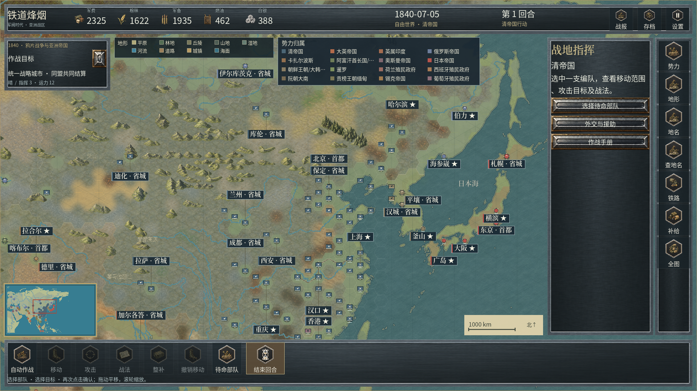
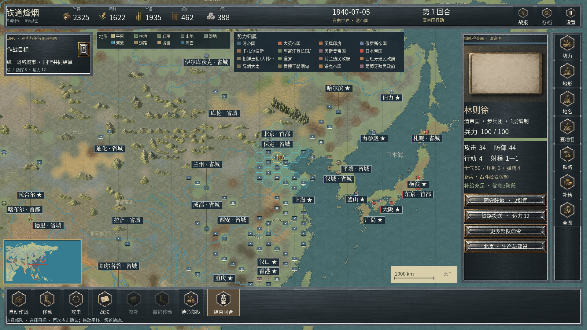

# 地图缩放层次与精确点选 · 0.2.18

本章保留0.2.18实现语境；共享原生截图和报告随当前0.2.20更新，具体版本以JSON为准。后续连续光影与岸带见[36](36_连续高程光影与细河岸带.md)，二十类新材质与旧图保留见[37](37_二十类地表材质形态重制.md)。

本轮处理亚洲区域视角的城市、部队堆叠，以及小图符的点选问题。既有 20 类地表、100 张专用地表原图及全部 1,156 张 PNG 保持原字节；地理、军队编制和规则位置不变。

[中文 README](../README.md) · [English README](../README.en.md) · [连续地表](34_连续地表混合与控制色去重.md) · [当前完成度](23_当前完成度评估.md)

## 缩放与地图信息

此前在区域视角仍绘制 136×116 世界单位的完整建筑和整套部队模型；相邻地格中心距约为 83 世界单位。城市、驻军、旗帜和状态条叠在一起，使地表、河道和城名难以辨认。

本版按实际缩放切换图符。所有图符仍对应原来的单个规则实体，不合并军队，不移动地格，也不移除城镇。

| 视角 | 城市与地方节点 | 部队 |
| --- | --- | --- |
| 总览，缩放小于 0.20 | 简洁据点，重要行政节点保留外圈 | 随比例缩小的势力标记，避免固定 8 像素方块挤成团 |
| 区域，0.20 至小于 0.56 | 根据行政重要性显示城镇图符，港口保留水运提示 | 兵种图符、势力色和生命提示；驻军与城镇共用真实地理锚点 |
| 近景，0.56 及以上 | 恢复既有完整建筑与旗帜 | 恢复既有独立原图、朝向、状态和动作表现 |
| 区域中的选中/战斗对象 | 选中城市恢复完整建筑 | 选中或正在演出的编队优先恢复完整模型 |

总览选中对象保留明确描边。中景驻军使用城镇外圈和单个编队图符共同表达，势力颜色仍取自实际所有者；没有把游戏显示区当成历史实测国界。

下面两张图使用当前 Windows 导出程序、正式亚洲剧本和完整原生视口，未裁切、拼接或后期补绘。桌面移动比例截图不能替代手机验收。

## 点选与缓存

旧的城市点选吸附半径为 22 屏幕像素。在中远景，一个相邻部队的中心可能落入这个范围，导致点击部队却选中城市所在的格子。

现在先解析可见编队图符，再处理城市和地方节点。点选发出的仍是该部队原有的六边格坐标，命令仍由同一套规则校验。选中后的详情、移动和攻击流程继续使用原部队 ID。

部队缓存的标识加入缩放层次。即使从 0.559 缩到 0.561，变化仍在原来的缓存容差内，也会立即切换表现；反向缩放同理。文字避让使用当前图符大小，选中部队恢复模型时同步扩大避让范围。

## 地形的显示层次

中景曾同时显示旧的重复山峰、树林线符和后续加入的手绘地景。完整素材库可用时，本版关闭这层重复线符，保留真实高程光影、地域底材、手绘山体、树林与水系。缺少素材库时仍有旧的后备路径。

这不是新增地理数据，也不把草地底材解释为历史树林。河道、海岸、已有地形分类、历史地名和控制归属沿用既有来源。

## 原生复核

专项入口为 `tools/verify_map_symbols.py`，报告位于 [地图图符原生证据](../reports/map_symbol_native_evidence.json)。它使用当前 EXE、两个桌面视口、正式亚洲与山海关剧本，并核对：

- 不同缩放下，可见规则编队与实际绘制 ID 的对应关系，不能用减少军队数量缓解拥挤。
- 缩放阈值两侧的图符、完整素材恢复和缓存切换。
- 小图符经普通地图点选进入正确部队，尤其是邻近城市的编队。
- 观察、缩放与选择不改变完整战局状态和随机流。
- 手绘地景仍实际绘制，重复地形线符只作为后备。

两个视口各通过110项，共220项，保存32张完整原生视口。已直接查看其中9张总览、区域、近景及选中画面，范围和剩余问题见[逐图目视记录](../reports/map_symbol_native_review.json)。通过项证明本专项行为，不把它换算成美术质量百分比。

完整回归、原生截图、材质、海岸、导出载荷及桌面容量结果以 [测试与验收](05_测试与验收.md) 和 [交付摘要](../reports/terrain_update_verification_summary.json) 为准。专项是运行正确性证据，不是美术品质评分。

## 仍需继续的差距

粗尺度高程的光影三角面、山体与地表的衔接、精细河岸和地点专属桥港仍需完善。区域图符改善了密集视角，但不代替近景美术精修、全兵种动作、历史起局审核、关卡平衡或 Motorola X30 物理设备验收。整体《欧陆战争6》商业品质目标继续保持未完成。
