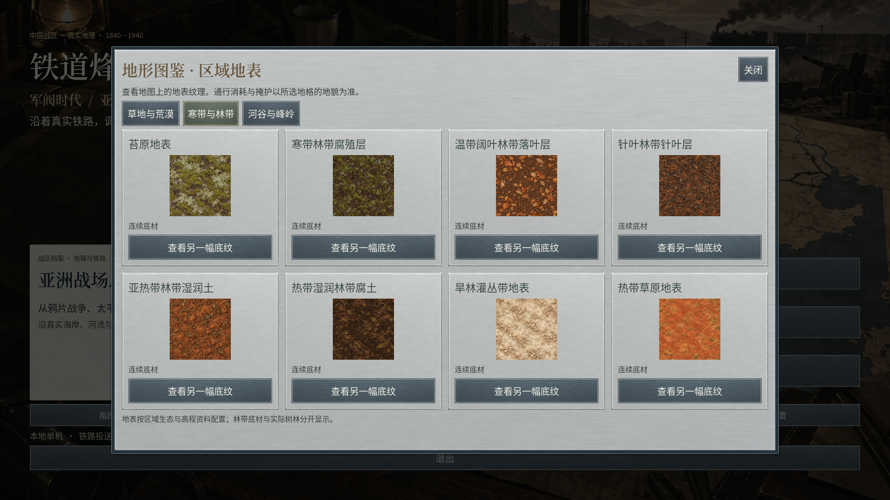
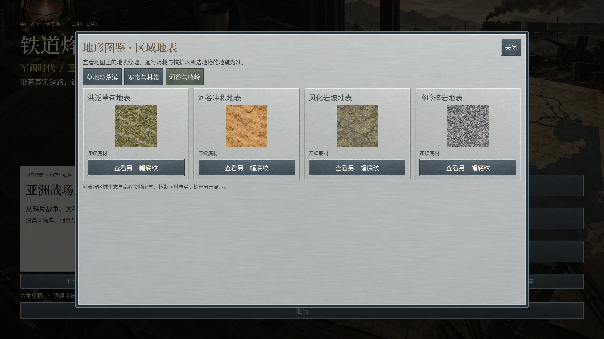

# 二十类地表材质形态重制 · 0.2.20

此前的底材虽然颜色不同，但生成要求过度强调抽象、安静的颗粒，限制了可辨认的叶片等形状。结果是草地、林底、苔原和碎石都容易呈现相近的斑驳质感。本版重新生成并启用 20 张连续底材，用材质本身的形态区别地域。

[中文 README](../README.md) · [English README](../README.en.md) · [原有二十类地表体系](30_二十类地域地表与纹理整改.md) · [当前完成度](23_当前完成度评估.md)

## 实际交付范围

本版通过指定的 `sub2-image-gen / gpt-image-2.5 / high` 路线生成 20 张独立、完整的底材原图。每张采用新资源 ID；旧 20 张底材保留原始字节、提示词和来源，不覆盖、不拼接、不裁取、不补绘原图。所有新原图均经过完整图片的逐张目视检查，记录见[原图检查](../reports/ground_identity_source_review.json)。

| 统计口径 | 数量与含义 |
|---|---|
| 地域视觉类型 | 20 类；沿用已有地理分配 |
| 本版新增原图 | 20 张连续底材，20 个不同 SHA-256 |
| 当前启用的专用地表原图 | 100 张：20 张新连续底材 + 80 张既有细节原图 |
| 保留的旧连续底材 | 20 张，当前未作为连续底材启用 |
| 存储的专用地表原图 | 120 张，包含上述旧底材 |
| 当前启用的地图资源 | 970 张 |
| 存储的地图资源 | 990 张，包含保留的旧底材 |
| 注册的全部 PNG | 1,176 张 |
| 规则地形 | 仍为 12 类；20 类地域材质不是 20 套新增战斗规则 |

## 二十类材质的可见区别

| 地域视觉类型 | 新底材的形态 | 地理分配依据与边界 |
|---|---|---|
| 温带草甸 | 成簇的绿色草叶、叶间壤土 | 既有温带草原与森林草原生态区 |
| 干旱草原 | 较长的浅黄枯草纤维 | 既有温带大陆性草原生态区 |
| 荒漠草原 | 裸露矿质土和稀疏草簇 | 明确记录的荒漠草原、半荒漠生态区 |
| 沙丘沙地 | 连贯梳状砂纹和细砂 | 明确记录的沙质荒漠生态区 |
| 砾质戈壁 | 棱角分明的砾石碎片 | 明确记录的石质、旱生荒漠生态区 |
| 盐碱草甸地表 | 浅色矿物结壳、灰绿稀疏草叶 | 明确记录的盐生草甸生态区；不推断水域面积 |
| 高山草甸 | 紧凑的冷绿草垫和细砾 | 明确记录的高山草甸生态区 |
| 高寒草原 | 冷灰细砾、银白枯草 | 高寒草原和高寒荒漠生态区 |
| 苔原地表 | 浅色卷缘地衣、橄榄色苔藓和泥炭 | 苔原生态区；不推断季节冻土或冰线 |
| 北方林地腐殖层 | 深色泥炭、苔藓、小块地衣和零散落针 | 北方森林生态区的林底参考 |
| 温带落叶林底 | 铜褐落叶、可辨叶脉和腐殖土 | 温带混交林、阔叶林生态区的林底参考 |
| 针叶林底 | 扇状落针、树皮碎片 | 针叶林生态区的林底参考 |
| 亚热带林底湿润土 | 红褐碎壤、叶片碎屑和纤维 | 亚洲低纬阔叶林生态区的地表参考 |
| 热带湿润林底 | 深棕腐殖土、较宽的腐叶 | 热带湿润阔叶林生态区的林底参考 |
| 干林灌丛地表 | 浅色尘土、纸质窄叶和细枝 | 干旱阔叶林、地中海型林地生态区参考 |
| 热带草原地表 | 红色黏土、浅裂纹和稀疏枯草 | 热带草原生态区；红色土壤是代表性美术表达 |
| 泛滥草甸地表 | 倒伏的长莎草带和灰色粉砂 | 已有泛滥草原生态区；不表示历史洪水范围 |
| 河谷冲积地表 | 浅黄沉积条纹、小型土块 | 既有具名冲积生态区、低起伏地形及来源河道邻近条件 |
| 风化岩坡 | 具有接缝的灰绿岩板 | 既有 DEM 分类的丘陵、山地；不等于岩性调查 |
| 高寒碎岩地表 | 细长、棱角分明的冷灰岩屑 | 既有 DEM 分类的高峰；不等于碎石坡实测分布 |

具体资源 ID、完整生成提示词与版本见[生成计划](../presentation/data/ground_identity_plan.json)；当前类型到素材的对应关系见[连续底材登记](../presentation/data/ground_macro_catalog.json)。原图哈希、提示词哈希、导入参数和保留的旧底材检查见[素材审计](../reports/ground_macro_asset_audit.json)。

上述形态用于可读的战略地图，不是 1840—1940 年逐年土地利用复原。林底材质不会自行创建规则树林、水障或行政边界。地理分配文件的哈希在安装前后保持一致，见[安装记录](../reports/ground_identity_installation.json)。

## 地图中的接入

20 张新底材沿用现有完整原图导入、世界坐标纹理、相邻材质混合与连续光影。整个原图按现有导入预算缩小、生成 mipmap，未裁成新的美术图块；原始 PNG 仍保留原始字节。实际近景检查发现原 384 单位周期将落叶等形态放得过大，因此本版改为 128 地图单位，让纹理服从军队与城镇的视觉比例。此为战略地图的符号比例，不是叶片或砂脊的实测尺度。地表细节层继续使用既有 80 张来源；阵营控制色使用半透明覆盖。

图鉴是程序内的材质说明场景；地图截图是原生运行视口，均非设计稿。确切来源、版本与哈希见[媒体记录](media/manifest.json)。旧版战斗 GIF 保留其原版本身份，不作为本版新素材或新动效的证据。

## 验证与尚存差距

素材验证分别检查 20 张新图的独立性、引擎副本与原图哈希、提示词便携副本、20 张旧图的保留及地理分配不变性。原生材质专项另检查完整导入纹理、覆盖、混合顺序和镜头平移，见[原生连续地表证据](../reports/ground_continuity_native_evidence.json)。这类数值检查不等于美术质量评分。

完整回归、当前 EXE/APK 身份、实际地图/UI 截图、容量与 Android 载荷以[测试与验收](05_测试与验收.md)和[交付摘要](../reports/terrain_update_verification_summary.json)为准。最终程序的三页图鉴完整展示 20 类材质，连同 8 处实际落图，共 11 张完整视口经过直接查看，见[材质目视记录](../reports/ground_identity_native_review.json)。山地、细支流、汉口、南京及移动比例汉口另有 5 张完整视口的[河流与地表目视记录](../reports/river_surface_native_review.json)。原图逐张检查与实际地图检查分别记录，不能互相替代。

区域材质/控制区仍有局部多边形边缘，独立山体的摆放感、地物密度和商业级动效也仍有差距。20 张新图解决的是底材形态高度相似这一项问题；不把新增数量当作《欧陆战争6》完整商业质量达标。Motorola X30 的物理设备验收仍待实际设备。

## English scope

Version 0.2.20 generates and activates twenty new, independent ground originals through the required Sub2 route. Grass blades, fallen needles, leaf veins, sand ripples, angular gravel, salt crust, lichens and jointed rock plates replace the previous generic mottled textures. All twenty complete originals were inspected individually. Original PNG bytes remain immutable; the previous twenty macrogrounds retain their IDs and provenance.

Twenty regional visual families share the existing geographical assignments. There are 100 active dedicated terrain originals, 20 retained superseded macrogrounds, 970 active map assets, 990 stored map assets and 1,176 registered PNGs. The rules still define twelve terrain categories. Ecological references and representative material colors are not a year-specific historical land-cover survey. Native material checks, historical-map inspection, performance acceptance and physical Android testing have separate evidence and limits.
