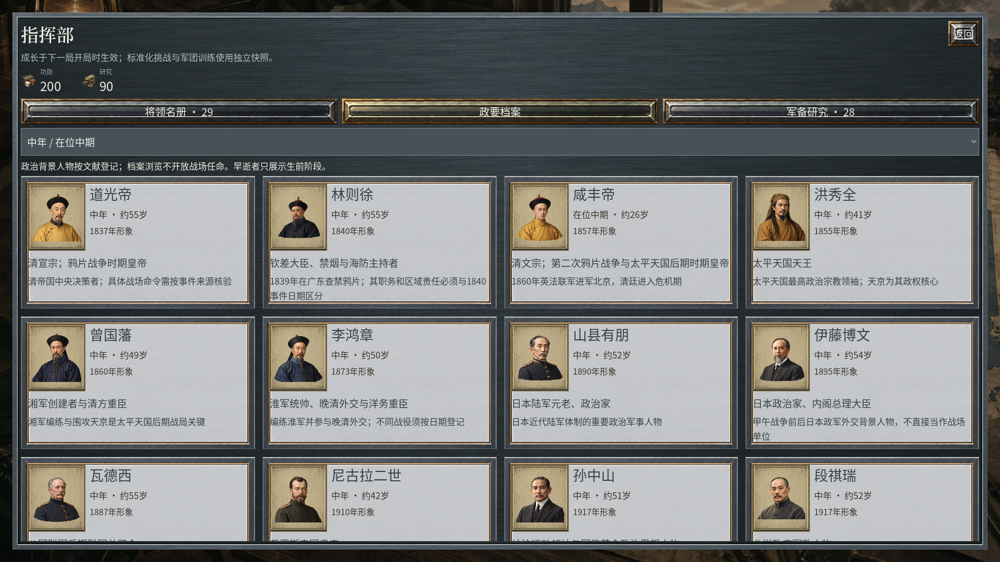
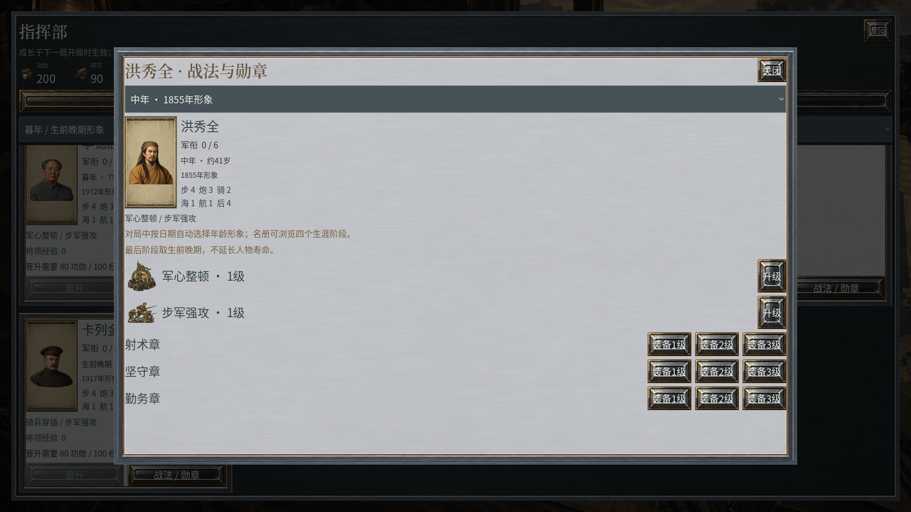
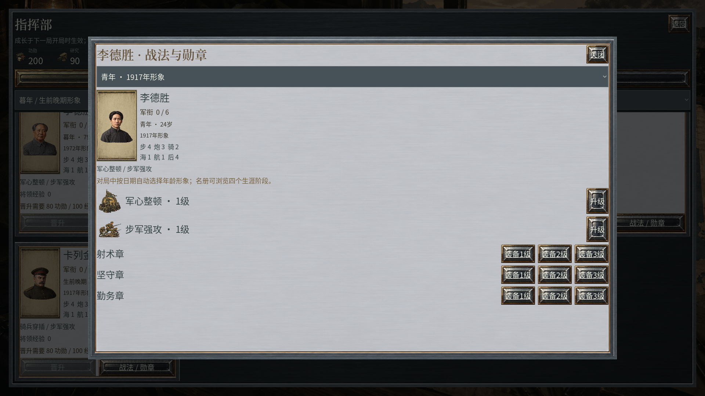
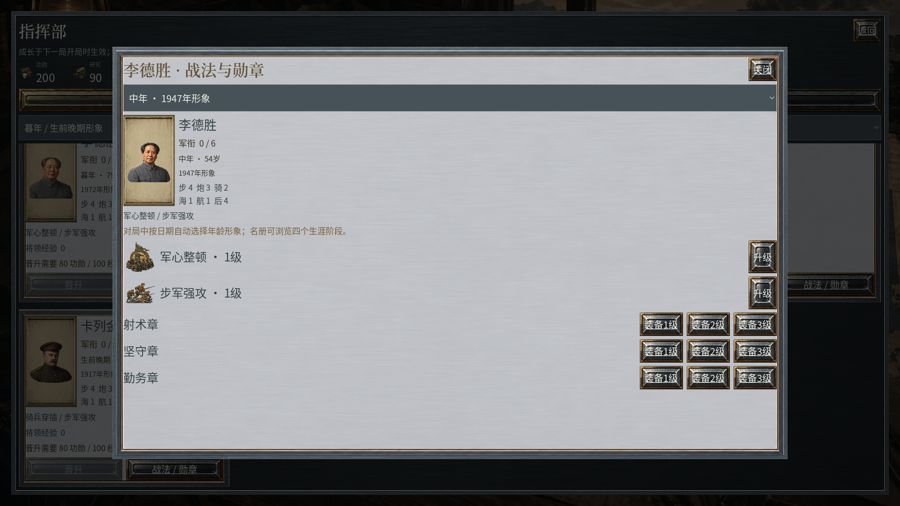

# 每日历法与四阶段人物肖像 · 0.2.22

本页保留0.2.22交付语境，四张人物页图片保留其原版身份与完整来源。当前0.2.27继续使用全部每日规则和135张肖像；档案版式见[41](41_军事界面与将领档案精修.md)，地图、外交及每日登记一致性见[42](42_战区沙盘与外交事务精修.md)，本轮地图与实际查看记录见[45](45_连续水纹与真实蜂窝显示.md)。

本版将全部61个剧本统一为每日制，并为全部33位人物登记、生产和接入四个生涯阶段。135张肖像由原有12张、此次补全123张构成；其中132张对应33×4阶段，另3张为保留的年代补充图。全部为独立Sub2原图，不通过复制、镜像、染色、拼接或裁切充数。

## 每回合一天

同一天内各存活阵营依次行动；一个阵营结束操作只切换行动阶段。所有阵营完成一轮后，回合数增加1，公历日期增加1天。月份长短、闰年和跨年由公历运算处理。天气预报展示接下来的三个连续日，而非三个星期或月份。

带有真实日期的历史事件以日期为准，旧的回合提示不能提前触发。事件条件、局势分支与一次性触发记录继续有效；读档不会重复执行已经发生的事件。仅为演习设置且没有日期的触发器保留回合语义。日期推进不是逐日历史天气复原，作战与经济仍为游戏规则。

各阵营每天恢复行动、结算收入和军需，并推进建设、修理及援助队列。现有单位能力、经济数值和任务回合上限未被伪称为史实日均值；每日制下的长局平衡仍需继续实玩调整。80回合对应80天、180回合对应180天，起始日算第1天。

规则版本升级为schema 2 / ruleset 10。旧ruleset 9战局不按新历法解释，请新开对局；原有档案不被覆盖。生涯成长与个人设置仍按其自身存档格式读取。

## 四个生涯阶段

指挥部的将领名册和战法/勋章页提供青年、壮年、中年、暮年四阶段切换；新增政要档案覆盖17位已登记政要，其中4位非军事角色也有完整四图。政要档案支持按当前战局日期选图及手动阶段预览。阵亡较早的人物将第四阶段标为“生前晚期”。战场检查面板和派遣名册按当前对局日期自动选图，无需玩家手选。

仅核实到生卒年的人物显示“约N岁”；生日核实到日的按生日计算实岁。出生前不显示成人肖像，16岁以前显示未到青年阶段；成年后的早期年份可使用青年阶段插画，但不会倒用中年或晚年脸。阶段图的参考年是插画设定，并非声称照片拍摄于当年。逝世后展示生前最后阶段并停止增龄，不据此开放其在后续年代的任命。

李德胜在1917年生日以前为23岁、生日当日起为24岁，自动采用青年形象；1947年为53至54岁，采用中年形象。1947及其后的图片属于人物生涯素材准备，当前游戏时间锚点仍止于1940，未新增1947解放战争战役。

洪秀全的四阶段已补全。其外貌采用文字记述和后世纪念形象参照绘制，不能称作已认证的生前肖像；不以误认木刻或后世纪念画冒充当时写生。其他人物亦不宣称所有阶段已经独立历史肖似度批准。

| 人物 | 生卒年 | 青年参考年 | 壮年参考年 | 中年参考年 | 第四阶段参考年 | 日期资料 |
| --- | --- | --- | --- | --- | --- | --- |
| 吴佩孚 | 1874—1939 | 1899（约25岁） | 1914（约40岁） | 1920（约46岁） | 1938（约64岁） | [来源](https://ecpo.cats.uni-heidelberg.de/ecpo/agent-information.php?agentid=1773) |
| 张作霖 | 1875—1928 | 1900（约25岁） | 1915（约40岁） | 1920（约45岁） | 1928（约53岁） | [来源](https://digital.janeaddams.ramapo.edu/items/show/35986) |
| 张学良 | 1901—2001 | 1920（约19岁） | 1936（约35岁） | 1955（约54岁） | 1995（约94岁） | [来源](https://www.024glsmy.cn/zhangxueliang/index.shtml) |
| 冯玉祥 | 1882—1948 | 1907（约25岁） | 1920（约38岁） | 1934（约52岁） | 1947（约65岁） | [来源](https://lex.dk/Feng_Yuxiang) |
| 孙传芳 | 1885—1935 | 1910（约25岁） | 1920（约35岁） | 1930（约45岁） | 1934（约49岁） | [来源](https://www.zgbk.com/ecph/words?Name=%E5%AD%99%E4%BC%A0%E8%8A%B3&SiteID=1&SourceID=85626&Type=bkzyb&subSourceType=000003000005000006) |
| 齐燮元 | 1885—1946 | 1910（约25岁） | 1920（约35岁） | 1937（约52岁） | 1945（约60岁） | [来源](https://zh.wikipedia.org/wiki/%E9%BD%90%E7%87%AE%E5%85%83) |
| 卢永祥 | 1867—1933 | 1892（约25岁） | 1907（约40岁） | 1920（约53岁） | 1932（约65岁） | [来源](https://www.dpm.org.cn/lemmas/245438.html) |
| 阎锡山 | 1883—1960 | 1908（约25岁） | 1920（约37岁） | 1938（约55岁） | 1958（约75岁） | [来源](https://digital.janeaddams.ramapo.edu/items/show/41915) |
| 唐继尧 | 1883—1927 | 1901（约18岁） | 1908（约25岁） | 1920（约37岁） | 1926（约43岁） | [来源](https://edata.nlpi.edu.tw/CNH/Personage/personage.aspx?ID=0000024) |
| 陈炯明 | 1878—1933 | 1903（约25岁） | 1914（约36岁） | 1920（约42岁） | 1932（约54岁） | [来源](https://edata.nlpi.edu.tw/CNH/Personage/personage.aspx?ID=0002599) |
| 许崇智 | 1887—1965 | 1912（约25岁） | 1920（约33岁） | 1940（约53岁） | 1960（约73岁） | [来源](https://xboorman.enpchina.eu/biographie/xu-chongzhi/) |
| 郭松龄 | 1883—1925 | 1901（约18岁） | 1910（约27岁） | 1920（约37岁） | 1925（约42岁） | [来源](https://zh.wikipedia.org/wiki/%E9%83%AD%E6%9D%BE%E9%BE%84) |
| 林则徐 | 1785—1850 | 1810（约25岁） | 1825（约40岁） | 1840（约55岁） | 1849（约64岁） | [来源](https://digitalarchive.npm.gov.tw/Collection/Detail/28680?dep=P) |
| 洪秀全 | 1814—1864 | 1835（约21岁） | 1845（约31岁） | 1855（约41岁） | 1863（约49岁） | [来源](https://onlinelibrary.wiley.com/doi/abs/10.1002/9780470670606.wbecc1486) |
| 曾国藩 | 1811—1872 | 1836（约25岁） | 1851（约40岁） | 1860（约49岁） | 1871（约60岁） | [来源](https://whhlyt.hunan.gov.cn/whhlyt/english/Culture/CulturalFigures/202205/t20220527_24654725.html) |
| 李鸿章 | 1823—1901 | 1848（约25岁） | 1860（约37岁） | 1873（约50岁） | 1900（约77岁） | [来源](https://www.npg.org.uk/collections/search/portrait/mw225127/Li-Hongzhang-Li-Hung-Chang) |
| 山县有朋 | 1838—1922 | 1863（约25岁） | 1878（约40岁） | 1890（约52岁） | 1917（约79岁） | [来源](https://www.ndl.go.jp/portrait/e/datas/208/) |
| 瓦德西 | 1832—1904 | 1857（约25岁） | 1872（约40岁） | 1887（约55岁） | 1900（约68岁） | [来源](https://en.wikipedia.org/wiki/Alfred_von_Waldersee) |
| 库罗帕特金 | 1848—1925 | 1873（约25岁） | 1890（约42岁） | 1900（约52岁） | 1920（约72岁） | [来源](https://www.enciklopedija.hr/clanak/kuropatkin-aleksej-nikolajevic) |
| 孙中山 | 1866—1925 | 1891（约25岁） | 1906（约40岁） | 1917（约51岁） | 1924（约58岁） | [来源](https://www.sunyat-sen.org/portal/list/index.html?id=216) |
| 段祺瑞 | 1865—1936 | 1890（约25岁） | 1905（约40岁） | 1917（约52岁） | 1927（约62岁） | [来源](https://www.zgbk.com/ecph/words?ID=57244&SiteID=1) |
| 蒋介石 | 1887—1975 | 1912（约25岁） | 1927（约40岁） | 1940（约53岁） | 1969（约82岁） | [来源](https://onlinebooks.library.upenn.edu/webbin/who/Chiang%2C%20Kai-shek%2C%201887-1975) |
| 李宗仁 | 1891—1969 | 1916（约25岁） | 1927（约36岁） | 1940（约49岁） | 1965（约74岁） | [来源](https://www.huangpu.org.cn/hpjs/201209/t20120923_3116368.html) |
| 白崇禧 | 1893—1966 | 1918（约25岁） | 1927（约34岁） | 1940（约47岁） | 1963（约70岁） | [来源](https://www.mnd.gov.tw/en/informationservices/publication/72322) |
| 李德胜 | 1893—1976 | 1917（约24岁） | 1927（约34岁） | 1947（约54岁） | 1972（约79岁） | [来源](https://www.12371.cn/2023/12/22/VIDE1703229361350208.shtml) |
| 彭德怀 | 1898—1974 | 1923（约25岁） | 1933（约35岁） | 1940（约42岁） | 1970（约72岁） | [来源](https://cpc.people.com.cn/GB/64162/126778/126780/7490066.html) |
| 东条英机 | 1884—1948 | 1909（约25岁） | 1924（约40岁） | 1940（约56岁） | 1947（约63岁） | [来源](https://www.ndl.go.jp/portrait/e/datas/142/) |
| 山下奉文 | 1885—1946 | 1910（约25岁） | 1925（约40岁） | 1940（约55岁） | 1945（约60岁） | [来源](https://onlinelibrary.wiley.com/doi/abs/10.1002/9781444338232.wbeow710) |
| 卡列金 | 1861—1918 | 1886（约25岁） | 1901（约40岁） | 1911（约50岁） | 1917（约56岁） | [来源](https://en.wikisource.org/wiki/1922_Encyclop%C3%A6dia_Britannica/Kaledin%2C_Alexei) |
| 道光帝 | 1782—1850 | 1807（约25岁） | 1822（约40岁） | 1837（约55岁） | 1848（约66岁） | [来源](https://www.dpm.org.cn/court/lineage/226239.html) |
| 咸丰帝 | 1831—1861 | 1849（约18岁） | 1853（约22岁） | 1857（约26岁） | 1860（约29岁） | [来源](https://www.dpm.org.cn/court/lineage/226247.html) |
| 伊藤博文 | 1841—1909 | 1864（约23岁） | 1878（约37岁） | 1895（约54岁） | 1908（约67岁） | [来源](https://www.ndl.go.jp/portrait/e/datas/12/) |
| 尼古拉二世 | 1868—1918 | 1890（约22岁） | 1900（约32岁） | 1910（约42岁） | 1917（约49岁） | [来源](https://www.rct.uk/collection/2926975/the-coronation-procession-of-nicholas-ii-emperor-of-russia) |

李宗仁采用所查黄埔同学会及故宫图书的1891年记载，保留部分英文资料1890年的分歧。陈炯明采用国立公共资讯图书馆的1878年，保留1877年的异说与生日差异。卡列金仅采用生卒年，避免混用俄历与公历死亡日期。齐燮元、郭松龄和瓦德西的部分年表仍待进一步一手资料校核；来源类型和未完成状态保存在general_lifespans.json。

政治年表与将领定义合并去重后共33人：29位将领及道光帝、咸丰帝、伊藤博文、尼古拉二世4位仅作政治背景的人物。后4位未被添加到军事任命表。咸丰帝约30岁逝世，四图取1849、1853、1857、1860年（约18、22、26、29岁），第三阶段按“在位中期”命名，不杜撰其中年和暮年。

## 原图与审核记录

栅格生产只使用指定sub2-image-gen / gpt-image-2.5 / high路线，每次直接生成一张完整肖像。原图、提示词和SHA256绑定；20张存在年代发式或年龄问题的早期原图不接入游戏，保留生产历史。运行时只由Godot导入设置生成512像素上限及mipmap缓存，assets内PNG保持原始字节。

原有两份提示词含旧显示名：原始UTF-8字节以可逆Base64封存并保留原SHA256，阅读副本统一使用李德胜。游戏、说明和新提示词使用已指定显示名；不改写旧Git历史或工作区原始生产记录。

[四阶段登记表](../presentation/data/general_portraits.json) · [生卒年与资料精度](../presentation/data/general_lifespans.json) · [素材来源索引](asset-provenance/index.json) · [原图审核](../reports/general_portrait_source_review.json)

## 原生程序画面

以下均来自0.2.22 Windows导出程序的完整Godot视口，没有拼接或叠字。手机比例测试运行于桌面，不能替代Motorola X30物理验收。

## English implementation notes

Every complete round advances exactly one Gregorian day, after all living factions finish their phases. Dated historical events follow their calendar date and retain one-shot state across save/load. All 61 scenarios declare one day per round. Existing ruleset 9 matches require a new game under ruleset 10. Economy and movement remain game abstractions; long-match daily balance has not received complete manual acceptance.

All 33 people now have four independently generated living-life-stage portraits. The library contains 135 originals: 132 stage anchors and 3 retained extra dates. Actual match dates choose the appearance; the headquarters and character pages provide stage controls. Lifespans use documented precision and explicitly retain disputed dates. Early deaths use the last living period instead of hypothetical old age. Post-1940 art is preparation, not a new 1947 scenario. Portraits are interpretive game illustrations, not authenticated photographs or independently approved historical likenesses.
