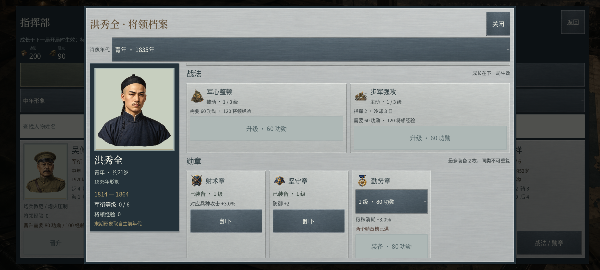

# 军事界面与将领档案精修 · 0.2.23

本轮继续推进《欧陆战争6》品质目标，处理0.2.22运行画面中仍存在的重复厚边框、人物过小、成长页大块留白及费用不清问题。每日历法和33人四阶段肖像保留；本章按实际实现、原图查看和最终原生证据说明范围。不能由单页或自动检查推导整套游戏已达到商业品质。

## 对照与版式选择

依据此前保存并登记 SHA256 的 [EasyTech 官方教程](https://ew6w.ieasytech.com/manual/en/?fwg=website) 第17、22幅画面，观察钢灰顶栏、浅灰内容面板、清楚的图像卡和局部强调。官方图片仅作研究，没有放入游戏资源。对应来源记录位于原工作区 `output/research/european_war_6/sources.json`。本轮在线访问教程失败，使用已保存的官方研究图，不把它表述为新版本截图。

| 设计项 | 本轮选择 | 对应问题 |
| --- | --- | --- |
| 颜色 | 钢灰 `#24323a`、按钮蓝灰 `#40515a`、冷银 `#cbd0cd`、纸灰 `#e0e1d8`、文字 `#303f43`、古铜 `#b6a270` | 去除重复厚金边，用明度区分壳体、信息与操作 |
| 字体 | 沿用项目已许可字体：地图字体只承担主标题，正文和费用使用界面字体 | 控制大字号使用范围，数值与正文不争夺层级 |
| 主体 | 左侧完整肖像、生平与成长等级；右侧兵种专长、晋升、战法和勋章 | 放大实际人物，减少无信息留白 |
| 浏览 | 左右独立滚动，年代选择和关闭始终保留；名册有姓名筛选 | 浏览勋章时不把人物脸部卷出画面；29人和17政要可快速定位 |
| 操作 | 每项显示登记表费用、经验、已装备及槽位条件；不可执行按钮禁用并说明 | 点击前可判断是否支付得起，减少无效尝试 |

本项目的特征是近代军事人物档案，界面围绕真实姓名、生卒资料和肖像年代组织；不额外装饰虚构军衔、奖项或历史身份。军衔等级、星级和成长勋章属于既有游戏规则，不作为真实人物履历。

## 本轮实际改动

`MilitaryUI` 集中管理原生控件的颜色、边缘和交互状态。浅色面板与深色人物牌分别声明正文对比，避免嵌套后文字错误变暗。源图继续由 Sub2 生成并完整引用；不把运行时控件布局作为一张拼接概念图发布。

`GeneralDossier` 使用原有135张肖像、33人生卒资料和现有成长规则。年代切换、晋升、战法升级、主动战法选择及勋章装备后保留所选阶段。军费、经验、技能等级和勋章价格始终读取登记表；付款与保存继续走 `ProfileRepository`。不新做一套费用公式，也不改变本局成长快照。

本轮新增两张低对比面板材质和三枚成长标识，使用指定 `sub2-image-gen / gpt-image-2.5 / high` 路线。5张原图均已逐张完整查看并接入工程，来源见[原图查看记录](../reports/ui_refinement_source_review.json)。三枚标识明确为游戏抽象符号，不冒充真实历史勋章。原图生成、逐张查看、原生使用与正式美术批准分别记录。

| 独立原图 | 运行用途 | 原图字节与导入 |
| --- | --- | --- |
| `ui_officer_sheet_v023` | 冷银模态壳和档案卡片 | 1254×1254原始PNG保留；Godot材质导入上限768 |
| `ui_command_plate_v023` | 蓝灰按钮与命令牌 | 同上；悬停、按下用控件状态调制 |
| `icon_medal_marksmanship_v023` | 射术成长标识 | 完整透明PNG保留；Godot图标导入上限128 |
| `icon_medal_steadfast_v023` | 坚守成长标识 | 同上；不计为真实授勋 |
| `icon_medal_logistics_v023` | 勤务成长标识 | 同上；不计为真实授勋 |

登记总量由1299增至1304，地图资源与135张人物原图不重复计为本轮新增。读取费用没有变更；征服默认规则的旧“7天”登记同步为1天，与现有61个每日剧本和当前设计登记表一致。

## 检查与证据

新增 `DossierQA` 在独立测试档案中操作真实界面控件，覆盖姓名筛选、四阶段入口、大幅完整肖像、短标签单行、横向溢出、功勋与经验限制、勋章价格切换、重复类型、两个槽位、卸下不退款、操作后保持年代以及档案恢复。先检查运行截图，再针对发现的竖排标签和窄能力条补上可读性检查。

最终Windows EXE已通过以下三布局的157项成长界面检查，保留24张未经编辑的完整视口；原始图、报告、源码及EXE哈希见[档案原生证据](../reports/ui_refinement_native_evidence.json)。这些检查通过真实控件信号调用既有生涯事务，不能替代物理鼠标/触屏操作验收。测试结束精确恢复隔离档案，不写用户生涯。

| 布局 | 视口 / 字号 | 通过项 | 完整视口 |
| --- | --- | --- | --- |
| 桌面 | 1920×1080 / 100% | 52 | 8 |
| X30桌面比例 | 2400×1080 / 120% | 53 | 8 |
| 大字 | 1280×720 / 150% | 52 | 8 |

另见[桌面勋章状态](media/dossier-medals-v0223.png)及[1280×720大字画面](media/dossier-large-text-v0223.png)。均为最终EXE的完整视口原样复制，不是概念图或后期排版。Motorola X30尚未连接，桌面比例测试不能代替其触控、驱动、GPU、发热及续航验收。

项目29组回归共5,780项通过，其中每日历法85项、人物资料611项；全人物、成长、地图/UI、海岸及图符专项合计340张本版原生画面，配乐18项通过。Android版本0.2.23/code28，核对125份JSON/许可、1304张导入纹理和3首OGG实际字节及v2/v3签名。汇总边界见[当前完成度](23_当前完成度评估.md)，构建与交付命令见[双端发布](06_双端构建与发布.md)。

## 整体目标仍未完成

本轮不会把“更紧凑的人物页”改写为整个品质目标。完整查看14张最终原生视口后的有限记录见[画面查看记录](../reports/ui_refinement_native_review.json)：战役浏览器的地貌预览仍简略，单一对手外交页仍有较多留白，战场山块与连续底纹还需继续衔接。地图连绵山脚、地点专属桥港、完整兵种动作、声音主观签核、逐年代行政与军队序列、每日长局平衡、跨设备触控和性能仍须继续完成并分别证明。所有旧发布目录保持原状态。
