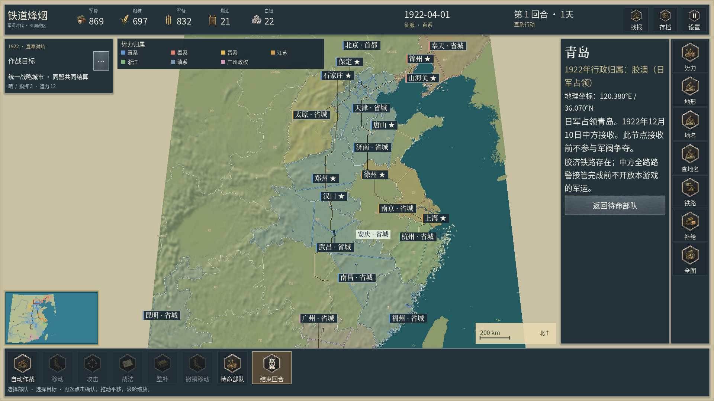
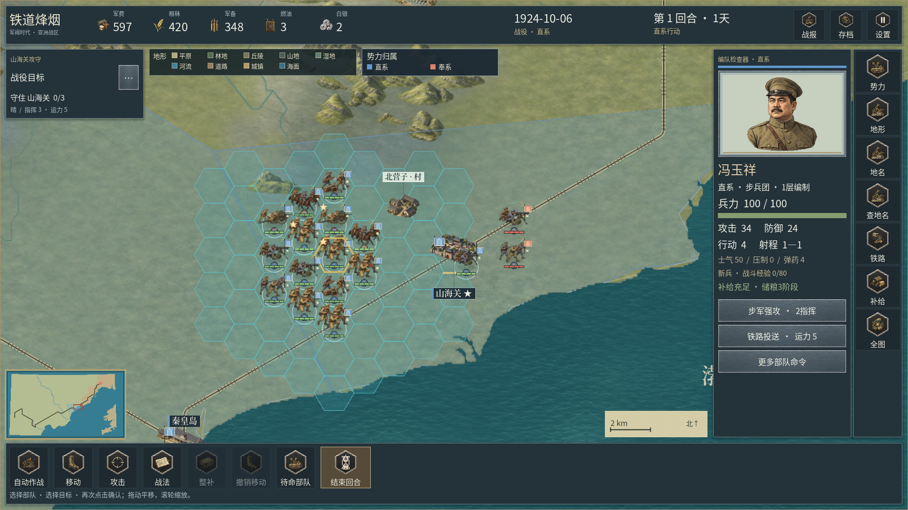
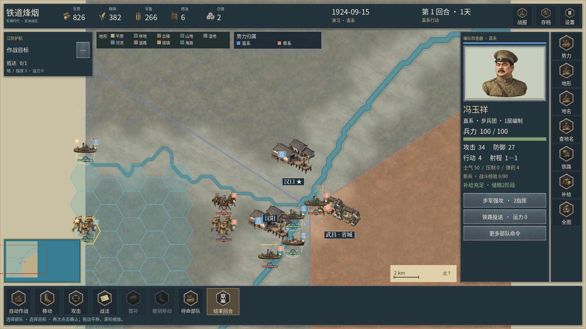

# 0.2.27 连续水纹与真实蜂窝显示

本轮处理海面绿褐色贴片、重复水纹接缝，以及全国总览上遮挡地图的三角斜线。它延续《欧陆战争6》的地图表现改进，不代表整体美术与玩法已达到参考作品的完成度。每日公历和33人四阶段人物系统继续保留。

## 水面素材与实际绘制

通过指定的 Sub2 路线分别直接生成海面、河面、内陆水面三张独立原图。每张1254×1254，完整原图、提示词、模型、生成日志和SHA256均可追溯；工程PNG与原始输出同字节。没有拼接、裁切、补绘或在图片上叠字。

| 原图 | 实际用途 |
| --- | --- |
| [海面](../assets/tile/tile_water_sea_v0227.png) | 已有图幅内的海域底面 |
| [河面](../assets/tile/tile_water_river_v0227.png) | 已有来源主河的连续河带 |
| [内陆水面](../assets/tile/tile_water_inland_v0227.png) | 既有湖泊等内陆水面网格 |

Godot通过导入设置生成512像素运行纹理和mipmap，不改写原PNG。主地图、缓存地图及单位绘制视图统一使用带mipmap的缩小过滤。水面不再覆盖旧的逐格海水贴片；旧素材、提示词和登记仍然保留。

水纹以世界坐标锚定，整个原图经过镜像取样和三路平移混合，让相邻网格共享同一水面相位。着色器从实际顶点计算坐标，UV只承载水面模式标记，避免大数值标记干扰细部坐标。没有生成中间纹理或派生拼接图片。

全国总览中，一张水纹若只占十余像素，原图较大的明暗变化仍会变成重复亮点。因此在原图投影尺寸24—80像素间平滑过渡：近景保留水波，远景逐步采用整张原图的最末级mipmap平均值。它是距离过滤，不是把海域改成另一种地理类型。原生GPU夹具另检查实际总览缩放，防止只在近景通过后遗漏远景亮点。

水色为美术表达，不能据此推断某地某年的水深、盐度、含沙量或污染状态。三类素材也不声称覆盖亚洲所有水体的历史外观。

## 操作蜂窝

删除原先由三组轴线组成的总览三角网纹。基础规则蜂窝仍为48世界单位半径，移动范围、攻击范围、目标选择与格子数量不变。可选格网在可读尺度绘制实际六边形；缩放低于0.20时隐藏，避免亚像素细线遮挡山河。没有以新的斜线替代操作蜂窝。

## 史实与规则边界

本轮沿用0.2.26已经核对来源的海岸、陆地三角网、内陆水域、河流源线、行政资料、城市、村落、铁路与渡点。既有地理和规则文件与交付提交逐字节比对；内容哈希、schema2/ruleset10及每日回合逻辑不因本轮材质改变。

所有在场阵营完成一轮才推进公历1天。33人至少四个生涯阶段，共135张独立肖像；按对局日期自动选形象，李德胜1917年用青年、1947年用中年。1947仍为素材准备，没有新增该年剧本。生卒、约龄和短寿人物的处理见[人物与历法说明](40_每日历法与四阶段人物肖像.md)。

0.2.26进行中战局可继续沿用同一内容身份；更早版本的兼容限制仍见各版交付说明，不绕过原有内容校验。

## 验证记录

三张均为同版本Windows导出程序直接保存的完整视口；原始分辨率、剧本、镜头及程序SHA在媒体登记和专项证据中记录，未制作拼接对照图。

Windows和签名Android导出、29组规则回归、已有地表/人物/军事UI/外交/海岸/图符/配乐检查，以及本轮的连续水面GPU夹具与11张完整地图视口分别记录。最终以当前版本和源码/程序哈希绑定的以下文件为准；生成成功、导出成功与画面查看分开判断。

- [本轮范围审计](../reports/water_map_scope_audit.json)：旧原图和既有地理/规则字节、三张新原图及提示词。
- [原生水面夹具](../reports/water_continuity_native_evidence.json)：网格分块、镜头平移、重复周期、镜像边界、实际总览尺度。
- [完整地图画面](../reports/water_map_native_capture_evidence.json)：全国、亚洲、渤海、日本、里海、汉口、南京、两种桌面移动布局及格网阈值。
- [实际完整查看记录](../reports/water_map_native_review.json)：逐张画面观察和剩余问题，不把自动截图视为人工全部验收。
- [本轮交付门槛](../reports/water_map_release_validation.json)：当前双端包、原生证据、仓库及来源核验。

夹具画面为合成测试场景中的原生GPU输出，单列保存，不作为游戏实机宣传图。文档中的地图截图使用完整正式程序视口，不做对照拼图。

[本次桌面性能样本](../reports/water_map_performance_observation.json)单独记录：RTX 3060、1920×1080、静止战场180帧，平均12.10 FPS，帧时p95为83.84ms，未达到60帧目标。原始报告、日志和完整视口保留。该测量未记录窗口焦点或遮挡，也缺少同条件旧版基线，不能将低帧率归因于本轮水纹，也不能推算手机帧率。受控前台复测、平移/交战负载和物理手机性能仍需处理；本轮功能与画面检查不能代替性能达标。

## 仍待处理

细支流的长直段与接头、部分地区的地表过渡、山林素材的重复与尺度、城市/编队/标签拥挤、UI细节、全兵种逐帧动作、逐年代军史复核、每日制长局平衡和独立声音审核仍需继续。Motorola X30尚未完成物理设备验收；2400×1080桌面截图不代表手机安装或性能测试。

本轮完整视口还暴露出需单独修复的年代显示问题：1927亚洲总览的图例仍显示“奥斯曼帝国”“卡扎尔波斯”，城市标签出现“彼得格勒”；1840里海视口可见巴库、大不里士与德黑兰一带的交通连线，其铁路身份及开通日期需要逐线复核。以上是当前画面的待核对项，不能因本轮未修改历史数据就视为史实验收通过。后续修订应同时处理按日期取名、势力可见范围与交通可用日期，并保留来源。

## English

Three independent, full Sub2 originals provide sea, river and inland-water materials. Original PNGs, prompts and hashes remain intact. Runtime imports use mipmaps; world-anchored mirrored sampling blends three translations of the full source. At continental distances, unreadable waves fade to the complete source's coarsest mip average, removing repeated bright dots without editing image files.

The overview's three axial guide families are removed. The actual 48-unit operation hexes, movement and attack logic remain; optional hex outlines are hidden below zoom 0.20. Delivered 0.2.26 geographical and rule files retain their bytes and content identity. Coastlines, river paths, historical administration, settlements and transport are unchanged. Water colors are illustrative, not dated measurements.

Every complete all-faction round still advances one Gregorian day. All 33 people retain four living stages and 135 portraits; Li Desheng is youthful in 1917 and middle-aged in 1947. The latter remains art preparation only. Current native evidence and manual review are recorded separately; physical Motorola X30 acceptance and overall EW6 parity remain pending.

Manual review also found date-sensitive labels requiring correction: the 1927 Asian view still lists the Ottoman and Qajar states and Petrograd. Transport lines visible around the 1840 Caspian view need individual identity and opening-date checks. Preserving earlier data bytes does not certify their historical correctness.

The recorded 180-frame RTX 3060 static battlefield sample averages 12.10 FPS, with 83.84ms p95 frame time, missing the 60 FPS target. Focus and occlusion were not recorded, and no matched old-build baseline is available. Raw evidence is preserved; controlled foreground, moving/combat and physical-phone performance remain unresolved.
