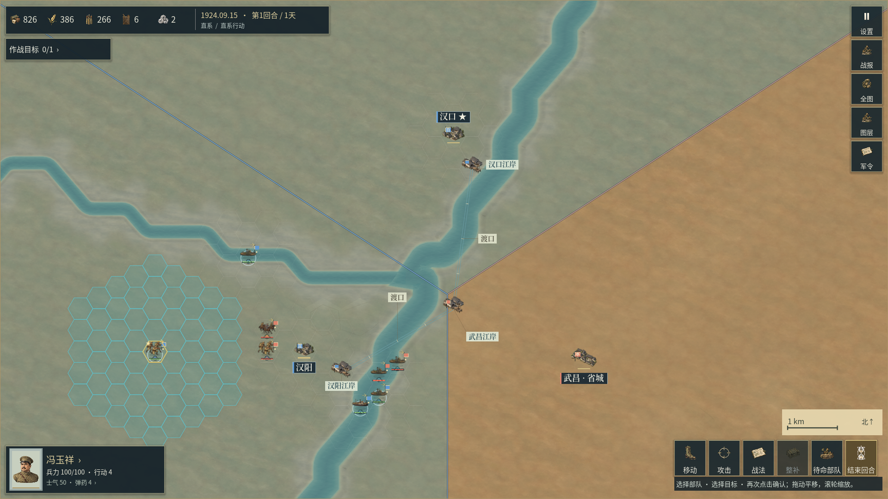
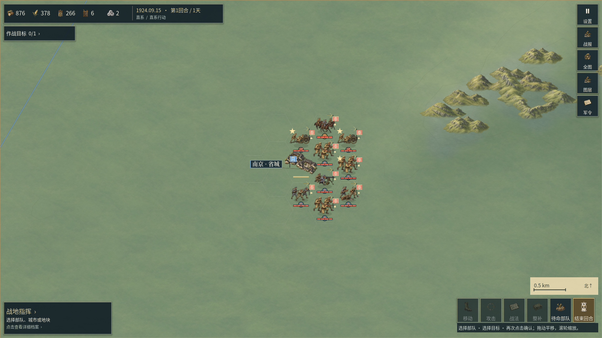
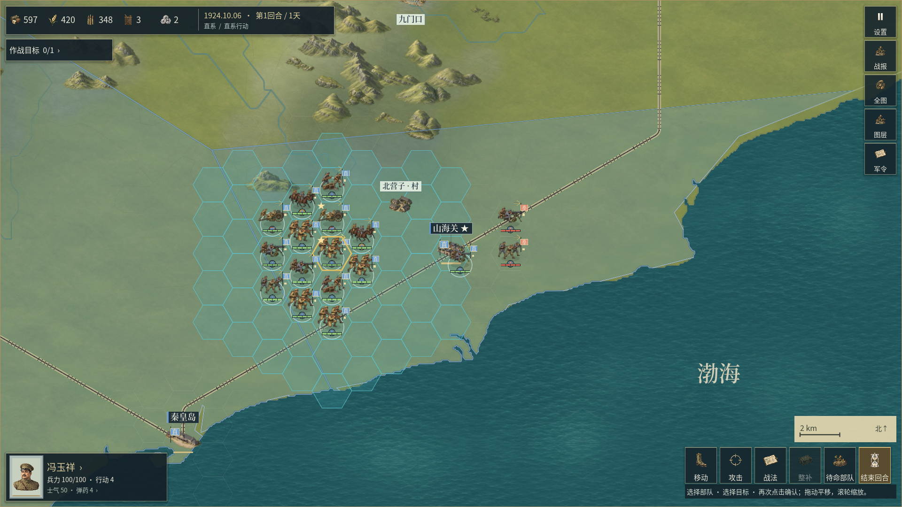

# 地表绘制层次修订（开发中）

本章保留当时的开发阶段身份；修订已随0.2.35合入双端测试包。最新交付和正式程序画面见[55章](55_城市建筑群层级与地图整合.md)。下文的未导出状态和0.2.34版本号属于该阶段记录。

当前源码在已发布的0.2.34之上试装四张新底材，并改善完整地表原图在重复边缘的采样。**本页记录0.2.35开发工作，不是新的Windows／Android交付回执。** 工程内应用版本暂为0.2.34，不能据此把这些开发画面、素材和旧0.2.34安装包视为同一源码身份。已归档的0.2.34包、报告和截图保留各自原始字节，范围见[52章](52_局部战区五倍比例与独立江岸.md)。

本页三张原始查看图保留当时源码身份。后续查出控制区整圈描边会额外强调海岸与内部划分，修复后的正常开发画面与独立检查见[54章](54_控制区共边与海岸描边修复.md)，不覆盖本页历史证据。

## 原图、选材与地图

新增温带草地、冲积壤土、泛滥草甸、亚热带腐殖地四张独立原图。全部通过用户指定的`sub2-image-gen / gpt-image-2.5 / high`路线直接生成，每张实际尺寸1254×1254、完全不透明；请求尺寸1024×1024与返回尺寸分别登记。每张整图和三张安装前的原生地图试装视口已完整查看，随后按原始字节安装。没有从概念图抠图、镜像、裁取、补绘或拼接生产PNG。

| 地表族 | 本轮启用的独立原图 | 画面目的 |
| --- | --- | --- |
| 温带草地 | `tile_ground_hierarchy_v0235_temperate_meadow` | 压低细碎草点，保留安静的橄榄绿地面 |
| 冲积壤土 | `tile_ground_hierarchy_v0235_alluvial_loam` | 减少过强颗粒与黄色斑点，保留浅土色笔触 |
| 泛滥草甸 | `tile_ground_hierarchy_v0235_flood_meadow` | 使用较冷的灰绿层次，给岸边模型留出辨识空间 |
| 亚热带腐殖地 | `tile_ground_hierarchy_v0235_subtropical_humus` | 收敛碎点，保留暖土与橄榄色的区别 |

当前素材登记共2,513张PNG；连续地表仍为20类、20张启用原图，另保留46张被替代原图。新增四张不等于新增四类真实地貌；其余16张启用底材没有替换。四张旧版本继续保留，不覆盖、删除或重新标成新生成。提示词、原图SHA、引擎引用和来源分别记录在[素材清单](../assets/manifest.json)、[便携来源索引](asset-provenance/index.json)及[本轮计划](../presentation/data/ground_material_plan_v0235.json)。

Godot正常导入为384×384、带mipmap的纹理；该尺寸是引擎缓存预算，不是原图尺寸。四个新资源各自生成独立UID。完整原图的引擎副本仍与来源SHA一致，运行时纹理数组逐层保留导入图片及其mipmap。

选材沿用既有地理分配，地表区域、海岸、河道、经纬度、聚落与行政边界不因本轮更换原图而重画。代表性材料用于阅读地图，不冒充1924年植被、耕地或土壤普查。新收集的历史地图资料尚未转为运行时湖泊或城区轮廓；需要可靠地理配准和独立核验后才能安装。

## 重复边缘的运行时处理

对新底材的分析发现，相对边缘的像素并未严格一致；“seamless”提示词不能保证实际边缘一致。原有三路世界坐标平移仍可能露出细窄的矩形接线。

[GroundMaterialBlend](../presentation/ground_material_blend.gd)在每次重复的边缘小范围内，渐混到同一完整原图的半周期平移位置。取样方向保持不变，不镜像或旋转原图；世界坐标、各材料笔触尺度、真实陆地裁切、地格身份和三路平移规则继续有效。片元导数在周期取模之前取得，继续使用导入mipmap。只有边缘片元需要额外取样，实际Android成本尚未测量。

这解决的是材料自身的重复接线。它不能修复来自地理输入的阶梯海岸、折线河道、等高线或简化城市，也不增加不存在的林地、溪流或历史建筑。控制色继续通过既有半透明图层显示，不把底材烘焙成阵营色块。

## 当前检查范围

- 原生Windows Godot正常导入退出码为0，四张新图完成重新导入。
- 地表GPU连续性48项通过：20层导入像素和mipmap保留、独立直接采样校准、生产材质在整面与蜂窝网格上的一致性、多材料绘制次序与平移世界相位等。
- [边缘专项](../tests/ground_source_edges_gpu_test.gd)23项通过：四种实际导入材料、X／Y两个方向，共3,208组边界相邻像素；和未渐混的直接采样对照，合计接线色差降低35.79%。渐混后的边界梯度与独立内部笔触参考接近，没有用压平所有细节来定义合格。

上述都是本机RTX 3060的开发引擎结果，未绑定新的正式EXE，不代表帧率提升、手机性能或整体美术评分。最初诊断要求每一条轴线单独降低30%，腐殖地Y方向未达到；失败记录保留。后续检查加入独立内部笔触参考，要求各轴线改善并接近自然内部梯度，同时保留所有样本合计至少降低30%的门槛；没有修改原图来迎合检查。

20张启用地表的原图、提示词、导入预算和46张被替代原图均已通过[来源检查](../reports/ground_hierarchy_v0235/source_audit.json)。[原生查看记录](../reports/ground_hierarchy_v0235/visual_review.json)保留源码依赖SHA、原始截图SHA及每个场景的实际观察。首次导入回执与安装前的查看记录也独立保留，没有倒写成正式发布。

## 完整游戏画面与剩余问题

以下三张为当前源码经过正常Godot导入后运行的完整1920×1080视口，均已逐张打开查看。没有使用安装前的纹理覆盖脚本，也没有拼接或后期加工。截图中仍显示0.2.34应用身份，实际材质修订是`quiet_ground_hierarchy_v0235_r001`，属于未发布开发工程。



武汉三镇的城市中心、江岸标记和部队均保持可见。底纹比旧材更安静，但城区仍只有小型模型，周围缺少经史料复核的城市轮廓、水网和其他细节；大范围控制区的直线边界属于现有玩法抽象，不能当作精确历史战线。



南京的军阵与山地模型更容易从地面分离，仍有较大的空地、可辨识的重复笔触和过长的折线等高线。更换四张底材并没有解决逐格内容密度或城区尺度的问题。



山海关保留半透明控制覆盖、模型、铁路和水面。海岸仍呈明显的阶梯和折线，部分地面可见多边形斑块；本轮没有将其记为已修复。后续需要逐项核对实际运行的海岸几何和底纹网格，不能用改色或增添虚构地貌掩盖。

商业美术、整体《欧陆战争6》品质和Motorola X30物理验收均未完成，新增原图仍不是正式批准的`game_ready`素材。下一步决定是否冻结这一开发修订并构建双端包；当前已发布包仍是0.2.34。

## 复查入口

[开发验证工具](../tools/verify_ground_hierarchy_development.py)分别提供`edges`、`continuity`、`wuhan`、`nanjing`和`coast`入口，每次使用新的`--attempt`后缀保留旧结果。它等待实际Godot进程退出，保存命令、相关依赖SHA、日志与结果；不会把成功启动进程误报为检查通过，也不启动模拟器。独立克隆时可通过`GODOT_BIN`指向已正常导入工程的原生Godot可执行文件。

```powershell
python tools/verify_ground_hierarchy_development.py edges --attempt _review01
python tools/verify_ground_hierarchy_development.py continuity --attempt _review01
python tools/verify_ground_hierarchy_development.py wuhan --attempt _review01
python tools/verify_ground_hierarchy_development.py nanjing --attempt _review01
python tools/verify_ground_hierarchy_development.py coast --attempt _review01
```

## English

This is development work ahead of the published 0.2.34 binaries. Four independent, immutable Sub2 originals replace four active ground sources; 20 material families remain active, 46 superseded originals are retained, and the registered raster inventory is 2,513. Existing geographic assignments are unchanged.

The production shader feathers repeat boundaries towards a translated sample of the same complete source, without mirroring, editing or saving derived artwork. Forty-eight continuity checks and 23 source-edge checks pass in the native Windows development engine. Across 3,208 diagnostic pixel pairs, aggregate edge contrast falls by 35.79%; this is a scoped rendering measurement, not an artistic score or Android performance result. All three whole gameplay viewports above were individually opened. Sparse cities, repeated brush structure, angular contours and stair-shaped coastlines remain visible. New shipping exports, commercial art approval and physical X30 acceptance are still pending.
