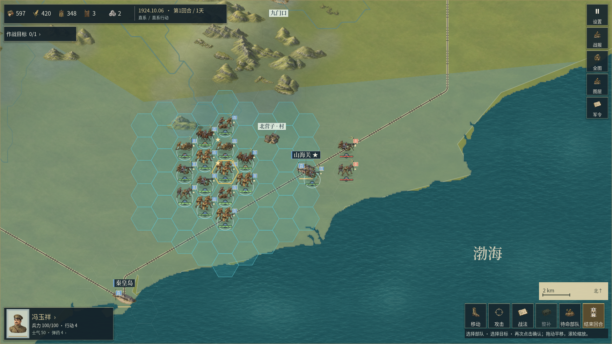
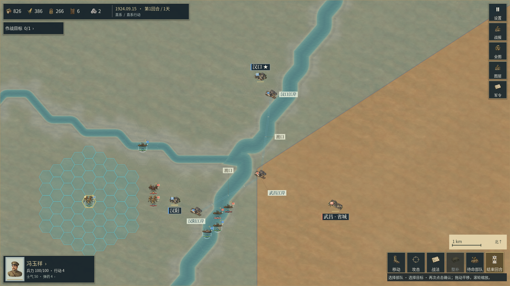
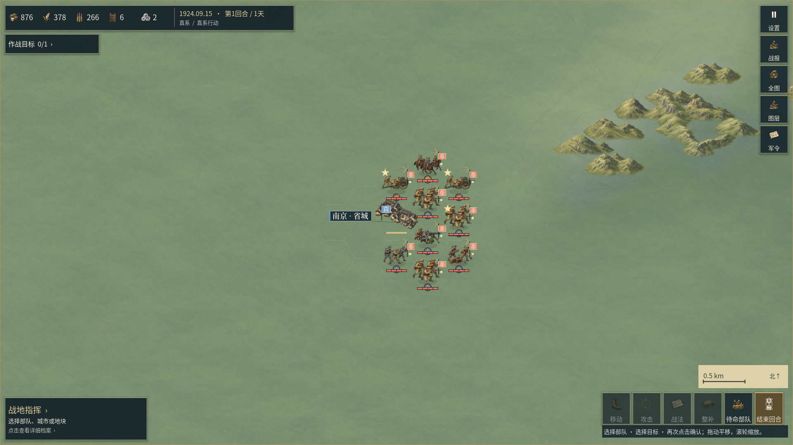

# 控制区共边与海岸描边修复（开发中）

本章继续0.2.35开发修订，前一轮底材见[53章](53_地表绘制层次修订.md)。最新已发布的Windows／Android包仍为0.2.34/code39；本章画面来自正常开发工程，应用版本尚未递增。旧包、旧报告和旧截图没有被倒写成新源码的验收证明。

## 问题与处理

旧绘制程序对每座城市影响区的完整多边形外圈描边。因此海岸、地图边框、同阵营城市间的内部划分也会叠上亮色粗线；相邻影响区的公共线还可能绘制两次。山海关画面中突出的海岸彩线和内陆V形线条包含这类错误，不能全部归因于地理源数据。

新程序保留控制区原有陆地裁切网格与单次半透明填色，只对两块相邻影响区的共边进行政治描边，并同时要求双方当前归属已知且不同。同阵营或任一归属未知时不画；城市被占领、归属改变后重新筛选；视口外线段沿用源线段索引裁剪。海岸和有来源的省界继续使用各自的地理图层。48单位操作蜂窝、0.26城市控制透明度、0.21战略控制透明度保留。

城市影响区仍是玩法抽象，**不是经测绘的历史县界或真实军事战线**。省级底图和影响区之间的区别没有因减少描边而改变。双方不同色的填面也依旧可能形成笔直的分界；本次不把它包装成历史前线。

## 数据与精度

[离线编译器](../tools/compile_control_borders.py)从既有控制区源外圈生成[共边图](../presentation/data/control_border_graph.json)，覆盖京奉、京津、中国东部、汉口、宁浦五图的1920／1922／1924行政期。沿海三图使用当前实际加载的海岸裁切控制区；汉口、宁浦使用现有聚落控制数据。每张图记录地图与控制区源文件的SHA，运行时绑定不匹配就停用该共边图，不回退到整圈描边。

原控制外圈已量化到0.001世界单位，长边拆段后会产生微小数值差异。编译仅用0.002世界单位的窄容差识别相邻线段，并保留第一条原始外圈上的坐标；它不移动真实海岸、河道或省界。输出到小数点后六位。三方交点处的重复小片段在量化后去重，海岸与地图边框附近的线段剔除。该容差是几何数值处理，不是历史资料精度声明。

运行时模块为[MapControlBorders](../presentation/map_control_borders.gd)，由[HistoricalPlaces](../presentation/historical_places.gd)准备，再交给[MapView](../presentation/map_view.gd)绘制。亚洲战略层原有的控制场独立保留；缩略图原本只画填色，无整圈描边，因此无需另做不同的边界规则。

## 验证与完整视口

[源几何审计](../reports/control_borders_v0235/source_audit02.json)86项通过，覆盖五图十五个地图／行政期组合：源文件SHA、整条输出线在双方源边界上的支持、海岸及边框排除、共边与线段去重、长度自洽，以及独立精确交集所要求的有效共边保留。规则、地理、经济、媒体源与`0d78d69`比较保持字节一致。

最初审计在三图的三方交点检出微小重复，失败记录与当时图数据保留于`source_audit01.json`、`graph01_before_junction_dedup.json`；定稿修复了重复，没有降低审计门槛来跳过。[运行交互专项](../reports/control_borders_v0235/rules02/validation.json)130项通过，见[测试脚本](../tests/control_borders_test.gd)：检查五图三个行政期、同阵营无描边、城市易手后出现／移除共边、未知归属、省外视口裁剪、源身份失配拒绝和原图数据不变。合计216项是本次专项，不是重复执行了完整30组回归。

以下是通过正常场景启动取得的1920×1080完整Godot视口，没有使用过程内图层隔离脚本，没有拼接、裁图、补绘或叠字。命令、引擎身份、代码／内容依赖SHA、原始PNG与元数据分别保存于`reports/control_borders_v0235/`，完整查看范围见[查看记录](../reports/control_borders_v0235/visual_review.json)。本机为Windows／RTX 3060，不能代表手机GPU表现。



海岸多余的亮色控制线和同阵营内部V形描边消失，控制区半透明覆盖仍在。地理源数据中的阶梯、细碎岬角，地面的多边形明暗及重复笔触仍可见；未记为已修复。



汉口、汉阳同属一方时不再对内部影响区画政治线；与另一方武昌之间的共边仍然绘制。河道折线、稀疏城区和影响区的长直线仍待后续处理。



南京军阵和山体仍可辨识，大面积空地与简化城市没有因边界修复而增加细节。本轮未新增栅格素材或音乐。后续配乐继续使用用户指定的远程YuE2／RTX 3080纯器乐路线，既有三首本地原曲来源保留。

## 复查与边界

```powershell
python tools/audit_control_borders.py --output reports/control_borders_v0235/source_audit_review01.json
python tools/verify_control_borders_development.py rules --attempt review01
python tools/verify_control_borders_development.py coast --attempt review01
python tools/verify_control_borders_development.py wuhan --attempt review01
python tools/verify_control_borders_development.py nanjing --attempt review01
```

离线几何工具需要本机原生Python和Shapely；游戏运行不需要Python。原生验证等待实际Godot子进程退出并检查错误，使用新的尝试名保留旧证据；可通过`GODOT_BIN`指定引擎。没有调用Docker、WSL或模拟器。

本章未完成新双端导出、商业美术签核、全兵种动作或Motorola X30物理验收，也不宣称整体达到《欧陆战争6》品质。当前定稿仅关闭错误的控制区整圈描边问题，其他差距继续单独记录。

## English

Development work ahead of published 0.2.34. Control outlines now use one shared edge between adjacent influence areas only when both current owners are known and different. Friendly subdivisions, shorelines and map frames no longer receive political strokes. Translucent fill meshes, province lines, rule geography and source artwork remain unchanged. These influence edges are gameplay abstractions, not surveyed historical military fronts.

The five-map, three-period graph is bound to source hashes. Eighty-six geometry checks verify support by both original boundaries, removal of coastal/frame strokes and duplicates, and retention of required exact shared borders. Native interaction checks exercise owner changes, unknown ownership, culling and stale-source rejection. The whole viewports above come from the normal Windows development scene. New shipping packages, complete art/animation approval and physical X30 acceptance are pending; existing local music provenance remains intact and future music uses the requested remote YuE2 route.
