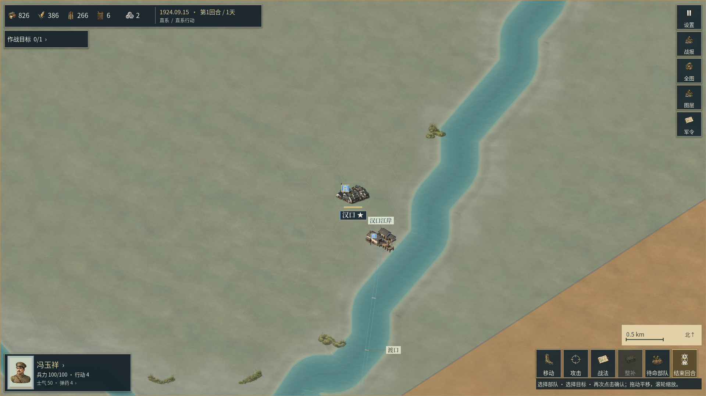
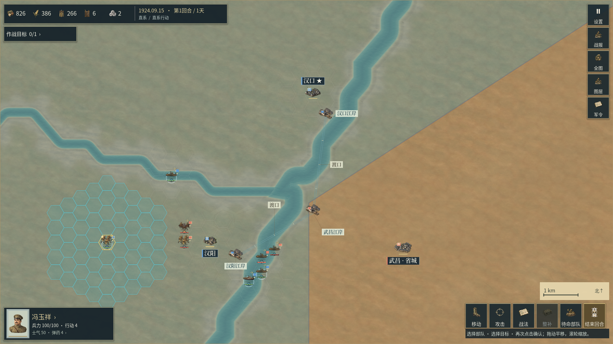
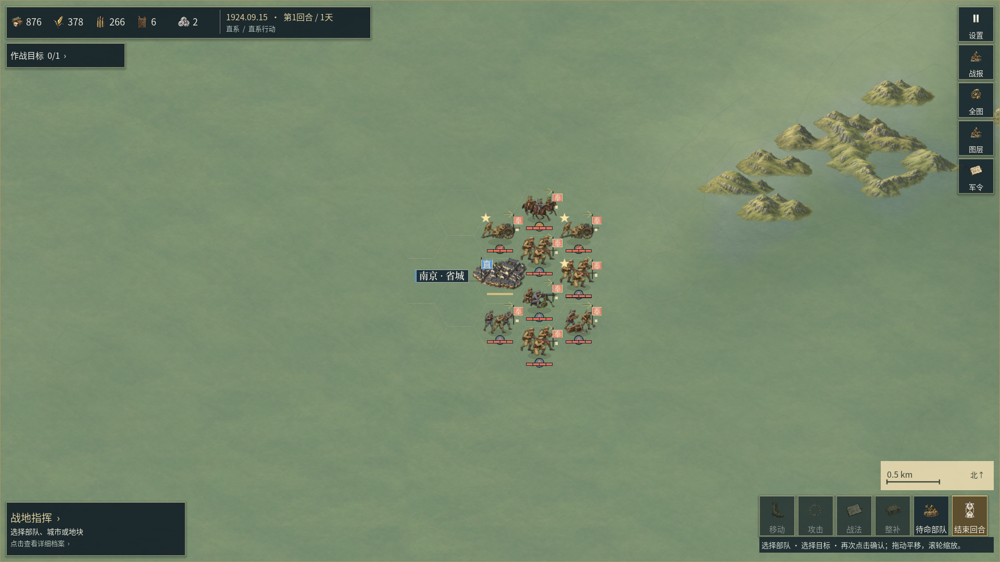

# 城市建筑群层级与地图整合：0.2.35

本轮把[53章地表修订](53_地表绘制层次修订.md)、[54章控制区共边修复](54_控制区共边与海岸描边修复.md)和新的城市建筑群合入同一版本。Windows与Android导出、最终程序视口及验证结果分别记录；此前的开发试图和0.2.34发布证据保留原版本身份。本章不是整体《欧陆战争6》品质签核。

## 城市为何显得过小、过于相似

旧选择器把历史类型`city`统一映射到县城素材；如果节点有车站或港口，主建筑还可能换成单个交通设施。城市、省城、县城的差别因此没有通过建筑密度表达出来。原有南方省城的少量独立院落也不足以表现城市群。

新增八张独立Sub2原图，分为北方城市、南方城市、北方省城、南方省城四组，每组两张。城市以密集灰瓦屋顶、窄街和连续建筑组团为主；省城增加街区层级和适量公署院落。它们是与地区建筑风格相容的战略符号，不是对某座真实城市的测绘复原，不凭空加上已命名地标、历史街道、城墙或城区占地。

城市与省城的可见模型仍限制在88×68、100×78世界单位内，操作蜂窝半径仍为48，普通部队仍为76×68。原图全幅显示，用已有透明边界确定脚点；没有裁图、翻转、重绘或离线拼接。Godot采用384像素上限、无损导入与mipmap控制运行负载，不把导入产物计为新原图。

## 历史类型和交通设施

使用节点的实际地理位置与有日期的聚落类型选建筑，不使用当前占领方的建筑风格。汉口是城市、武昌和南京是省城；汉阳沿用登记的县城类型，不为追求更密的建筑而改成大城市。天津仍按1924年的省城类型显示，1925年开始按现有日期约束显示为城市；石家庄沿用当时的集镇类型。

已有合适地区族的城市使用新的专属建筑群；其他地区沿用已有通用类型，缺乏对应资料的特殊城市不硬套中国建筑。八张旧省城原图仍存储、登记并可追溯，但退出这四组当前活动选择。四组新的建筑群在局部大视野内做稳定分配；平移和缩放不会随机换图。每组仅两张，不能宣称整张亚洲地图绝不重复。

城市主模型不再被车站或码头取代。设施等级、建设、运输、港口规则继续读取真实对局数据；已有独立江岸港口仍在源坐标单独绘制。截图的素材使用元数据同步读取实际城市绘制结果，区域符号视图不会误记为正在显示建筑原图。

## 原图与登记

- [生产计划](../presentation/data/map_urban_extension_plan.json)、[实际生成记录](../reports/map_urban_extension_generation.json)、[提示词](asset-prompts/)和[可携来源索引](asset-provenance/index.json)保存八张图的来源。
- 原始生成结果已逐张完整查看，运行副本与原图逐字节一致。两张先行试稿和其余六张均保留在工作区原生成目录，没有覆盖旧源图。
- 全部PNG从2,513增至2,521；其中地图原图存储1,027张。当前运行目录登记981张，其中8张旧省城图退出自动选择，因此自动选图池为973张；另有46张旧底材仅保留存储。不能用存储数冒充当前可见种类。
- 地图扩展目录从796增至804条，其中地表176、景物480、聚落148。该目录不是全部地图资源；原始74张基线与后续地表、水纹目录单独登记。
- 本轮没有生成音乐。后续配乐固定使用用户指定的`C:/Users/carzy/.codex/skills/music-gen-remote-YuE2/SKILL.md`，由远端RTX 3080生成无台词、无歌词的纯器乐。已有三首本地原曲及旧交付来源保留。

## 已完成的开发检查

[原图审计](../reports/urban_hierarchy_v0235/source_audit.json)确认804条地图扩展记录的生成原图、引擎副本、提示词、透明边界和导入预算相符。[与0.2.34发布源码的对照](../reports/urban_hierarchy_v0235/scope.json)2,638项通过，保留已有2,509张原图及历史、地理、经济、军队、存档、音频和规则代码；允许的内容登记器差异仅是应用版本递增。

[城市专项](../reports/urban_hierarchy_v0235/rules03/validation.json)64项通过，覆盖真实剧本城市选择、历史类型、占领后建筑保持、交通设施不吞掉城市主体、全幅原图比例与脚点、正常导入内存上限及唯一UID、缩放与重建稳定、实际绘制素材元数据和独立江岸。

首次专项试验错误地把汉阳预期为城市，并把未在该战役中作为可战斗城池出场的天津当成必有城池；错误记录保留于`rules01`。修正了测试预期和缺失节点的失败处理，没有改写历史类型或战役城池规则来迎合测试。`rules02`为修正后的0.2.34开发身份，`rules03`为递增后的0.2.35身份。

以下三张是已完整查看的普通开发视口，不是最终Windows导出截图：






城市轮廓比旧县城模型更密集，但大量平地仍空，低地笔触仍偏均匀，河道的粗折线和岸边细节不足仍然明显。这些问题没有因为本轮增加八张城市图而记为已完成。地格植被、支流、历史城区范围需要可支持的地理资料；不以任意添加森林、溪流或道路填空。

## 双端验证与交付

0.2.35 / Android versionCode40已完成同源Windows x86_64与Android ARM64/ARMv7导出。[完整回归依赖封存](../reports/regression_dependency_evidence.json)确认30组、14,585项通过，内容身份仍为`1f7e449dc80b289ab5274fda5636519d1e3a320062d04f95374669302b754256`，两端运行源码身份为`e3e9f0defc159cf3f5f9ece2d5628f7e199e1eb5a7b355093cfc63d42bc77224`。

| 核验范围 | 本版实际结果 |
| --- | --- |
| [城市专项](../reports/urban_hierarchy_v0235/rules03/validation.json) | 64项通过 |
| [原生HUD输入](../reports/battle_hud_native_v0230/map_visual_v0235_01/validation.json) | 三种尺寸/输入条件，773项通过；30张自动截图不等同逐张人工美术签核 |
| [正式EXE地图视口](../reports/urban_hierarchy_v0235/composition_shipping01/validation.json) | 13个镜头、106项布局检查通过 |
| [正式EXE地表与界面](../reports/urban_hierarchy_v0235/shipping01/validation.json) | 48项GPU检查及菜单、界面冒烟、山地视口通过 |
| [原图边缘GPU检查](../reports/ground_hierarchy_v0235/edgesshipping_source01/validation.json) | 23项通过 |
| [实际查看记录](../reports/urban_hierarchy_v0235/visual_review.json) | 以上最终程序16张整幅图均已逐张打开 |
| [Android包载荷](../reports/apk_content_validation.json) | 签名v2/v3、双架构、无权限声明、144份数据/说明、2,521张当前贴图及三首既有音乐载荷通过 |

以下两张来自本版正式Windows程序，完整视口按原字节复制；更多整幅图见[媒体目录](MEDIA.md)。




城市建筑群更密集，但平地细节不足、支流折线化、港口素材重复、部分地面色面边界突兀及海岸阶梯仍然可见。全兵种完整动作、亚洲起局逐项史实修订、长期AI平衡、商业美术与物理Motorola X30验收仍未完成。2400×1080桌面触摸布局不能替代物理手机；开发试图不能替代正式EXE证据。

本版归档目录为原工作区`output/releases/railway-warlords-0.2.35/`，包含Windows压缩包、签名APK和证据压缩包。归档终态由`reports/map_visual_preview_v0235.json`及归档目录的`preview_manifest.json`单独记录，不覆盖0.2.34及此前交付。

## 复查

```powershell
python tools/audit_map_bank.py --output reports/urban_hierarchy_v0235/review_source_audit.json
python tools/verify_urban_hierarchy.py rules --attempt review01
python tools/capture_map_composition.py --development --local-refinement --evidence-root reports/urban_hierarchy_v0235/review_composition01
```

各原生试验使用新目录，等待所启动的实际Windows子进程结束并检查错误。未使用Docker、WSL、虚拟机、Android模拟器或合成实机图。

## English

Version 0.2.35 combines the four ground originals and shared-edge control outlines from chapters 53–54 with eight new whole urban originals. Four explicit north/south city and province-seat families replace the blanket city-to-county mapping. A station no longer replaces the main urban model; real transport facilities and separate river-bank ports retain their rules and anchors. Whole-source aspect, alpha foot, existing model budgets, unit sizes and 48-unit operation hexes are preserved.

Historical rank remains authoritative: Hanyang stays a county symbol, Hankou a city, Wuchang and Nanjing province seats, and Tianjin follows the existing dated role transition. The models are representative architectural symbols, not surveyed historical urban footprints. Old originals retain their bytes and provenance. There are 2,521 registered PNGs, including 1,027 stored map originals and 973 selectable map originals after retiring older macrogrounds and province-seat models.

The 64 urban checks pass on the current source; initial incorrect test assumptions retain their failed attempt. The first three images above are development viewports; the last two are whole shipping-Windows images. Windows and signed Android/code40 share the same runtime identity. All 30 regression groups / 14,585 checks, 773 native HUD input checks, 106 shipping map-layout checks, 48 shipping GPU checks and 23 source-edge GPU checks pass. Sixteen whole final-application images were individually opened. APK signatures, both ABIs, 144 data/notice files, all 2,521 current texture imports and three existing music imports are verified. Archive completion has its own manifest. Flat land detail, angular rivers, repeated ports, abrupt color boundaries, physical X30 acceptance, complete unit actions, dated Asian starting states, long-run balance and final EW6 art parity remain unfinished. Future instrumental music uses the requested remote YuE2 / RTX 3080 route; existing local tracks keep their actual provenance.
