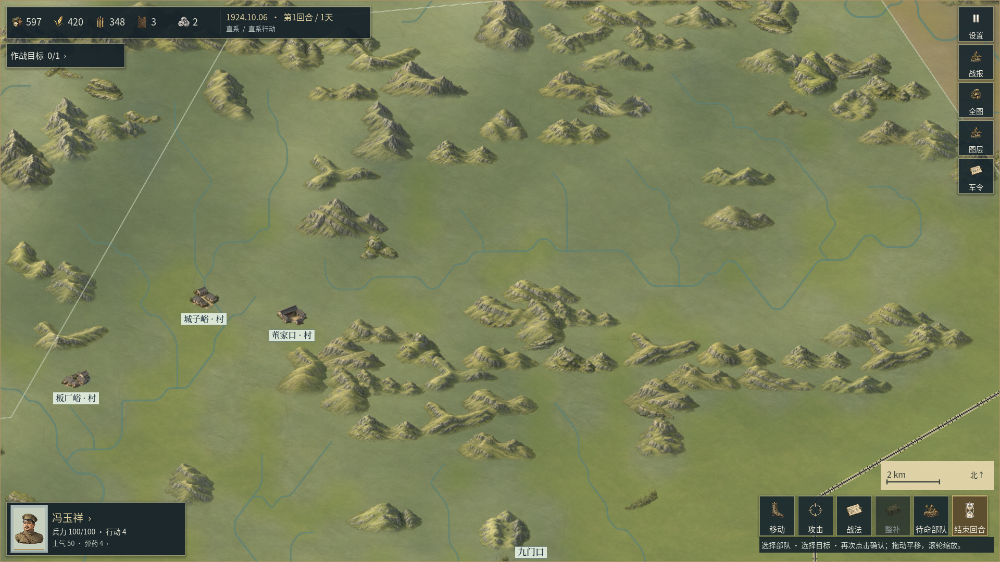
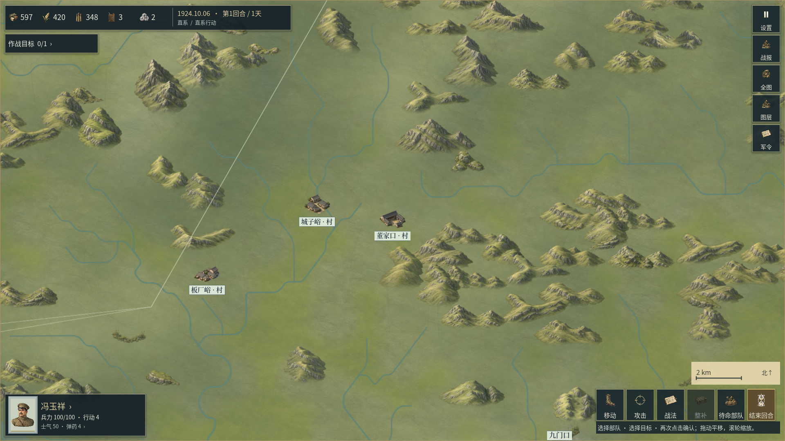
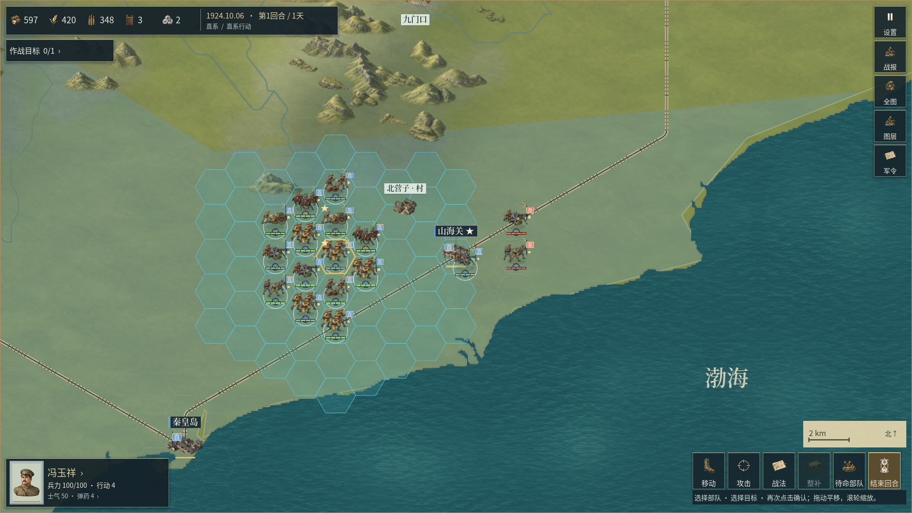
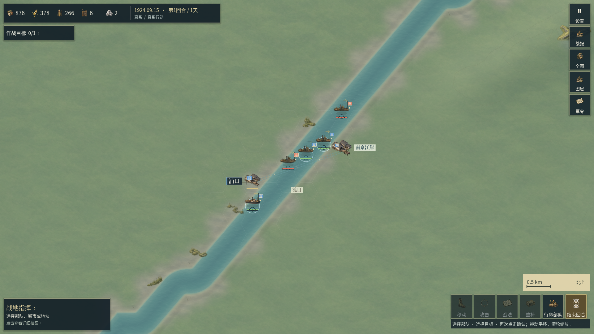

# 细水系圆角与水床显示 · 开发记录

本章记录0.2.35发布后的河道显示修订。当前安装包仍为0.2.35/code40；本章中的新代码和新画面尚未导出为Windows或Android安装包。证据目录使用`river_cartography_v0236`作为下一轮研发编号，不表示已经发布0.2.36，原生报告仍如实记录运行时的0.2.35版本常量。

实际目标是减轻细支流的亮线、源折点处的尖角，同时保留真实水系来源和连接。它只解决地图画面的一部分；地表重复、海岸台阶、山体重复、全兵种动作与整体《欧陆战争6》品质仍未完成。

## 来源与地理边界

细水系仍使用已存档的HydroRIVERS河段，不添加随机曲流、杜撰支流或虚构历史河名。官方说明其核心由15角秒栅格提取，入选河道涉及集水面积或流量阈值，因此它不能代表每条溪流，也不是1840—1940年逐年的河岸测绘。参见[HydroRIVERS官方资料](https://www.hydrosheds.org/products/hydrorivers)。

本轮原始河道数组、地理数据、年代区划、规则水格、桥渡、城市、港口和交通数据不变。细水系主要作用于地图表现；是否能过河、补给如何衰减仍由既有规则数据决定。

显示圆角允许的位移按各地图`hex_radius_m`换算，预算为60米。这是显示概化的上限，不是历史河岸精度或大地测量精度。河宽仍是按河级绘制的符号宽度，不能解读为测得的真实河宽；柔和岸缘也不表示已调查的沿岸植被。

## 实现

`MapHydrography.rounded_source_corners()`将原折点附近的两段直线替换为等切距二次曲线。对于转角θ，切距不超过`1.98 × D / sin(θ/2)`，同时不超过相邻较短边的45%。其中D为显示位移预算，1%的余量用于实际引擎float32坐标和离散曲线顶点。

每个圆角按转角细分为4—30段，段数保持偶数，包含曲线中点。原有河段首尾坐标保持精确相同；相邻圆角不会占满共同边。源数组与显示数组分别保存，未用显示线回写规则地图。

对宽度小于3.6世界单位的细流，改用三层较轻的岸缘和两层水床颜色，取消贯穿中心的高亮轴线。与原实现一样是五次线绘制；较宽主河继续使用既有渐变水面、世界坐标水纹和源端点接头。本轮未生成、裁切、重绘或改色任何栅格原图，也未生成或替换配乐。

90度夹具的最大局部折角由旧实现的28.07度降至7.59度。这个夹具度量说明细分后的转角更平顺，不是对整张地图美术质量的评分。

## 实际验证

| 范围 | 本轮结果 | 边界 |
| --- | --- | --- |
| 原生几何专项 | 12项通过，导出六图25,522条实际源线／显示线 | 直接调用正常生产代码，不以Python复写圆角算法代替引擎 |
| 独立距离与来源核验 | 103,246项检查通过；19,805条显示线发生变化 | 检查项包含逐河段重复约束，不等同于十万种玩法测试 |
| 连续双向距离约束 | 全部完整曲线在对方60米缓冲内；最大采样对称距离59.686米 | 连续包容是通过条件；采样Hausdorff值仅作描述 |
| 接触图 | 24,436条HydroRIVERS河段、23,647组连接保持；15项通过 | 五图适用；亚洲战略图没有该类细水系；不将混合Natural Earth线强行视为同一拓扑 |
| 自交 | 未新增源线原本不存在的自交 | 精确GEOS线段相交检查，不是视觉人工推断 |
| 已有规则专项 | 河面48项、地理选材39项、材质连续39项，共126项通过 | 未重跑全部30组回归，旧版本全量报告保持原身份 |
| 完整画面 | 山地、村镇、山海关和长江江岸四幅最终开发视口已逐张完整查看 | 原生Windows开发引擎，非最终EXE或物理X30验收 |

原始JSON双精度坐标作为距离核验依据；不是只比较引擎内部两个float32副本。连续约束通过GEOS双向完整线缓冲包容检查，60米正预算不加通过容差。最大显示顶点到源线的距离为56.556米。原生内容身份保持`1f7e449dc80b289ab5274fda5636519d1e3a320062d04f95374669302b754256`。

最终证据：

- [原生几何与实际生产源码身份](../reports/river_cartography_v0236/revised/geometry03/command.json)、[原生执行回执](../reports/river_cartography_v0236/revised/geometry03/result.json)。
- [独立连续距离、来源数组与逐河段结果](../reports/river_cartography_v0236/geometry_audit03.json)。
- [独立河段接触图与自交检查](../reports/river_cartography_v0236/contact_graph01.json)。
- [河面专项](../reports/river_cartography_v0236/revised/river_rules01/validation.json)、[地理专项](../reports/river_cartography_v0236/revised/surface_rules01/validation.json)、[连续材质专项](../reports/river_cartography_v0236/revised/material_rules01/validation.json)。
- [7,935个受保护文件的原始字节保持核验](../reports/river_cartography_v0236/protected_scope01.json)、[四幅完整画面的实际查看记录](../reports/river_cartography_v0236/visual_review01.json)、[本轮开发范围汇总](../reports/river_cartography_v0236/development_summary01.json)。
- [文档、原图与来源完整性检查](../reports/river_cartography_v0236/repository_documentation01.json)：43份公开文档及当时1,101个本地链接通过，2,521张原图与提示词核验通过。后加的本条证据链接另由提交前链接检查复核；该报告不表示正式双端发布门槛已完成。

## 原生拖动测量

使用普通`app/main.tscn`和正常生产MapView，保留60 FPS上限与原垂直同步，不替换任何生产文件。每个布局预热后沿同一山地路径移动相机180帧，以`frame_post_draw`记录间隔。两次运行均保持对局状态不变，但仍有卡顿；这不是画质或流畅度的通过门槛。

| 原生Windows布局 | 中位毫秒 | 95分位毫秒 | 最长毫秒 | 焦点帧数 |
| --- | --- | --- | --- | --- |
| 1920×1080桌面 | 16.48 | 46.50 | 124.68 | 180 / 180 |
| 2400×1080手机尺寸UI | 16.41 | 46.72 | 141.20 | 0 / 180 |

硬件为RTX 3060。手机尺寸这次没有窗口焦点，只用来记录Windows布局与绘制，不能视为前台手机性能；没有调用模拟器。后台其他程序负载未完全控制，也没有同条件旧实现对照。桌面样本有11次静态背景重建，并出现1次新增同步素材读取，卡顿原因仍需后续分析，不能将尖峰归因于或排除本轮曲线变更。

详细数据：[桌面原始逐帧样本](../reports/river_cartography_v0236/revised/perf_desktop01/pan.json)与[执行回执](../reports/river_cartography_v0236/revised/perf_desktop01/result.json)；[手机尺寸原始样本](../reports/river_cartography_v0236/revised/perf_touch_dimensions01/pan.json)与[执行回执](../reports/river_cartography_v0236/revised/perf_touch_dimensions01/result.json)。

## 完整原生画面与实际差距

以下均为未拼接、未裁切、未叠字的完整1920×1080原生视口；相机参数和执行源码身份保存在同目录JSON中。它们仍能看出来源栅格造成的长直段、重复山体和大片相似地表，不能作为整体美术达标的证明。



山地细流的轴线亮边减弱，转角更连续；原源线的阶梯分布和长直段仍可见，山体素材重复仍明显。



村镇镜头保留实际地理选材；没有为填满空地而添加未经来源支持的林地或聚落。大面积灰绿色地表的相似质感仍待改进。



山海关附近细流应用相同新样式；海岸台阶和大面积控制色块的观感仍需后续修订，本轮没有用平滑河道掩盖海岸问题。



较宽主河仍有连续渐变水面与水纹，港口／渡口标注保持原位置。重复港口模型、江岸折线和空旷地面仍与目标作品存在明显差距。

## 保留的失败与中间尝试

`geometry_audit01.json`有5,124项失败：奇数细分没有包含中点，直线弦会略超过预算。第二次改为偶数细分后，`geometry_audit02.json`仅在容许float32误差时通过，最大采样距离约60.214米；它不作为严格60米验收。本次最终采用1%余量并以存档JSON核验，见`geometry_audit03.json`。

`mountains01/02`保留各自中间阶段，最终山地画面为`mountains03`。`yangtze01`相机对准南京城市，虽然程序正常退出，却没有展示主河，不计为河面画面验收；修正相机后的`yangtze02`才用于本章江岸检查。失败文件、原始输出和旧版本证据没有被新结果覆盖。

## 复查入口

原生工具链为Windows Godot 4.7.2。执行新尝试时使用新的`--attempt`编号，控制器禁止覆盖已有目录；独立审计的`--output`也须指定新文件。

```powershell
python tools/verify_river_cartography.py geometry --phase revised --attempt 04
python tools/verify_river_cartography.py mountains --phase revised --attempt 04
python tools/measure_river_pan.py desktop --attempt 02
```

上述命令不会发布新包。双端交付仍需冻结新源码、完成对应回归、正式导出并核对载荷，再分别记录Windows与实际Android设备的验收结果。
