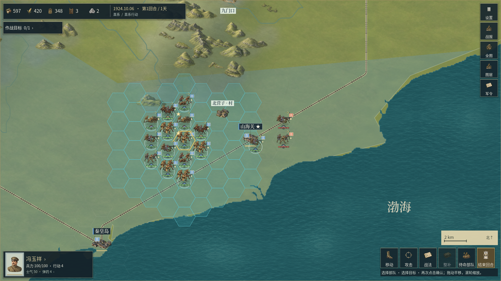
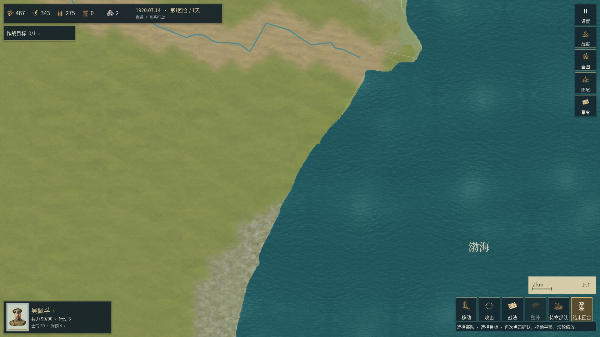
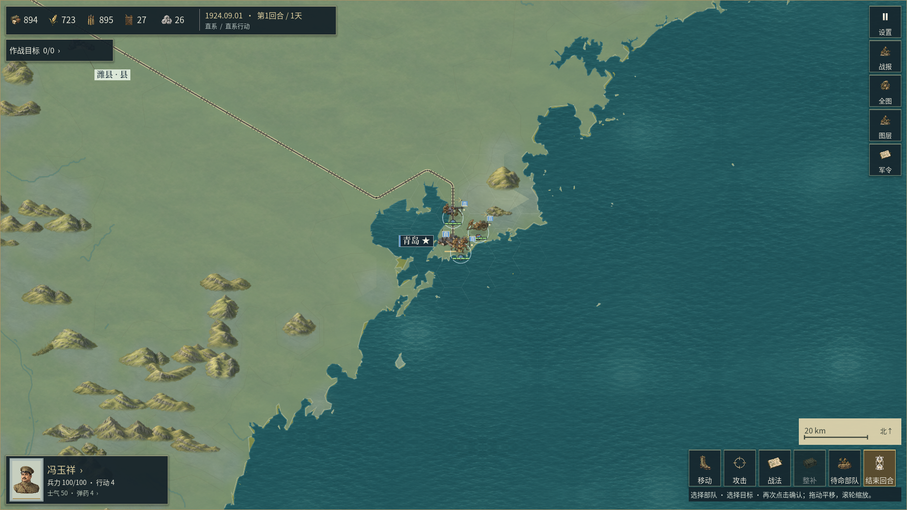
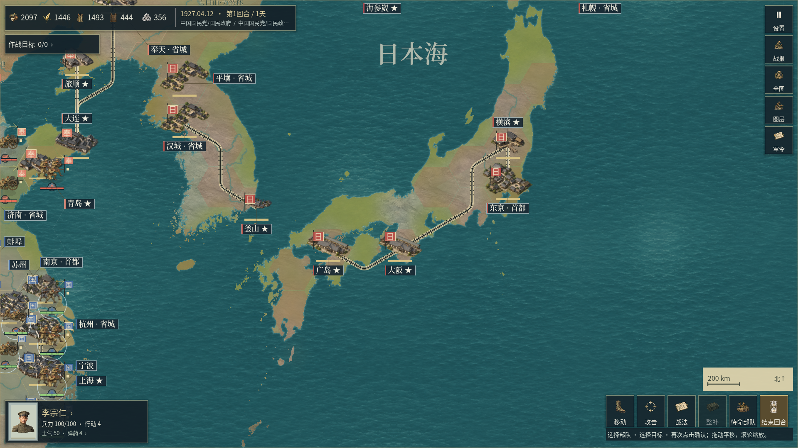

# 源岸线方向与柔和海岸过渡 · 开发记录

本章记录0.2.35发布后的海岸显示开发，与[细水系修订](56_细水系圆角与水床显示.md)共同保存在当前源码中。安装包仍为0.2.35/code40，新源码尚未导出为Windows或Android安装包。证据目录中的`v0236`是研发编号，原生报告保留实际的0.2.35版本常量。

本次改善海陆交界的颜色层次、小岛周围的过宽光晕及岸缘准备耗时。来源中的海岸台阶、大面积相似地表、重复山体、政治色块和全兵种动作仍有明显差距，整体《欧陆战争6》美术目标尚未完成。

## 参考与来源

重新查看了[EasyTech官方手册](https://ew6w.ieasytech.com/manual/en/?fwg=website)中已存档的菜单与战场整幅画面，参考海陆边界较柔和的水色过渡、暖色细边和地表层次。官方图片只用于观察；游戏采用自己的材质、运行网格和配色。

海岸仍使用已登记的GSHHG 2.3.7 L1来源，四图分别沿用full／high／intermediate精度。原始`render_coast`、陆地多边形、离线三角网、城市、行政区、交通、规则地格和年代数据保留原字节。[NOAA资料](https://www.ngdc.noaa.gov/mgg/shorelines/shorelines.html)说明其来源与分辨率；[官方2.3.7发布](https://github.com/GenericMappingTools/gshhg-gmt/releases/tag/2.3.7)用于核对原始包。GSHHG是自然地理参考，不能当作1840—1940年逐年历史岸线测绘。

岸缘宽度与颜色属于制图符号。海滩、礁石、潮间带、水深和历史围垦需要各自来源支持，本轮没有增加这些地貌判断或栅格素材，也没有改写水陆通行规则。

## 显示与实现

原有对称细带改为有海陆方向的渐淡过渡：陆侧低饱和阴影、中心暖色细边、水侧蓝绿色淡洗。普通已分类岸缘的名义宽度为陆侧1.8、水侧4.0世界单位；转角miter上限1.35，对应最大偏移2.43／5.4世界单位。顶点颜色alpha最高0.36，水线中心仍为原坐标。

海陆方向先由来源陆地外环及原有内洞的精确共边确定。使用标量双精度计算环方向，逐段确认共边方向；冲突或没有精确依据的碎片使用窄幅中性带。实际生产调用不再对每个小岛重复扫描陆地三角网。

闭合小岛／水洞另按源环面积A与周长P限制符号宽度，令R＝2A/P，宽度比例为`min(1, R/16)`。因此水侧名义宽度不超过`min(4, R/4)`。这只缩小显示带，保留每个来源中心点，并避免几像素的小岛被宽光晕吞没；R不代表水深或真实潮汐宽度。全部海岸继续合为一次网格绘制。

## 实际验证

最终原生专项57项通过，逐一检查六图185,351个实际网格水线中心顶点与引擎float32来源坐标相同，包含闭环接缝、反向线、内洞、负坐标、小岛宽度和中性回退。六图来源数据及规则指纹保持；原生内容身份仍为`1f7e449dc80b289ab5274fda5636519d1e3a320062d04f95374669302b754256`。

| 地图 | 来源岸线条数 | 已分类 | 中性碎片 | 本次岸带准备毫秒 |
| --- | --- | --- | --- | --- |
| 京奉／山海关 | 62 | 62 | 0 | 232.06 |
| 京津／天津 | 1 | 1 | 0 | 19.43 |
| 中国全图／青岛 | 5,295 | 5,295 | 0 | 836.69 |
| 亚洲战略／大阪 | 12,136 | 10,959 | 1,177 | 1,990.11 |

汉口、宁浦沿用各自内陆水面，来源海岸线为0。表中为本次Windows原生无窗口检查的岸带网格构建耗时，另有边界索引、内容加载等准备步骤；后台负载未完全控制，不是整体启动时间、帧率门槛或物理手机性能。

独立GIS对全部16,317条已分类岸线，使用归档三角网的实际float32顶点建立GEOS陆地索引，再在边的两侧探点核对方向。它没有导入生产方向判断或用同一环方向算法作为真值。最终有24项报告约束通过，其中无原生查询的条件项只是空集检查；实际覆盖以16,317条独立复核岸线为准，不把检查数量相加当作玩法覆盖率。1,177条未分类碎片保留窄幅中性过渡，没有承诺其海陆侧或具体地貌。

本轮还在最终颜色收窄前完成61项既有海岸几何检查，其源码身份单独保留；随后颜色与显示宽度修订由最终57项和完整场景复核覆盖。没有重跑30组全量回归、生成新原图、替换音乐或完成物理X30验收。

- [最终原生57项及逐地图网格检查](../reports/shore_presentation_v0236/revised/shore_rules06/validation.json)、[实际执行与源文件身份](../reports/shore_presentation_v0236/revised/shore_rules06/command.json)。
- [独立GIS方向检查及逐岸线探点](../reports/shore_presentation_v0236/shore_side_audit06.json)、[收窄颜色前的既有海岸61项](../reports/shore_presentation_v0236/revised/coast_rules05/validation.json)。
- [四张基线与四张最终整幅画面的实际查看记录](../reports/shore_presentation_v0236/visual_review01.json)、[官方参考查看记录](../reports/shore_presentation_v0236/official_reference_review01.json)。
- [7,936个受保护文件的原始字节检查](../reports/shore_presentation_v0236/protected_scope06.json)：相对上一轮河道提交，仅两份生产脚本改变；2,521张PNG、原地理／历史／规则数据与配乐保持原字节。字节保持说明变更范围，不能替代历史准确性审核。
- [文档与来源完整性检查](../reports/shore_presentation_v0236/repository_documentation01.json)：44份公开文档、校验时1,120个本地链接和2,521组原图／提示词通过；本条新增证据链接另由提交前检查复核。历史GIF保留实际旧版本身份，完整正式发布门槛没有重跑。
- [本轮开发汇总](../reports/shore_presentation_v0236/development_summary01.json)：源码、技术检查、实际整幅查看、正式美术及物理设备状态分别记录。

## 完整开发画面

以下均为直接保存的完整1920×1080原生Windows开发视口，逐张完整查看；没有裁切、拼接、补绘或叠字。它们展示本次局部修订，也保留总体美术仍未达标的实际差距。



岸缘较轻，水线与战场布局保持；来源台阶、岸边楔形色块和重复山体仍可见。



水侧过渡保持克制；大面积相似地表、南侧泛白底材和上部控制色折角仍需处理。镜头用于沿岸检查，不是天津城市中心展示。



半岛、港湾和小岛沿用来源形状；水侧淡洗减弱硬切观感，海岸折点、空旷地面与重复地貌仍明显。



相较被否决的第五版，密集碎岛的宽光晕明显减轻；政治六边块、大面积相似地表和远景细节仍未达到目标作品的精细度。

## 保留的迭代

首版的法线符号与网格约定相反，六个方向夹具失败，宽水色画在了陆侧；已存档于`rejected01`。第二版跨图检查在360秒超时，记录在`performance02`。第三版51项原生检查通过，但整场景发现变量名错误，亚洲岸缘准备约49秒；见`boundary03`。

第四版通过51项与独立GIS检查，但亚洲图仍因碎岛查询耗时约31秒；见`performance04`。第五版采用中性回退，通过52项原生和独立GIS检查；实际整幅查看又发现密集碎岛光晕过大，因此继续缩窄、减淡并增加源环尺寸约束，见`visual05`。这些耗时来自不同后台负载下的开发检查，不能用于严格版本速度比较或推断手机性能。

## 复查

```powershell
python tools/verify_shore_presentation.py shore_rules --phase revised --attempt 07
python tools/verify_shore_presentation.py osaka --phase revised --attempt 07
```

每次须使用新尝试编号；控制器保存引擎、源码、数据及执行回执，拒绝覆盖旧目录。独立GIS工具为`tools/audit_shore_sides.py`，原始字节保持工具为`tools/audit_shore_scope.py`。完整视口由Godot直接保存，原图保持不变。后续配乐继续按用户指定的远程YuE2／RTX 3080纯器乐路线制作。
