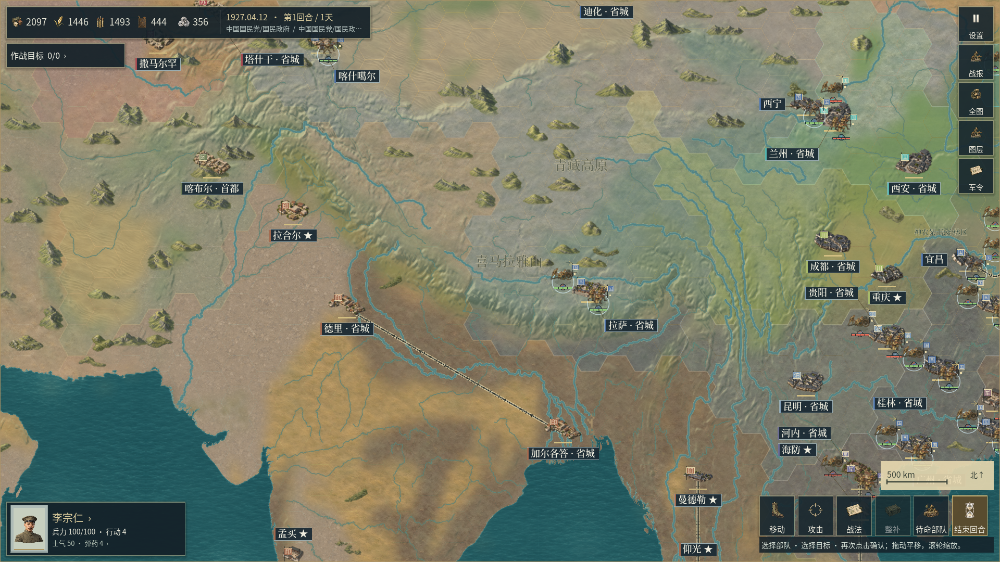
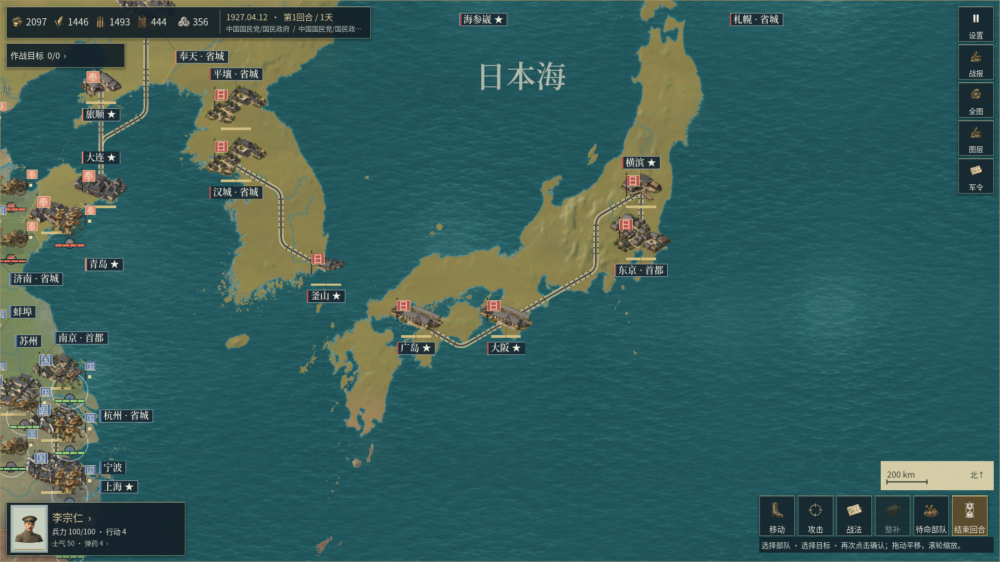

# 0.2.37开发修订：地理底材连续过渡与山林比例

本轮继续处理对照《欧陆战争6》时仍明显的粗地块、材质阶梯和山林贴片比例。此前[0.2.36细高程](58_亚洲细高程与沿海控制覆盖.md)改善了连续山势，但底材仍主要由较粗的操作格选择；直接增加同类素材数量不能消除材质边界跟着蜂窝走的问题。

本轮使用**已有Sub2完整原图**，另外增加有来源的数值地理查找表。它是游戏的运行时材质选择与混合，不是自行绘制、拼接或裁取的美术图片；生成原PNG、原始GIS、操作蜂窝、海陆几何、城市、河流和规则数据保持原状。本章属于开发过程记录；专项通过和正式程序交付分别以对应回执为准，不宣称整体美术已经达到商业成品水准。

## 地理底材与混合

输入继续使用已归档的RESOLVE Ecoregions 2017原始GIS，来源、许可和文件SHA256沿用[地理资料说明](../assets/legal/GEOGRAPHIC-DATA-NOTICES.txt)。其论文为[Dinerstein等，2017](https://doi.org/10.1093/biosci/bix014)。生态区域提供代表性草土、沙砾、湿润腐殖土等底材的区域参考，**不能证明1840—1940年的具体地表利用、森林边界、湿地面积、岩性或土壤测绘**。

| 内容 | 本轮实现 |
|---|---|
| 范围 | 东经20°—180°，南纬10°—北纬80° |
| 分类采样 | 1,601×901，1,442,501个节点，经纬间隔0.1° |
| 分类方式 | 原始生态多边形覆盖判断；边界重合时取较小ECO_ID |
| 分类覆盖 | 716,186个已分类节点、726,315个空节点；空节点主要位于海域，已分类区域涉及现有目录中的13种底材 |
| 没有来源的节点 | 分类保留为空，不用最近地区伪造归属 |
| 林下底材 | 没有历史林地支持时，继续沿用既有草土替代政策；底材查找表不决定树木分布 |
| 过渡权重 | 801×451×20个数值通道，运行时约7.23MB；与美术纹理分开 |
| 平滑宽度 | 高斯标准差0.25°，截断半径0.75°；仅为绘制过渡，绝非真实生态交错带的测量宽度 |
| 材质取样 | 世界坐标锚定，读取原有20种完整Sub2底材；不裁切、旋转或保存派生PNG |
| 岩质点缀 | 从已有细DEM坡度决定低强度岩质表现，不把整个山地操作格画成裸岩块 |
| 政权覆盖 | 继续在自然底材上独立绘制原来的半透明控制色；没有把控制色改成不透明 |
| 海陆裁切 | 复用已有陆地网格、岛屿和水洞的全部顶点与索引 |

分类编号不能直接线性插值，否则会混出第三种没有依据的材质。现在先读取数值混合权重，再混合对应完整底材的颜色；分类空洞仍由原来的来源覆盖掩膜保留。GPU在进入逐材质分支前计算纹理导数，避免材质交界两侧因选择不同纹理而使用不稳定的mip级别。

大多数位置只有一种或两种非零材质。混合权重使用独立R8数值纹理数组，没有sRGB变换和美术mip链。海拔点缀继续使用[58章](58_亚洲细高程与沿海控制覆盖.md)已验证的数值高程，既不生成虚构山峰，也不把插值节点数当成独立实测点数。

最终数值文件`presentation/data/asia_ground_regions.json`的SHA256为`50a866840af44c12cd80f5f9cff8099c816f7295a1ac907e0d95757355bd53cd`。原始分类载荷与最终分类载荷保持相同；原始分类JSON单独封存，权重推导回执明确绑定其SHA256，避免将增加权重后的JSON冒充前一次来源审计的输入。

## 山林比例

亚洲战略图的山体尺寸系数从0.88改为0.60；连续山势由细DEM承担，独立微缩山体作为地貌提示。树丛的最大可见轮廓由稀疏104×94、密集122×112调整为80×72、94×86世界单位。原始图的比例、透明边缘和完整纹理继续保留，放置仍须避开来源海岸、河流与铁路。

这些数值是插画尺度，不是山峰或树木的真实尺寸。基础操作蜂窝半径仍为48，军队的行动、城市坐标和地形加成不随图像缩放变化。素材原图数量并未增加，本轮不把数值节点或GPU混合层计入新增美术素材。

缩小图符会使部分原来因占用区域冲突而隐藏的既有候选点可以显示，因此同一镜头的可见山林图符数量可能变化；来源林区、地形格和候选地理依据没有增加。这种排布变化不等于增加历史森林面积或新增美术种类。

## 已完成的来源与开发专项

- [原始GIS逐节点核对](../reports/geographic_ground_v0237/source_audit01.json)：重新读取原始shapefile，不使用编译器的WKB缓存。1,442,501个节点的生态编号与材质选择均为零差异；分类函数沿用已有登记规则，报告明确记录这项共享依赖。
- [过渡权重推导](../reports/geographic_ground_v0237/weight_derivation01.json)：原始分类载荷保持；量化后权重总和最大误差约0.007844，绘制时再次归一化。
- [原生解码专项](../reports/geographic_ground_v0237/rules01/validation.json)：15项，包含6,650个经原始多边形核对的采样、完整海陆网格、数值纹理、投影拒绝、规则与48单位蜂窝保持。
- [原生GPU专项](../reports/geographic_ground_v0237/gpu01/validation.json)：5项。6,848个视图采样比较实际陆地网格与单张连续四边形，最大通道差约1/255；相机平移后最大差为0。关闭新材质分支会产生明显差异，排除了“分支未启用却测试通过”的情况。
- [既有完整底材连续性复核](../reports/geographic_ground_v0237/continuity01/validation.json)：0.2.37开发引擎的48项检查通过，包含20张完整原图及其mip、格间接缝、三材质绘制顺序和相机平移固定相位。
- [正常控制层复核](../reports/geographic_ground_v0237/control01/validation.json)：0.2.37开发引擎的37项检查通过，五个视图共1,767个水面采样的最大颜色通道差为0；五个小地图像素项因正常HUD隐藏该控件而跳过，不计作小地图实际显示通过。

GPU专项中的小视口是数值测试夹具，不是完整游戏画面，也不作为美术达标证明。开发专项开始于0.2.36基础工作树；最终程序版本、源文件身份和安装包必须由后续独立导出记录确认。

## 迭代与当前限制

第一轮完整喜马拉雅视口暴露了0.1°分类边界的细小阶梯斑块，虽然着色器启用且程序正常退出，仍未接受为最终视觉结果。原数据、当时源码和整幅画面保留在[第一轮来源快照](../reports/geographic_ground_v0237/iterations01/asia_ground_regions.json)与[第一轮实机图](../reports/geographic_ground_v0237/himalaya01/viewport.png)。增加标量混合权重后，第二轮才改善这些交界。

开发阶段实际完整查看了[9张原生整幅视口](../reports/geographic_ground_v0237/development_viewing01.json)，包括被拒绝的第一轮、第二轮、东北、亚洲、大阪、山海关和三个控制层视口。它们保留各自0.2.36／0.2.37开发身份；最终导出EXE的实际查看另行记录，不将源工程画面改标为最终程序。

控制影响区仍是既有城市归属的游戏抽象，当前仍可见蜂窝式控制边界；本轮没有将它伪称为真实历史国界或逐日军事前线。地面细节叠层也仍有明显的蜂窝状明暗块，不能把所有粗块都归为政治控制色。大阪同机位完整对照中，原来的褐灰地块交界减轻，但本州低地仍偏单一草土色，不能视为地块细节已经充分。聚落、军队、标注的拥挤、重复山林轮廓、完整兵种动作、UI整体材质与年代政权校订继续处理；拉萨等地点仍沿用统一“省城”标签，年代行政身份与名称仍待核对。Motorola X30的物理安装、触控、发热、内存与帧率尚待真实设备验证。

本轮没有新增配乐。后续音乐使用用户指定的`C:/Users/carzy/.codex/skills/music-gen-remote-YuE2/SKILL.md`，从原生Windows调度远端RTX 3080，优先制作无歌词、无台词的纯器乐；三首既有本地YuE2曲目的原始来源不改写。具体流程见[后续配乐制作路线](39_本地YuE2纯器乐配乐与场景衔接.md#后续制作路线2026-10-21)。

## 双端程序与最终画面

运行源码以逐文件SHA256封存后复制到独立的原生Windows工程，导出不引用工作树覆盖。Windows x86_64与签名Android/code42均由同一份运行输入生成，运行文件集合摘要为`28c03d7e66796e8917c902a18b2d7551ef22541f2a315b8c7b8ad0d34621eb3f`；[导出回执](../reports/geographic_ground_v0237/preview_export01.json)保存引擎、控制脚本、逐文件输入与两个成品的校验值。

| 检查对象 | 实际结果与范围 |
|---|---|
| Windows成品 | 独立EXE，实际PE文件与产品版本均为0.2.37.0 |
| Android成品 | 0.2.37/code42，v2/v3签名、ARM64/ARMv7、最低API24、目标API36，声明权限为0 |
| APK内容 | 147份数据／说明、2,521张导入贴图、3首既有音乐载荷逐项核对，通过[成品APK检查](../reports/geographic_ground_v0237/apk01/validation.json) |
| EXE画面与交互 | 10组，包含菜单、不同地理范围、低于0.10缩放的亚洲全图、局部战役、界面冒烟与2400×1080桌面布局 |
| EXE正常控制层 | 37项通过；五个视图的1,767个水面采样最大通道差为0；五个被正常HUD隐藏的小地图像素项保持跳过 |
| EXE完整底材GPU | 48项通过，使用实际打包的20张完整原图；测试夹具不计入实机游玩图 |
| 实际逐张看图 | [21张最终EXE整幅视口](../reports/geographic_ground_v0237/visual_review01.json)，与前面9张开发阶段视口分别记录 |
| 原图与规则范围 | [5,288份既有受保护文件](../reports/geographic_ground_v0237/final_scope01.json)核对；唯一既有内容变更为应用版本号，新数值地理表单独登记；不由此推断原有年代资料已经正确 |
| 手机验收 | 未连接物理Android设备；2400×1080桌面布局不能替代Motorola X30安装、触控、温升、内存和性能验收 |

最终EXE的来源连续底材与细高程分支均实际启用，分类与权重文件的SHA256与导出输入一致。静止战场采集180帧：桌面RTX 3060、1920×1080、60帧上限，平均约59.98FPS、95分位帧耗时约18.52毫秒。采集期间另有无窗口回归进程，未作受控的新旧性能对照；这些数字仅描述该次静止窗口，不代表拖动、大规模交锋或Android性能。

这两幅图均为未加工的完整原生视口，仍可看出地面叠层与控制边界的粗块、重复图符和单一低地底色；它们展示本次修改的实际范围，不代表整体美术验收通过。

## 回归失败与复测记录

首次完整回归在历史聚落组输出22项断言通过后，出现无窗口渲染后端的`texture_2d_initialize`空纹理错误，因此当次完整回归停止，不能计为30组通过。[首次失败原始记录](../reports/geographic_ground_v0237/regression_failure01/failure.json)及其日志和源码快照保留。归档脚本使用`.gd.txt`后缀避免Godot再次发现同名全局类，原始字节和初始索引均保留。

随后在同一封存工程、没有修改运行代码或测试脚本的条件下，[单独复测22项](../reports/geographic_ground_v0237/regression_retry01/validation.json)正常退出且无引擎错误；完整回归续跑中的该组也再次干净通过。错误根因尚未确定，不将重试成功表述为已经修复了引擎问题。最终续跑的[完整30组14,585项回归](../reports/geographic_ground_v0237/regression01/validation.json)通过。前14组保留同一封存输入下本轮已通过的结果，其余组重新执行；所有最终组均无脚本或引擎错误，原始失败记录继续保留。

## 预览封存与使用

本版为0.2.37地图开发预览，单独保存到工作区`output/development/railway-warlords-0.2.37-preview01/`；[封存回执](../reports/geographic_ground_v0237/package01.json)记录两个成品、证据包、组件、回归和看图记录的SHA256。Windows程序PE版本为0.2.37.0，Android版本code42。证据包收录本轮实际日志、原始失败、源码快照与完整视口；提交并推送源码后，包外的`SOURCE_RECEIPT.json`绑定对应Git提交与成品。

Windows直接运行`RailwayWarlords-0.2.37-preview-windows-x64.exe`，无需另装Godot；Android使用`RailwayWarlords-0.2.37-preview-android.apk`。入口`START_HERE.md`提供双语安装说明，完整操作与剧本内容见[README](../README.md)。旧0.2.36预览与0.2.35完整归档保留。新数值底材没有改变本局定义指纹，不通过修改地理与规则来迁就画面。

本轮新增栅格美术为0、新增音乐为0；已有原图、三首本地配乐和历史快照保留实际来源。本次交付不关闭整体美术、全兵种动作、历史起局校订、无窗口纹理错误根因和物理Motorola X30验收等事项。
