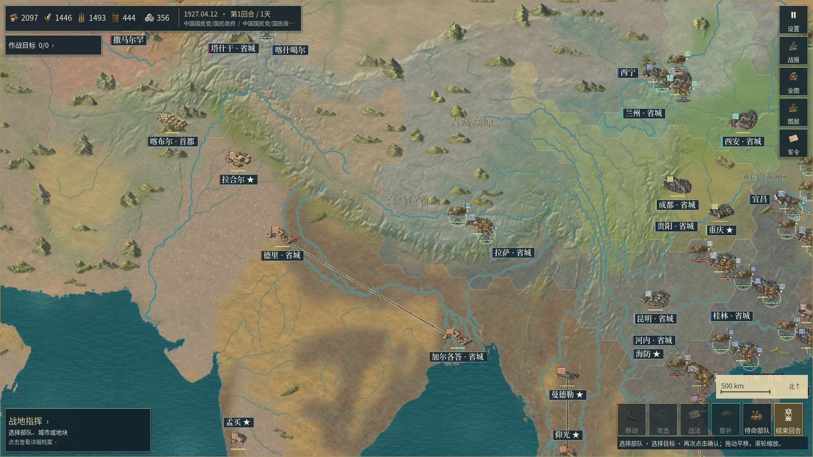

# 0.2.38开发修订：控制填色接缝与基础网格去重

本轮修复亚洲战略图同阵营内部反复出现蜂窝缝的问题。控制填色格此前使用47.4单位半径，操作格使用48单位；每条内部共边两侧因此留出约1.04单位的空隙。控制覆盖本身仍然半透明，但这些缝会把大片相同归属切成独立地块。基础操作网格的共边还会被相邻格重复描线，使低透明度线条叠加变亮。

**状态：0.2.38开发源码与原生专项已验证，尚未导出本轮Windows／Android新包。** 配置已准备Android/code43，不能把这个配置值当成安装包已生成。最近可下载的双端预览仍是[0.2.37](59_地理底材连续过渡与山林比例.md)。本轮没有执行或宣称新的完整30组回归、完整动作验收或物理Motorola X30验收。

## 修复内容

- 控制填色半径与操作格同为48，内部共边不再留装饰缝；操作格尺寸、城市归属和行动规则不变。
- 普通陆地和海中心格内的真实岛岸碎片一起重新裁切。仍只对已有海陆多边形及其湖洞做数值几何处理，不扩张真实陆地。
- 控制边线采用裁切数据登记的同一半径，避免填色与边线错位。
- 基础操作网格的每条共享边只画一次；原来的可见格筛选和开关行为保留。
- 运行时拒绝加载半径不匹配的控制缓存，避免混用旧沿海碎片。
- 项目、运行版本和导出元数据统一为0.2.38；此前项目设置中残留的0.2.36版本号一并更新。

现有20种完整Sub2底材、细高程、山林素材及其选图政策保持。半透明覆盖仍采用原来的战略20—23%、战术26%参数；本轮没有用不透明填色掩盖地表问题，没有新增栅格美术或音乐。

控制区域仍是实际游戏城市及当前归属计算的**城市影响范围**，不是历史省界、真实国界或逐日军事前线。蜂窝形政治边缘仍可见；这次修复的是同一归属内部的空隙和重复描线，不能据此宣称已经解决全部地图风格差距。

## 逐层诊断与完整原生画面

先在相同机位分别保留正常控制覆盖、关闭控制覆盖、暂时去掉地格细节纹理、再去掉格心色洗。后两类明确标为诊断覆盖，不是交付程序画面。有效的[修复前诊断](../reports/ground_layers_v0238/before02/validation.json)和[修复后诊断](../reports/ground_layers_v0238/after01/validation.json)均包含8张完整原生视口与9项相机／状态检查；其输入文件身份逐项登记。

画面表明：关闭细节纹理和格心色洗只带来轻微变化，最强的蜂窝缝主要来自控制覆盖。因而本轮保留底材与地貌细节，针对填色几何与描线修复。

| 机位 | 修复前正常渲染 | 修复后正常渲染 |
|---|---|---|
| 喜马拉雅／青藏高原，控制开启 | [完整画面](../reports/ground_layers_v0238/before02/himalaya_control.png) | [完整画面](../reports/ground_layers_v0238/after01/himalaya_control.png) |
| 喜马拉雅／青藏高原，控制关闭 | [完整画面](../reports/ground_layers_v0238/before02/himalaya_natural.png) | [完整画面](../reports/ground_layers_v0238/after01/himalaya_natural.png) |
| 华北／东北亚，控制开启 | [完整画面](../reports/ground_layers_v0238/before02/tianjin_control.png) | [完整画面](../reports/ground_layers_v0238/after01/tianjin_control.png) |
| 华北／东北亚，控制关闭 | [完整画面](../reports/ground_layers_v0238/before02/tianjin_natural.png) | [完整画面](../reports/ground_layers_v0238/after01/tianjin_natural.png) |

以上来自Godot原生Windows源码运行，未拼接、裁图、补绘或叠加说明文字；不是独立EXE截图。修复后上述4张正常视口已实际完整查看，记录见[查看及范围回执](../reports/ground_layers_v0238/scope01.json)。图中仍有重复地貌、低地单一、单位与标注拥挤，以及拉萨等地点使用统一“省城”后缀的历史身份问题，整体目标尚未达到。

首次诊断的第一组机位被开局延迟定位覆盖，实际仍在华北。其原图及[偏差记录](../reports/ground_layers_v0238/before01_deviation.json)保留，未当作喜马拉雅对照。重跑前先等待开局定位完成，并逐张检查请求的相机位置与缩放。

## 来源与数值复核

[重建回执](../reports/ground_layers_v0238/vector_rebuild01/validation.json)绑定既有亚洲规则地图的原始SHA256。普通陆地缓存现在包括3,097个完整格、633个部分格与14个空格；沿海补充包括924个已有海中心格内的真实陆地碎片、49,368个三角形。增加的是原来缝隙处既有陆地的显示覆盖，不是新增岛屿或改写规则海格。原城市影响多边形与源海岸保持。

[独立地理审计](../reports/ground_layers_v0238/source_audit01.json)重新读取原始海陆数据，不调用重建器的裁切函数，核对全部1,571条边界记录、87,456个原生精度三角形及边线。最大对称差面积约0.028164世界单位平方；在0.002世界单位的原生坐标舍入容差之外，超出源陆地的面积为0。

初次审计要求每个双精度源三角形转为float32后面积仍为正，遇到两处极薄源片而停止；[失败记录](../reports/ground_layers_v0238/source_audit_failed01.json)与当时审计脚本保留。复核后确认两处源片高度约0.000246与0.000237世界单位，在原生精度下塌缩且不绘制像素。最终审计逐一登记这些片段并限制其宽度，同时保留完整覆盖差、海陆越界和边线检查；没有修改海岸来通过检查。

## 本轮实际验证范围

| 检查 | 结果 |
|---|---|
| [原生控制几何与七时间线](../reports/ground_layers_v0238/rules01/validation.json) | 48项通过；含实际同归属网格中36个共边采样点的填色覆盖 |
| [既有细高程与沿海补充](../reports/ground_layers_v0238/relief01/validation.json) | 23项通过；含来源解码、原生坐标、沿海碎片及规则保持 |
| [正常窗口控制覆盖开关](../reports/ground_layers_v0238/control01/validation.json) | 37项通过，5个机位、10张完整原生视口；1,767个水面采样最大颜色通道差为0 |
| [修复后取景与状态](../reports/ground_layers_v0238/after01/validation.json) | 9项通过，4张正常视口及4张标明用途的诊断视口 |

五个小地图像素项因当前生产HUD隐藏小地图而跳过，不计为小地图实测通过。上述结果是源码工程专项，不冒充独立EXE、Android安装或全量回归结果。0.2.37曾遇到的无窗口空纹理错误仍保留在其原章节；本轮完成的日志没有该错误，但没有宣称查明或修复其根因。

后续音乐继续使用用户指定的`C:/Users/carzy/.codex/skills/music-gen-remote-YuE2/SKILL.md`，经原生Windows调度远端RTX 3080，以无台词、无歌词的纯器乐协调菜单、战略与交锋。既有三首本地YuE2曲目保留真实来源，详见[配乐制作路线](39_本地YuE2纯器乐配乐与场景衔接.md#后续制作路线2026-10-21)。
